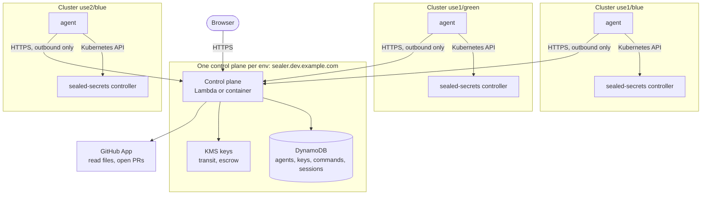

# k8s-sealed-secrets-sealer

One web app per environment for sealing Kubernetes secrets with
[Sealed Secrets](https://github.com/bitnami-labs/sealed-secrets), however many
clusters and regions that environment spans. Users pick a repository and a
file, type a value, and get a pull request. They never pick a cluster, a
region or a certificate.

> **Status:** early development. This repository currently contains the
> scaffold: the local k3d stack, the agent reading its controller's key, and
> the tooling. See [the design](docs/design.md) for where it is going.

## How it works



Agents always open the connection; nothing calls into a cluster, and the
controllers never talk to the control plane.

- **Control plane:** serves the UI and API for one environment. Runs on AWS
  Lambda behind API Gateway, or as a container. It has no Kubernetes client
  and knows nothing about the cluster it runs in.
- **Agents:** one per cluster, beside the sealed-secrets controller. They only
  make outbound calls. They report the controller's keys, seal values and keep
  every cluster in the environment holding the same keys.
- **Security:** values travel to agents encrypted with a KMS key the control
  plane can only encrypt with. Sealing keys are escrowed under a KMS key the
  control plane cannot use at all. Agents run with namespaced RBAC, and what
  each agent may do is set in its Helm values, never by the control plane.

Read [docs/design.md](docs/design.md) for the full design and security model.

## Quick start (local)

Requirements: Docker and [Atmos](https://atmos.tools) 1.233 or later. Atmos
installs every other tool (Go, k3d, Tilt, Helm, kubectl) into `.tools/`.

```sh
atmos dev up        # k3d cluster + Tilt dashboard at http://localhost:10350
atmos dev status    # pods, each agent's controller key, endpoints
atmos test e2e      # the end-to-end suite in a throwaway cluster
```

See [docs/development.md](docs/development.md) for the local stack and every
command.

## Repository layout

| Path                         | Contents                                         |
| ---------------------------- | ------------------------------------------------ |
| `cmd/server`, `cmd/agent`    | Control plane (HTTP server) and agent binaries   |
| `internal/`                  | Application packages                             |
| `deploy/helm/`               | Helm charts for the agent and the control plane  |
| `dev/`, `Tiltfile`           | The local k3d stack                              |
| `.atmos/`, `atmos.yaml`      | Developer and CI commands                        |
| `docs/`                      | Design and development guides                    |

AWS infrastructure for the control plane (API Gateway, Lambda, DynamoDB, KMS)
lives in a companion Terraform module repository,
`terraform-aws-k8s-sealed-secrets-sealer`.

## License

MIT. See [LICENSE](LICENSE).
