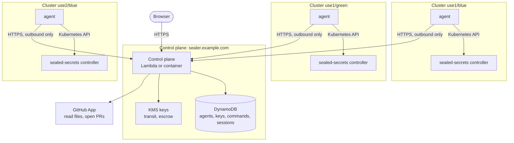
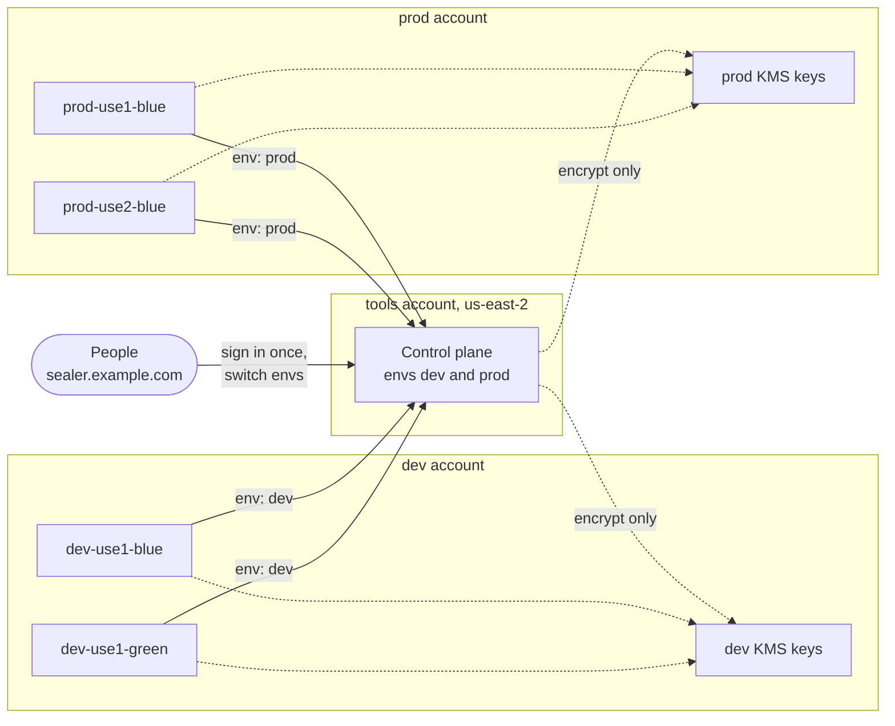

# k8s-sealed-secrets-sealer

A web app for sealing Kubernetes secrets with
[Sealed Secrets](https://github.com/bitnami-labs/sealed-secrets), for one
environment or several, however many clusters, regions and AWS accounts they
span. Users pick a repository and a file, type a value, and get a pull
request. They never pick a cluster, a region or a certificate.

> **Status:** early development. People sign in with GitHub, browse the
> SealedSecrets for their env in the repositories they can read, seal values
> into them as pending changes, and open a pull request with those changes;
> an agent seals each value with the env key, and only `spec.encryptedData`
> changes in the files. A value that differs by region can be sealed for
> some regions' documents only. Optional annotations tell them what a secret
> is for, which keys it should hold and where its docs are. Admins see the fleet
> (every agent, its controller's keys and the env's key state); everyone else
> sees whether sealing works. Agents keep every cluster holding the same keys.
> One deployment can also serve several envs, such as dev and prod, on one
> URL, with one sign-in and per-env teams.
> Releases publish the control plane for Lambda, container images and Helm
> charts; the Terraform module for AWS is next. See
> [the design](docs/design.md) for where it is going.

## How it works



Agents always open the connection; nothing calls into a cluster, and the
controllers never talk to the control plane.

- **Control plane:** serves the UI and API for one environment, or several on
  one URL. Its clusters may be in any AWS account and region. Runs on AWS
  Lambda behind API Gateway, or as a container. It has no Kubernetes client
  and knows nothing about the cluster it runs in.
- **Agents:** one per cluster, beside the sealed-secrets controller. They only
  make outbound calls. They report the controller's keys, seal values and keep
  every cluster in the environment holding the same keys.
- **Security:** values travel to agents encrypted with a KMS key the control
  plane can only encrypt with. Sealing keys are escrowed under a KMS key the
  control plane cannot use at all. Agents run with namespaced RBAC, and what
  each agent may do is set in its Helm values, never by the control plane.

Read [docs/design.md](docs/design.md) for the full design and security model.

## Environments

An environment (env) is a set of clusters that hold the same sealing keys, so
a value sealed once decrypts in every one of them. Dev and prod are separate
envs, so dev's clusters never hold prod's keys. Which documents belong to an
env is set in the files themselves, by an annotation, so one repository, and
one file, can hold documents for several envs:

```yaml
metadata:
  name: billing
  namespace: billing
  annotations:
    k8s-sealed-secrets-sealer/env: prod
    k8s-sealed-secrets-sealer/region: use2
```

An env's clusters can be in any AWS account and region, and the control plane
can run anywhere: agents always open the connection. One control plane can
serve one env, or several on one URL. For example, one control plane in
`us-east-2` of a tools account can serve dev and prod, whose clusters run in
their own accounts:



- **People** sign in once at `sealer.example.com`, with GitHub. Each env
  admits the members of its own teams, and has its own admins. Pages carry
  their env (`/prod/secrets/example-org/apps`), and the env badge in the
  header switches between the envs a person may use.
- **The control plane** lists its envs, each with its own agent registry,
  DynamoDB table, KMS transit key and teams:

  ```yaml
  # APP_ENVS, or the control plane chart's envs
  envs:
    - name: dev
      dynamodbTable: sealer-dev
      kmsTransitKeyId: arn:aws:kms:us-east-2:222222222222:key/mrk-dev-transit
      registry: arn:aws:ssm:us-east-2:111111111111:parameter/sealer/dev/registry
    - name: prod
      dynamodbTable: sealer-prod
      kmsTransitKeyId: arn:aws:kms:us-east-2:333333333333:key/mrk-prod-transit
      registry: arn:aws:ssm:us-east-2:111111111111:parameter/sealer/prod/registry
      allowedTeams: [prod-sealers]
  ```

- **Each agent** names its env, and the control plane sends it to that env,
  whose registry must list the agent's IAM role:

  ```yaml
  # agent chart values in prod-use2-blue
  env: prod
  controlPlane:
    url: https://sealer.example.com
  identity:
    mode: aws-sts
  ```

- **Each env's KMS keys** can live in its own account. The control plane may
  only encrypt with them, and only for its own env, so nothing in the tools
  account can decrypt anything.

Serving several envs from one control plane shares one IAM role between
them, so whoever can deploy it controls prod too. To keep prod isolated down
to the role, deploy one control plane per env instead, each on its own URL;
everything else stays the same. [docs/deployment.md](docs/deployment.md)
walks through both, account by account.

## Quick start (local)

Requirements: Docker and [Atmos](https://atmos.tools) 1.233 or later. Atmos
installs every other tool (Go, k3d, Tilt, Helm, kubectl) into `.tools/`.

```sh
atmos dev up        # k3d cluster + Tilt dashboard at http://localhost:10350
open http://localhost:4100   # sign in as alice (a GitHub mock)
atmos dev status    # pods, each env's fleet and keys, endpoints
atmos test e2e      # the end-to-end suite in a throwaway cluster
```

See [docs/development.md](docs/development.md) for the local stack and every
command.

## Install

Each [release](https://github.com/cruxstack/k8s-sealed-secrets-sealer/releases)
publishes:

| Artifact                 | Where                                                                                    |
| ------------------------ | ---------------------------------------------------------------------------------------- |
| Control plane for Lambda | `k8s-sealed-secrets-sealer-lambda_arm64.zip` and `_amd64.zip` on the release             |
| Control plane image      | `ghcr.io/cruxstack/k8s-sealed-secrets-sealer-control-plane:<version>`                    |
| Agent image              | `ghcr.io/cruxstack/k8s-sealed-secrets-sealer-agent:<version>`                            |
| Agent chart              | `oci://ghcr.io/cruxstack/charts/k8s-sealed-secrets-sealer-agent`                         |
| Control plane chart      | `oci://ghcr.io/cruxstack/charts/k8s-sealed-secrets-sealer-control-plane`, for containers |

[docs/deployment.md](docs/deployment.md) shows how to lay out the control
plane, the agents and their keys across envs, accounts and regions. Install
the agent in each cluster, beside its sealed-secrets controller:

```sh
helm install sealer-agent oci://ghcr.io/cruxstack/charts/k8s-sealed-secrets-sealer-agent \
  --version <version> --namespace sealer --create-namespace -f values.yaml
```

Every file, image and chart has a build provenance attestation:

```sh
gh attestation verify k8s-sealed-secrets-sealer-lambda_arm64.zip --repo cruxstack/k8s-sealed-secrets-sealer
gh attestation verify oci://ghcr.io/cruxstack/k8s-sealed-secrets-sealer-agent:<version> \
  --repo cruxstack/k8s-sealed-secrets-sealer
```

## Repository layout

| Path                         | Contents                                         |
| ---------------------------- | ------------------------------------------------ |
| `cmd/server`, `cmd/lambda`   | Control plane as an HTTP server and on Lambda    |
| `cmd/agent`                  | The agent                                        |
| `web/`                       | The web UI, built into the control plane         |
| `internal/`                  | Application packages                             |
| `deploy/helm/`               | Helm charts for the agent and the control plane  |
| `dev/`, `Tiltfile`           | The local k3d stack                              |
| `.atmos/`, `atmos.yaml`      | Developer and CI commands                        |
| `docs/`                      | Design, deployment and development guides        |

AWS infrastructure for the control plane (API Gateway, Lambda, DynamoDB, KMS)
lives in a companion Terraform module repository,
`terraform-aws-k8s-sealed-secrets-sealer`.

## License

MIT. See [LICENSE](LICENSE).
