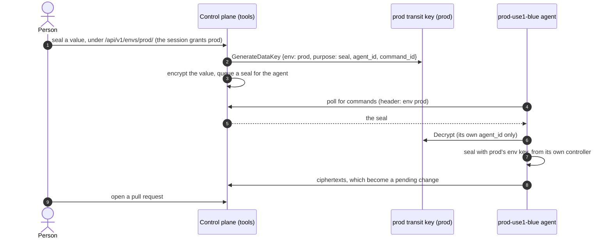

# Deploying across envs, accounts and regions

This guide follows one layout from end to end: a control plane in `us-east-2`
of a tools account, serving a dev env and a prod env whose clusters run in
their own AWS accounts, in `us-east-1` and sometimes `us-east-2`. It shows
what goes in each account, how each piece is configured and what people see.
[The design](design.md) explains why it works this way.

## Envs, accounts and regions

An **env** is a set of clusters that hold the same sealing keys, so a value
sealed once decrypts in every one of them. Dev and prod are separate envs:
if they were one, every dev cluster would hold prod's keys. A SealedSecret
document belongs to an env through its env annotation, so one repository,
and one file, can hold documents for several envs.

Accounts and regions are not part of an env's identity. An env's clusters can
be in any account and region; the control plane can run anywhere, and calls
nothing in the clusters, since agents always open the connection.

The example:

| Account               | Region      | What runs there                           |
| --------------------- | ----------- | ----------------------------------------- |
| tools (111111111111)  | `us-east-2` | The control plane and its DynamoDB tables |
| dev (222222222222)    | `us-east-1` | Clusters `dev-use1-blue`, `dev-use1-green` |
| prod (333333333333)   | `us-east-1` | Cluster `prod-use1-blue`                  |
| prod (333333333333)   | `us-east-2` | Cluster `prod-use2-blue`, at times        |


## One URL or one per env

The same binary runs either way.

| | One URL for every env | One deployment per env |
| --- | --- | --- |
| URL | `sealer.example.com/dev/...`, `/prod/...` | `sealer.dev.example.com`, `sealer.prod.example.com` |
| Sign-in | Once, for every env the person's teams admit | Once per env |
| Configuration | `APP_ENVS` (the chart's `envs`) lists the envs | `APP_ENV_NAME` and the env's settings |
| Agents | Name their env; the control plane sends them to it | Use their env's URL |
| Isolation | Envs share one IAM role and one deploy | Each env has its own role and deploy |

Each env keeps its own registry, DynamoDB table, transit key and agents
either way, and a session never crosses envs. What one URL gives up is
isolation at the IAM role: whoever can deploy the shared control plane
controls prod too, and a compromised or broken control plane affects every
env. Choose one deployment per env when prod must be isolated from
everything else. The rest of this guide uses one URL; the per-env variant is
at the end.

## 1. Keys, in each env's account

Each env account holds its env's two KMS keys. Make them multi-Region keys in
`us-east-1` with a replica in `us-east-2`, so every cluster calls its own
region and the keys survive the loss of one. A key named by its ARN is
called in the region the ARN names, by the control plane and agents alike.

| Key     | Who may use it                                 | Encryption context                     |
| ------- | ---------------------------------------------- | -------------------------------------- |
| transit | the control plane: `kms:GenerateDataKey`;      | `env`, `purpose: seal`, `command_id`,  |
|         | each agent: `kms:Decrypt` of its own commands  | `agent_id`                             |
| escrow  | the env's agents: `kms:GenerateDataKey` and    | `env`, `purpose: key-escrow`,          |
|         | `kms:Decrypt`; the control plane: nothing      | `fingerprint`                          |

The prod transit key's policy, beside the account's usual administration
statements:

```json
[
  {
    "Sid": "ControlPlaneEncryptsForProd",
    "Effect": "Allow",
    "Principal": { "AWS": "arn:aws:iam::111111111111:role/sealer-control-plane" },
    "Action": "kms:GenerateDataKey",
    "Resource": "*",
    "Condition": {
      "StringEquals": {
        "kms:EncryptionContext:env": "prod",
        "kms:EncryptionContext:purpose": "seal"
      }
    }
  },
  {
    "Sid": "AgentDecryptsItsOwnCommands",
    "Effect": "Allow",
    "Principal": { "AWS": "arn:aws:iam::333333333333:role/sealer-agent-prod-use1-blue" },
    "Action": "kms:Decrypt",
    "Resource": "*",
    "Condition": {
      "StringEquals": {
        "kms:EncryptionContext:env": "prod",
        "kms:EncryptionContext:agent_id": "prod-use1-blue"
      }
    }
  }
]
```

Add one `AgentDecryptsItsOwnCommands` statement per agent, with its own role
and ID. The escrow key's policy allows the env's agent roles
`kms:GenerateDataKey` and `kms:Decrypt` when `kms:EncryptionContext:env` is
the env and `kms:EncryptionContext:purpose` is `key-escrow`, and allows the
control plane nothing.

The control plane's only grant across accounts is `kms:GenerateDataKey` on
each env's transit key. Its role also needs that action on the keys' ARNs in
its own IAM policy, as any cross-account KMS call does. Agents use only keys
in their own account, and nothing in the tools account can decrypt anything.

## 2. An agent in each cluster

Each cluster runs the agent beside its sealed-secrets controller, with its
own IAM role (through EKS Pod Identity) in its env's account. Its Helm values
for `prod-use2-blue`:

```yaml
env: prod
controlPlane:
  url: https://sealer.example.com
identity:
  mode: aws-sts
aws:
  # the STS endpoint the agent signs its login for
  region: us-east-2
capabilities:
  seal: true
  keys: true
  renewal: true
kms:
  # the replicas in this cluster's region
  transitKeyId: arn:aws:kms:us-east-2:333333333333:key/mrk-prod-transit
  escrowKeyId: arn:aws:kms:us-east-2:333333333333:key/mrk-prod-escrow
```

With one URL, every agent uses the same `controlPlane.url`. Each names its
env (`env`) on every request, in the `X-K8s-Sealed-Secrets-Sealer-Env`
header; the control plane sends the request to that env, whose registry must
know the agent, and refuses an agent that names no env. An agent never names
an env other than its own: the value comes from its Helm values, and it also
binds the keys it escrows.

## 3. A registry per env

Each env's registry lists its agents and the role each logs in with, account
included. The prod registry:

```yaml
issuers: []
agents:
  - id: prod-use1-blue
    cluster: prod-use1-blue
    region: use1
    capabilities: [seal, keys, renewal]
    identity:
      aws:
        roleArn: arn:aws:iam::333333333333:role/sealer-agent-prod-use1-blue
  - id: prod-use2-blue
    cluster: prod-use2-blue
    region: use2
    capabilities: [seal, keys, renewal]
    identity:
      aws:
        roleArn: arn:aws:iam::333333333333:role/sealer-agent-prod-use2-blue
```

A role is matched by partition, account and name, so the same role name in
another account is another agent. `roleId` can pin the role's unique ID as
well.

A cluster that runs only at times, like `prod-use2-blue`, stays in the
registry. While it is down, it keeps its last known keys: the env key, which
values are sealed with, does not move past them, so everything sealed
meanwhile still decrypts there. When the cluster comes back, or is rebuilt,
its agent restores the env's keys from escrow. Seals meant for `use2` go to
an agent in `use1` while no `use2` agent is healthy; any agent of the env
can seal for any of its clusters.

## 4. The control plane, in the tools account

On Lambda, the control plane reads `APP_` variables, and any of them may be
the ARN of an SSM parameter instead, read at start, from any account. The
envs:

```yaml
# APP_ENVS
envs:
  - name: dev
    dynamodbTable: sealer-dev
    kmsTransitKeyId: arn:aws:kms:us-east-2:222222222222:key/mrk-dev-transit
    registry: arn:aws:ssm:us-east-2:111111111111:parameter/sealer/dev/registry
    adminTeams: [platform]
  - name: prod
    dynamodbTable: sealer-prod
    kmsTransitKeyId: arn:aws:kms:us-east-2:333333333333:key/mrk-prod-transit
    registry: arn:aws:ssm:us-east-2:111111111111:parameter/sealer/prod/registry
    allowedTeams: [prod-sealers]
    adminTeams: [platform]
```

The other settings are shared: `APP_PUBLIC_URL=https://sealer.example.com`,
the GitHub App and OAuth client, the session keys, and so on
([the full list](development.md#configuration)). An env's teams replace the
shared `APP_GITHUB_ALLOWED_TEAMS` and `APP_GITHUB_ADMIN_TEAMS`; here anyone
in the org may use dev, and only `prod-sealers` may use prod. In a container,
the control plane chart takes the same list as `envs`, and reads each env's
registry from `registry-<env>.yaml` in its registry ConfigMap.

Its role needs:

- `dynamodb` actions on `sealer-dev` and `sealer-prod`;
- `kms:GenerateDataKey` on each env's transit key (the replica in
  `us-east-2`);
- `ssm:GetParameter` on its parameters, and `kms:Decrypt` for those that are
  SecureStrings.

One GitHub App serves every env: it reads files and opens pull requests, and
signs people in.

## 5. Documents in the repositories

A file can hold a document for each env and region; the env annotation picks
the env, and the region annotation the region:

```yaml
apiVersion: bitnami.com/v1alpha1
kind: SealedSecret
metadata:
  name: billing
  namespace: billing
  annotations:
    k8s-sealed-secrets-sealer/env: dev
    k8s-sealed-secrets-sealer/region: use1
spec:
  encryptedData: {}
---
apiVersion: bitnami.com/v1alpha1
kind: SealedSecret
metadata:
  name: billing
  namespace: billing
  annotations:
    k8s-sealed-secrets-sealer/env: prod
    k8s-sealed-secrets-sealer/region: use1
spec:
  encryptedData: {}
---
apiVersion: bitnami.com/v1alpha1
kind: SealedSecret
metadata:
  name: billing
  namespace: billing
  annotations:
    k8s-sealed-secrets-sealer/env: prod
    k8s-sealed-secrets-sealer/region: use2
spec:
  encryptedData: {}
```

In dev, the file has one document. In prod it has two: a value goes into
both, or only one region's when it differs by region.

## 6. What people see

People open `https://sealer.example.com` and sign in with GitHub once. At
sign-in the control plane works out which envs their teams admit and which
they administer, and the session carries that and nothing more.

- `/` opens their first env. Every page has its env first in its path
  (`/prod/secrets/example-org/apps`), so a link opens in the env it was made
  in.
- Someone who may use several envs switches between them from the env badge
  in the header, or the command palette. The badge's dot says whether sealing
  works in the env.
- Someone who opens an env their teams do not admit is told so, with links to
  the envs they may use.
- The fleet of an env is for its admins.

A seal in prod, from the browser to a prod cluster:



## One deployment per env instead

To keep prod apart from dev down to the IAM role, deploy the control plane
once per env, each with its own URL, role and table, and leave `APP_ENVS`
unset:

| Setting                  | dev                               | prod                               |
| ------------------------ | --------------------------------- | ---------------------------------- |
| `APP_ENV_NAME`           | `dev`                             | `prod`                             |
| `APP_PUBLIC_URL`         | `https://sealer.dev.example.com`  | `https://sealer.prod.example.com`  |
| `APP_DYNAMODB_TABLE`     | `sealer-dev`                      | `sealer-prod`                      |
| `APP_KMS_TRANSIT_KEY_ID` | dev's transit key                 | prod's transit key                 |
| `APP_REGISTRY`           | dev's registry                    | prod's registry                    |

Each env's agents set `controlPlane.url` to their env's URL. The two
deployments can still both run in the tools account, and share the GitHub
App; keys, registries and documents stay as above.
