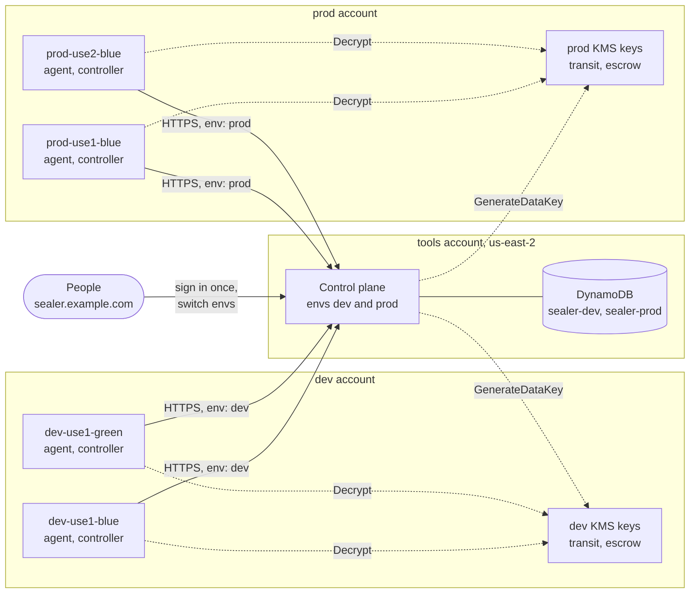
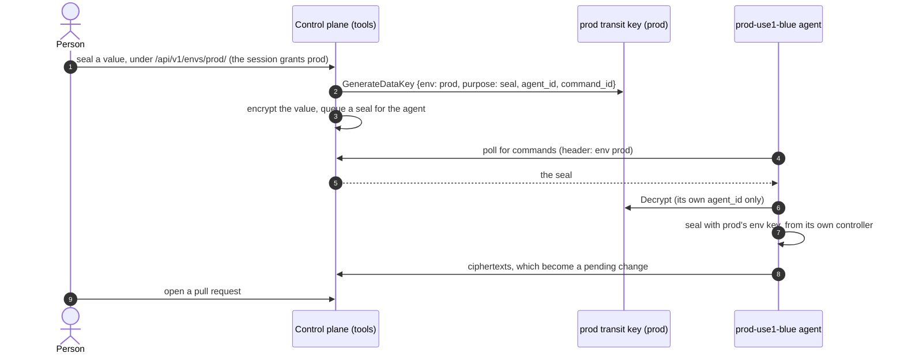

# Deploying across envs, accounts and regions

This guide follows one layout from end to end: a control plane in `us-east-2`
of a tools account, serving a dev env and a prod env whose clusters run in
their own AWS accounts, in `us-east-1` and sometimes `us-east-2`. It shows
what goes in each account, how each piece is configured and what people see.
[The design](design.md) explains why it works this way.

## Envs, accounts and regions

An **env** is a set of clusters that hold the same sealing keys, so a value
sealed once decrypts in every one of them. Dev and prod are separate envs:
if they were one, every dev cluster would hold prod's keys. A SealedSecret
document belongs to an env through its env annotation, so one repository,
and one file, can hold documents for several envs.

Accounts and regions are not part of an env's identity. An env's clusters can
be in any account and region; the control plane can run anywhere, and calls
nothing in the clusters, since agents always open the connection.

The example:

| Account               | Region      | What runs there                           |
| --------------------- | ----------- | ----------------------------------------- |
| tools (111111111111)  | `us-east-2` | The control plane and its DynamoDB tables |
| dev (222222222222)    | `us-east-1` | Clusters `dev-use1-blue`, `dev-use1-green` |
| prod (333333333333)   | `us-east-1` | Cluster `prod-use1-blue`                  |
| prod (333333333333)   | `us-east-2` | Cluster `prod-use2-blue`, at times        |



## One URL or one per env

The same binary runs either way.

| | One URL for every env | One deployment per env |
| --- | --- | --- |
| URL | `sealer.example.com/dev/...`, `/prod/...` | `sealer.dev.example.com`, `sealer.prod.example.com` |
| Sign-in | Once, for every env the person's teams admit | Once per env |
| Configuration | `APP_ENVS` (the chart's `envs`) lists the envs | `APP_ENV_NAME` and the env's settings |
| Agents | Name their env; the control plane sends them to it | Use their env's URL |
| Isolation | Envs share one IAM role and one deploy | Each env has its own role and deploy |

Each env keeps its own registry, DynamoDB table, transit key and agents
either way, and a session never crosses envs. What one URL gives up is
isolation at the IAM role: whoever can deploy the shared control plane
controls prod too, and a compromised or broken control plane affects every
env. Choose one deployment per env when prod must be isolated from
everything else. The rest of this guide uses one URL; the per-env variant is
at the end.

## 1. Keys, in each env's account

Each env account holds its env's two KMS keys. Make them multi-Region keys in
`us-east-1` with a replica in `us-east-2`, so every cluster calls its own
region and the keys survive the loss of one. A key named by its ARN is
called in the region the ARN names, by the control plane and agents alike.

| Key     | Who may use it                                 | Encryption context                     |
| ------- | ---------------------------------------------- | -------------------------------------- |
| transit | the control plane: `kms:GenerateDataKey`;      | `env`, `purpose: seal`, `command_id`,  |
|         | each agent: `kms:Decrypt` of its own commands  | `agent_id`                             |
| escrow  | the env's agents: `kms:GenerateDataKey` and    | `env`, `purpose: key-escrow`,          |
|         | `kms:Decrypt`; the control plane: nothing      | `fingerprint`                          |

The prod transit key's policy, beside the account's usual administration
statements:

```json
[
  {
    "Sid": "ControlPlaneEncryptsForProd",
    "Effect": "Allow",
    "Principal": { "AWS": "arn:aws:iam::111111111111:role/sealer-control-plane" },
    "Action": "kms:GenerateDataKey",
    "Resource": "*",
    "Condition": {
      "StringEquals": {
        "kms:EncryptionContext:env": "prod",
        "kms:EncryptionContext:purpose": "seal"
      }
    }
  },
  {
    "Sid": "AgentDecryptsItsOwnCommands",
    "Effect": "Allow",
    "Principal": { "AWS": "arn:aws:iam::333333333333:role/sealer-agent-prod-use1-blue" },
    "Action": "kms:Decrypt",
    "Resource": "*",
    "Condition": {
      "StringEquals": {
        "kms:EncryptionContext:env": "prod",
        "kms:EncryptionContext:agent_id": "prod-use1-blue"
      }
    }
  }
]
```

Add one `AgentDecryptsItsOwnCommands` statement per agent, with its own role
and ID. The escrow key's policy allows the env's agent roles
`kms:GenerateDataKey` and `kms:Decrypt` when `kms:EncryptionContext:env` is
the env and `kms:EncryptionContext:purpose` is `key-escrow`, and allows the
control plane nothing.

A multi-Region key's primary and each of its replicas have a key policy of
their own: put these statements on the primary and on every replica.

A key policy is at most 32 KB. Each `AgentDecryptsItsOwnCommands` statement
takes 300 to 450 bytes, depending on the names and formatting, so a transit
key's policy holds roughly 70 to 100 agents. For more, or to leave the key
policy alone when an agent is added, one statement can match the
encryption context's `agent_id` to a tag on the agent's role:

```json
{
  "Sid": "AgentsDecryptTheirOwnCommands",
  "Effect": "Allow",
  "Principal": { "AWS": "arn:aws:iam::333333333333:root" },
  "Action": "kms:Decrypt",
  "Resource": "*",
  "Condition": {
    "ArnLike": { "aws:PrincipalArn": "arn:aws:iam::333333333333:role/sealer-agent-prod-*" },
    "StringEquals": {
      "kms:EncryptionContext:env": "prod",
      "kms:EncryptionContext:agent_id": "${aws:PrincipalTag/sealer-agent-id}"
    }
  }
}
```

Tag each agent role `sealer-agent-id` with its agent ID. With EKS Pod
Identity, `${aws:PrincipalTag/eks-cluster-name}` works without a tag when
each agent's ID is its cluster's name. With the account as the principal,
each agent role also needs `kms:Decrypt` on the key in its own IAM policy.
The trade-off: whoever may tag those roles (`iam:TagRole`) then decides
which agent's commands each role can decrypt, so guard that permission as
you would the key policy.

The control plane's only grant across accounts is `kms:GenerateDataKey` on
each env's transit key. Its role also needs that action on the keys' ARNs in
its own IAM policy, as any cross-account KMS call does. Agents use only keys
in their own account, and nothing in the tools account can decrypt anything.

## 2. An agent in each cluster

Each cluster runs the agent beside its sealed-secrets controller, with its
own IAM role in its env's account. Its Helm values for `prod-use2-blue`:

```yaml
env: prod
controlPlane:
  url: https://sealer.example.com
identity:
  mode: aws-sts
aws:
  # the STS endpoint the agent signs its login for
  region: us-east-2
capabilities:
  seal: true
  keys: true
  # this cluster runs only at times; renewal belongs in one that is always
  # up (design section 9)
  renewal: false
  # count the values sealed with each key, so unused keys can be deleted,
  # and remove deleted keys; needs keys
  cleanup: true
  # move values off older keys onto the env key, so they can be deleted;
  # needs keys
  reseal: true
kms:
  # the replicas in this cluster's region
  transitKeyId: arn:aws:kms:us-east-2:333333333333:key/mrk-prod-transit
  escrowKeyId: arn:aws:kms:us-east-2:333333333333:key/mrk-prod-escrow
```

Everything the chart grants the agent is in the controller's namespace,
except with `cleanup`: a ClusterRole and ClusterRoleBinding, named
`<release namespace>-<full name>-sealedsecrets`, let it `list`
SealedSecrets in every namespace, to count the values sealed with each key.
With `keys` the agent holds its cluster's private keys, so this lets it
decrypt every SealedSecret they sealed, in any namespace. `cleanup` also
lets it delete Secrets in the controller's namespace, to remove keys an
admin deleted. It needs `keys`, and the chart refuses it without.
`keyUsageInterval` (5 minutes by default, 30s to 30m) sets how often it
counts. An admin can delete a key only once every
cluster's agent counts (design section 10), so turn `cleanup` on in every
cluster of an env, in its values and its registry entry, or in none.

`reseal` lets the agent move values sealed with older keys onto the env key
(design section 16): it decrypts only the RSA-wrapped one-time key of each
value, with the key Secrets `keys` lets it read, and wraps it again for the
env key under the same label. It adds no RBAC, needs `keys`, and the chart
refuses it without. An agent moves values only onto the key its own
controller seals with, never onto an older one, so the control plane
sends reseals only to agents whose controller seals with the env key; a
value whose key the agent's cluster does not hold fails there. Key sync
gives every cluster every key, so any such agent can reseal any value of
the env: a few with `reseal`, in clusters that are always up, are
enough. Clusters made in the same second may each seal with their own
key; until a renewal gives them one newer key, only the cluster whose own
key is the env key reseals, so give that one `reseal` too.

Installed with `helm install sealer-agent ... --namespace sealer`, the chart
creates the service account `sealer-agent` (the release's full name, unless
`serviceAccount.name` is set) in the namespace `sealer`. Attach the agent's
role to it in one of two ways:

- **EKS Pod Identity.** The role trusts `pods.eks.amazonaws.com` with
  `sts:AssumeRole` and `sts:TagSession`, and an association names the
  cluster, namespace and service account:

  ```sh
  aws eks create-pod-identity-association --cluster-name prod-use2-blue \
    --namespace sealer --service-account sealer-agent \
    --role-arn arn:aws:iam::333333333333:role/sealer-agent-prod-use2-blue
  ```

- **IRSA.** The role trusts the cluster's OIDC provider for
  `system:serviceaccount:sealer:sealer-agent`, and the chart annotates the
  service account:

  ```yaml
  serviceAccount:
    annotations:
      eks.amazonaws.com/role-arn: arn:aws:iam::333333333333:role/sealer-agent-prod-use2-blue
  ```

The role needs no permission to log in: signing `sts:GetCallerIdentity`
needs none. The key policies in step 1 name it for KMS.

How the login reaches STS:

- The agent signs the request for the STS endpoint of `aws.region` (or the
  AWS SDK's region) and sends it to the control plane, which forwards it.
  So the control plane needs HTTPS to `sts.us-east-2.amazonaws.com` here.
  The agent needs HTTPS to the control plane and to KMS in its region, and
  whatever its credentials need (STS itself, with IRSA).
- An agent may sign for any region whose STS endpoint its account has
  active, so `aws.region` can be the control plane's own region, for
  example when the control plane reaches only that region's STS, through a
  VPC endpoint with private DNS.
- The control plane accepts `sts.amazonaws.com` and the regional STS hosts
  of the AWS regions it knows. For a newer region, list the hosts it may
  forward to in the chart's `aws.stsHosts` (`APP_AWS_STS_HOSTS`), which
  replaces that default.
- The agent signs a header naming `identity.audience`, by default
  `controlPlane.url`. It must equal the control plane's agent audience: its
  `publicURL`, unless `agentAudience` is set. If agents reach the control
  plane at a URL other than people's (a private endpoint, say), set
  `identity.audience` to the control plane's `publicURL`.

With one URL, every agent uses the same `controlPlane.url`. Each names its
env (`env`) on every request, in the `X-K8s-Sealed-Secrets-Sealer-Env`
header; the control plane sends the request to that env, whose registry must
know the agent, and refuses an agent that names no env. An agent never names
an env other than its own: the value comes from its Helm values, and it also
binds the keys it escrows.

## 3. A registry per env

Each env's registry lists its agents and the role each logs in with, account
included. The prod registry:

```yaml
issuers: []
agents:
  - id: prod-use1-blue
    cluster: prod-use1-blue
    region: use1
    capabilities: [seal, keys, renewal, cleanup, reseal]
    identity:
      aws:
        roleArn: arn:aws:iam::333333333333:role/sealer-agent-prod-use1-blue
  - id: prod-use2-blue
    cluster: prod-use2-blue
    region: use2
    capabilities: [seal, keys, cleanup, reseal]
    identity:
      aws:
        roleArn: arn:aws:iam::333333333333:role/sealer-agent-prod-use2-blue
```

A role is matched by partition, account and name, so the same role name in
another account is another agent. `roleId` can pin the role's unique ID as
well. A role, or a service account of an issuer, can be in only one env's
registry: envs on one URL would otherwise both accept its logins.

The control plane reads a registry in an SSM parameter or a file again
about once a minute, with the JWKS and CA files it names, so adding or
removing an agent, or changing one of those files, needs no restart. If
the new registry or a file it names can't be read, or it is invalid, it
keeps the old one and logs `registry.reload_failed`.

A cluster that runs only at times, like `prod-use2-blue`, stays in the
registry. While it is down, it keeps its last known keys: the env key, which
values are sealed with, does not move past them, so everything sealed
meanwhile still decrypts there. When the cluster comes back, or is rebuilt,
its agent restores the env's keys from escrow. A rebuilt cluster is left
out of the env key for up to 30 minutes while it does, so sealing goes on
meanwhile; that needs the `keys` capability. Seals meant for `use2` go to
an agent in `use1` while no `use2` agent is healthy; any agent of the env
can seal for any of its clusters.

### The registry's format

| Field                         | Holds                                                  |
| ----------------------------- | ------------------------------------------------------ |
| `agents[].id`                 | The agent's ID, unique in the env. Commands, transit   |
|                               | key policies and the fleet use it.                     |
| `agents[].cluster`            | The cluster's name, shown in the fleet and logs.       |
| `agents[].region`             | The cluster's region label (`use1`), which documents'  |
|                               | region annotations name.                               |
| `agents[].capabilities`       | What the agent may do: `seal`, `keys`, `renewal`,      |
|                               | `cleanup` and `reseal` (which need `keys`).            |
| `agents[].identity.aws`       | `roleArn`, and optionally `roleId` (`AROA...`).        |
| `agents[].identity.k8s`       | `issuer` (an issuer's `name`) and `subject`            |
|                               | (`system:serviceaccount:<namespace>:<name>`).          |
| `issuers[].name`              | The name agents refer to.                              |
| `issuers[].url`               | The issuer as in its tokens' `iss` claim, https.       |
| `issuers[].jwksURL`           | Where its signing keys are, https; or                  |
| `issuers[].jwksFile`          | a file holding them.                                   |
| `issuers[].caFile`            | Optionally, the CA bundle that serves `jwksURL`.       |

IDs, cluster names, regions and issuer names are DNS labels. Each agent has
exactly one identity, and no identity belongs to two agents. The control
plane refuses to start with an invalid registry and reports every problem
at once. An agent's capabilities are those both its registry entry and its
Helm values grant: the control plane ignores any other the agent reports
(and logs `agent.capability_ignored`), and the agent never uses one its
values leave out.

A registry grows by about 200 bytes per agent. Given as an SSM parameter,
that is about 20 agents in a standard parameter (4 KB) and 40 in an
advanced one (8 KB). A larger registry goes in a file: `registryFile`, in
the control plane chart's registry ConfigMap or, on Lambda, in a layer
(under `/opt`).

### Agents outside AWS: k8s-oidc

An agent can log in with its projected service-account token instead of an
IAM role (`identity.mode: k8s-oidc`, the chart's default). The chart mounts
a token for `identity.audience` (by default `controlPlane.url`) that lives
`identity.expirationSeconds` (10 minutes), and the registry names the
cluster's token issuer and the agent's service account:

```yaml
issuers:
  - name: dev-use1-blue
    # the iss claim of the cluster's service-account tokens
    url: https://oidc.example.com/clusters/dev-use1-blue
    jwksURL: https://oidc.example.com/clusters/dev-use1-blue/keys
  - name: dev-use1-green
    url: https://kubernetes.default.svc.cluster.local
    # the keys themselves, for an issuer the control plane cannot reach
    jwksFile: dev-use1-green-jwks.json
agents:
  - id: dev-use1-blue
    cluster: dev-use1-blue
    region: use1
    capabilities: [seal, keys, renewal]
    identity:
      k8s:
        issuer: dev-use1-blue
        subject: system:serviceaccount:sealer:sealer-agent
  - id: dev-use1-green
    cluster: dev-use1-green
    region: use1
    capabilities: [seal, keys]
    identity:
      k8s:
        issuer: dev-use1-green
        subject: system:serviceaccount:sealer:sealer-agent
```

- A cluster's issuer is the `issuer` in
  `kubectl get --raw /.well-known/openid-configuration`, and its keys are
  `kubectl get --raw /openid/v1/jwks`.
- `jwksURL` is fetched and cached; give `caFile` when its certificate is not
  publicly trusted. A `jwksFile` does not follow key rotation: when the
  cluster's signing keys change, update it. A changed `jwksFile` or
  `caFile` is read again with the registry, about once a minute, without a
  restart; one named in a registry given inline needs a restart.
- Relative `jwksFile` and `caFile` paths are relative to the registry
  file's directory; the chart's registry ConfigMap can hold the files. In a
  registry given inline or from SSM, use absolute paths.
- The subject is the chart's service account in the release's namespace.
- The agent still needs AWS credentials for KMS, from the AWS SDK's default
  chain (environment variables through `extraEnv`, for example).

## 4. The control plane, in the tools account

On Lambda, the control plane reads `APP_` variables, and any of them may be
the ARN of an SSM parameter instead, read at start, from any account. The
envs:

```yaml
# APP_ENVS
envs:
  - name: dev
    dynamodbTable: sealer-dev
    kmsTransitKeyId: arn:aws:kms:us-east-2:222222222222:key/mrk-dev-transit
    registry: arn:aws:ssm:us-east-2:111111111111:parameter/sealer/dev/registry
    adminTeams: [platform]
  - name: prod
    dynamodbTable: sealer-prod
    kmsTransitKeyId: arn:aws:kms:us-east-2:333333333333:key/mrk-prod-transit
    registry: arn:aws:ssm:us-east-2:111111111111:parameter/sealer/prod/registry
    allowedTeams: [prod-sealers]
    adminTeams: [platform]
```

The other settings are shared: `APP_PUBLIC_URL=https://sealer.example.com`,
the GitHub App and OAuth client, the session keys, and so on
([the full list](development.md#configuration)). An env's teams replace the
shared `APP_GITHUB_ALLOWED_TEAMS` and `APP_GITHUB_ADMIN_TEAMS`; here anyone
in the org may use dev, and only `prod-sealers` may use prod. In a container,
the control plane chart takes the same list as `envs`, and reads each env's
registry from `registry-<env>.yaml` in its registry ConfigMap. Lambda's
environment variables hold 4 KB in all; `APP_ENVS` may itself be an SSM
parameter's ARN when the list grows.

Its role needs:

- `dynamodb:GetItem`, `BatchGetItem`, `Query`, `PutItem`, `UpdateItem`,
  `DeleteItem` and `ConditionCheckItem` on `sealer-dev` and `sealer-prod`.
  Some writes are transactions (`TransactWriteItems`), which IAM checks
  part by part: a put, update or delete as that action, and a condition
  check as `ConditionCheckItem`;
- `kms:Decrypt` on each table's KMS key, which DynamoDB uses on the role's
  behalf to read the table;
- `kms:GenerateDataKey` on each env's transit key (the replica in
  `us-east-2`);
- `ssm:GetParameter` on its parameters, and `kms:Decrypt` for those that are
  SecureStrings.

Reseal schedules (design section 16) run on ticks. On Lambda, an
EventBridge Scheduler schedule invokes the function every minute with the
payload `{"sealer": "tick"}`; without it, schedules never start and runs
never move on. The function ticks every env it serves within the time the
invocation has, less 10 seconds, so give it a timeout of a minute or so.
The schedule's role needs `lambda:InvokeFunction` on the function:

```sh
aws scheduler create-schedule --name sealer-tick \
  --schedule-expression 'rate(1 minute)' --flexible-time-window Mode=OFF \
  --target '{"Arn": "<function ARN>", "RoleArn": "<scheduler role ARN>", "Input": "{\"sealer\": \"tick\"}"}'
```

In a container, the control plane ticks on its own every
`APP_TICK_INTERVAL` (the chart's `tickInterval`, a minute by default). On
Lambda, set `APP_TICK_INTERVAL` to the schedule's rate if it is not a
minute: each open reseal pull request is checked about every 15 ticks.

Each env's table has a string partition key `pk` and a string sort key
`sk`, TTL on `expires_at`, point-in-time recovery and a customer-managed
KMS key, and no secondary indexes; on-demand capacity suits it. With the
AWS CLI:

```sh
aws dynamodb create-table --table-name sealer-prod \
  --attribute-definitions AttributeName=pk,AttributeType=S AttributeName=sk,AttributeType=S \
  --key-schema AttributeName=pk,KeyType=HASH AttributeName=sk,KeyType=RANGE \
  --billing-mode PAY_PER_REQUEST \
  --sse-specification Enabled=true,SSEType=KMS,KMSMasterKeyId=<table key ARN>
aws dynamodb update-time-to-live --table-name sealer-prod \
  --time-to-live-specification Enabled=true,AttributeName=expires_at
aws dynamodb update-continuous-backups --table-name sealer-prod \
  --point-in-time-recovery-specification PointInTimeRecoveryEnabled=true
```

An env keeps its table for good: the table holds its escrowed keys
([backups and restore](operations.md#backups-and-restore)).

One GitHub App serves every env: it reads files and opens pull requests, and
signs people in. [docs/operations.md](operations.md) covers running all
this: the admin API, size limits and cost, upgrades, backups and
troubleshooting.

### The GitHub App

The control plane can create its GitHub App itself. Point
`APP_GITHUB_APP_PARAMETER` (the chart's `github.appParameter`) at an SSM
parameter in the control plane's own account, with a hierarchical name,
such as `arn:aws:ssm:us-east-2:111111111111:parameter/sealer/github-app`,
and leave `APP_GITHUB_APP_ID`, `APP_GITHUB_APP_PRIVATE_KEY`,
`APP_GITHUB_OAUTH_CLIENT_ID` and `APP_GITHUB_OAUTH_CLIENT_SECRET` unset. Its
role needs `ssm:GetParameter` and `ssm:PutParameter` on that parameter,
which is a SecureString under the account's `aws/ssm` key.

Until the parameter exists, every page is the setup page,
`https://sealer.example.com/setup`, and nobody can sign in; agents check in
as usual. An owner of the org opens it and creates the App on GitHub, which
suggests the name `Sealer for <org>` and lets them change it. GitHub sends
them back; the control plane checks that the App belongs to the org,
writes its ID, private key, client ID and secret to the parameter, starts
using it, and sends them on to install the App on the repositories that
hold SealedSecrets. Other instances take it up within about ten seconds.
The App asks for repository Contents and Pull requests (read and write),
Metadata (read) and organization Members (read), has no webhook, and only
the org can install it. Its installation is looked up on the org, so
`APP_GITHUB_APP_INSTALLATION_ID` stays unset.

The parameter is written once. To replace the App, delete it on GitHub and
the parameter in SSM, and set it up again; the control plane serves the
setup page from its next start, or within ten seconds on instances that
have not started using the old App.

To create the App by hand instead, in the org's settings: homepage
`https://sealer.example.com`, callback URL
`https://sealer.example.com/api/v1/auth/callback`, webhook off, the
permissions above, and installable only on the org. Generate a private key
and a client secret, set the four settings from it (the private key and
client secret may be SSM parameter ARNs), and install it.

## 5. Documents in the repositories

A file can hold a document for each env and region; the env annotation picks
the env, and the region annotation the region:

```yaml
apiVersion: bitnami.com/v1alpha1
kind: SealedSecret
metadata:
  name: billing
  namespace: billing
  annotations:
    k8s-sealed-secrets-sealer/env: dev
    k8s-sealed-secrets-sealer/region: use1
spec:
  encryptedData: {}
---
apiVersion: bitnami.com/v1alpha1
kind: SealedSecret
metadata:
  name: billing
  namespace: billing
  annotations:
    k8s-sealed-secrets-sealer/env: prod
    k8s-sealed-secrets-sealer/region: use1
spec:
  encryptedData: {}
---
apiVersion: bitnami.com/v1alpha1
kind: SealedSecret
metadata:
  name: billing
  namespace: billing
  annotations:
    k8s-sealed-secrets-sealer/env: prod
    k8s-sealed-secrets-sealer/region: use2
spec:
  encryptedData: {}
```

In dev, the file has one document. In prod it has two: a value goes into
both, or only one region's when it differs by region.

## 6. What people see

People open `https://sealer.example.com` and sign in with GitHub once. At
sign-in the control plane works out which envs their teams admit and which
they administer, and the session carries that and nothing more.

- `/` opens their first env. Every page has its env first in its path
  (`/prod/secrets/example-org/apps`), so a link opens in the env it was made
  in.
- Someone who may use several envs switches between them from the env badge
  in the header, or the command palette. The badge's dot says whether sealing
  works in the env.
- Someone who opens an env their teams do not admit is told so, with links to
  the envs they may use.
- The fleet of an env is for its admins.

A seal in prod, from the browser to a prod cluster:



## One deployment per env instead

To keep prod apart from dev down to the IAM role, deploy the control plane
once per env, each with its own URL, role and table, and leave `APP_ENVS`
unset:

| Setting                  | dev                               | prod                               |
| ------------------------ | --------------------------------- | ---------------------------------- |
| `APP_ENV_NAME`           | `dev`                             | `prod`                             |
| `APP_PUBLIC_URL`         | `https://sealer.dev.example.com`  | `https://sealer.prod.example.com`  |
| `APP_DYNAMODB_TABLE`     | `sealer-dev`                      | `sealer-prod`                      |
| `APP_KMS_TRANSIT_KEY_ID` | dev's transit key                 | prod's transit key                 |
| `APP_REGISTRY`           | dev's registry                    | prod's registry                    |

Each env's agents set `controlPlane.url` to their env's URL. The two
deployments can still both run in the tools account, and share the GitHub
App; keys, registries and documents stay as above.
