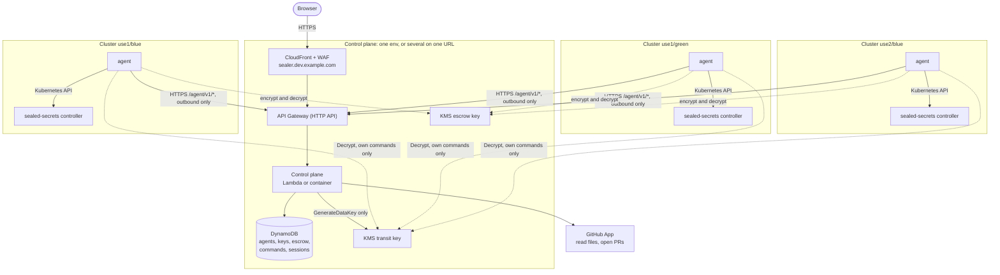
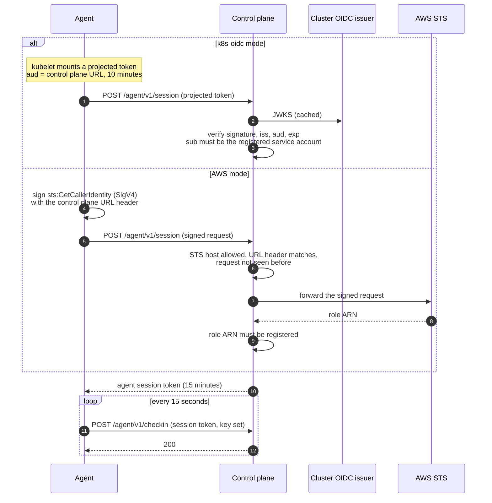
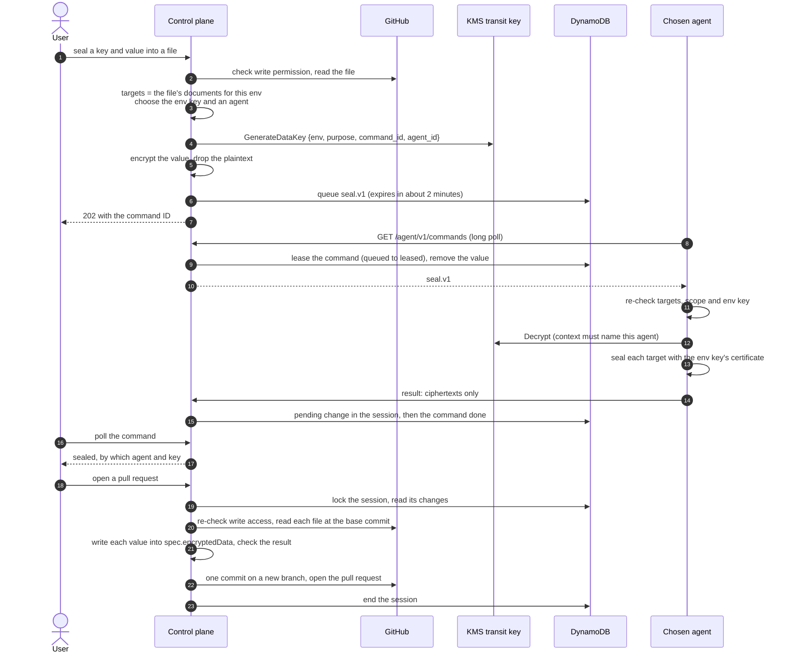
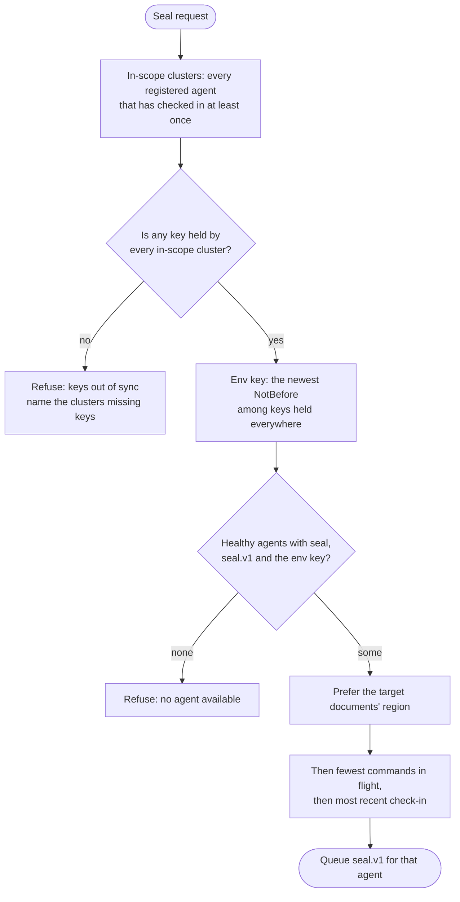
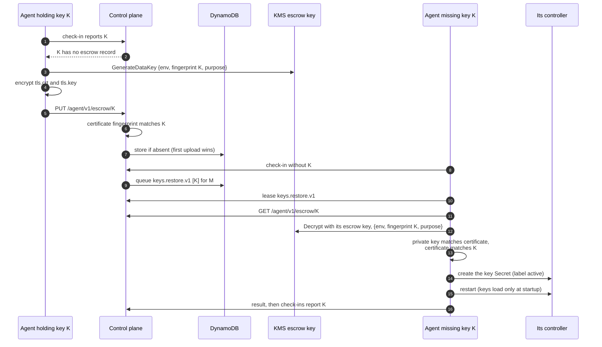

# Design

This document describes v1 of k8s-sealed-secrets-sealer: a control plane and a
set of per-cluster agents that let people seal values into
[Sealed Secrets](https://github.com/bitnami-labs/sealed-secrets) files in
GitHub, and that keep the sealing keys of every cluster in an environment in
sync.

## 1. Goals and non-goals

Goals:

- **One URL, no clusters to pick.** A person sealing a value opens the
  control plane's URL, one per environment (`sealer.dev.example.com`) or one
  for several (`sealer.example.com/prod/...`, section 15), picks a
  repository and a file, and enters a key and a value. They never pick a
  cluster or a region.
- **Every cluster in an environment can decrypt every value sealed for that
  environment.** The system keeps the clusters' sealing keys in sync and only
  seals with a key that every cluster already holds.
- **No inbound access to clusters.** Agents make outbound HTTPS calls only.
- **The control plane can never read a private sealing key,** and stored data
  never contains plaintext.
- **Runs serverless on AWS** (API Gateway and Lambda, preferred) or as a
  container on Kubernetes, from the same code. Past about 50 agents a
  container costs less (section 15).
- **Runs and is tested locally** on a single k3d cluster.
- **Agnostic.** Annotation keys, environment, region and cluster names are all
  configuration. The project is MIT licensed.

Non-goals for v1:

- Unsealing, viewing or exporting secret values. Nothing in the system returns
  plaintext to a user.
- Cluster-wide sealing scope. It is refused everywhere (see section 6).
- Sharing keys or data across environments. Each environment has its own
  sealing keys, KMS keys, agent registry and DynamoDB table, whether it has a
  control plane of its own or shares one URL with others (section 15).
- Resealing existing values or retiring old keys (see section 16).
- Non-GitHub source control.

## 2. Concepts and terms

| Term          | Meaning                                                        |
| ------------- | -------------------------------------------------------------- |
| Env           | A set of clusters that hold the same sealing keys, such as     |
|               | `dev` or `prod`. Each env has its own sealing keys, KMS keys,  |
|               | registry and table. A control plane serves one env, or several |
|               | on one URL (section 15).                                       |
| Region        | A label for where a cluster runs, such as `use1` or `use2`.    |
|               | A value that differs by region is sealed into only its         |
|               | regions' documents (section 6), and an agent there is          |
|               | preferred.                                                     |
| Cluster       | A Kubernetes cluster running one sealed-secrets controller and |
|               | one agent. Named by region and cluster, e.g. `use1/blue`.      |
| Agent         | The process in each cluster. It reports the controller's keys, |
|               | seals values and syncs keys. It only makes outbound calls.     |
| Control plane | The service behind the env's URL, which several envs may       |
|               | share. It serves the UI, talks to GitHub, queues commands for  |
|               | agents and stores state in DynamoDB. It has no Kubernetes      |
|               | client.                                                        |
| Sealing key   | An RSA key pair the controller stores as a Secret labeled      |
|               | `sealedsecrets.bitnami.com/sealed-secrets-key=active`.         |
| Fingerprint   | The controller's own key identifier: the SSH-style SHA-256     |
|               | fingerprint of the public key (`SHA256:<base64>`), computed    |
|               | with sealed-secrets' `crypto.PublicKeyFingerprint`. It depends |
|               | only on the key, so a reissued certificate keeps it, and it    |
|               | matches what the controller logs.                              |
| Key set       | Every sealing key one controller holds. A controller decrypts  |
|               | with any key in its set.                                       |
| Env key       | The newest key (by certificate `NotBefore`) held by every      |
|               | registered cluster in the env. Every seal uses the env key.    |
| Escrow        | The KMS-encrypted copy of every sealing key, stored in         |
|               | DynamoDB. Agents sync keys to each other through it.           |

## 3. Architecture

```
  Browser
     │ HTTPS
     ▼
  CloudFront + WAF (sealer.dev.example.com)
     │
     ▼
  API Gateway (HTTP API) ◄─────────────── agents (below)
     │
     ▼
  Lambda: control plane ────────────────► GitHub App (read files, open PRs)
     │        │
     │        └─────────────────────────► KMS transit key (GenerateDataKey)
     ▼
  DynamoDB: agents, keys, escrow, commands, sessions

          HTTPS to /agent/v1/*, always opened by the agent
     ┌───────────────────────┬───────────────────────┬──────► API Gateway
     │                       │                       │
┌────┴─ use1/blue ──┐   ┌────┴─ use1/green ─┐   ┌────┴─ use2/blue ──┐
│  agent            │   │  agent            │   │  agent            │
│    │ Kubernetes   │   │    │ Kubernetes   │   │    │ Kubernetes   │
│    │ API          │   │    │ API          │   │    │ API          │
│    ▼              │   │    ▼              │   │    ▼              │
│  sealed-secrets   │   │  sealed-secrets   │   │  sealed-secrets   │
│  controller       │   │  controller       │   │  controller       │
└───────────────────┘   └───────────────────┘   └───────────────────┘

  Agents also call KMS directly: transit Decrypt (their own commands only)
  and the escrow key. Controllers never talk to the control plane.
```

The same picture, rendered:



**Control plane.** One Go binary with two entry points that serve the same
router:

- `cmd/lambda`: the preferred mode. API Gateway HTTP API invokes Lambda.
  CloudFront and WAF sit in front. The UI is embedded in the binary and
  CloudFront caches its hashed assets.
- `cmd/server`: a plain HTTP server for running as a container, for example
  on Kubernetes. It contains no Kubernetes client and knows nothing about the
  cluster it runs on. Locally this is the mode that runs in k3d.

An env serves every cluster in it, in every region and AWS account. Where
the control plane runs is unrelated to which clusters it serves: a control
plane in `use2` of a tools account serves clusters in `use1` and `use2` of
other accounts. One control plane serves one env or, optionally, several
envs on one URL (section 15, "Several envs on one URL").

**Agent.** One Deployment per cluster (`cmd/agent`), outbound only, with no
Ingress and no Service. It checks in on a timer, long-polls for commands, and
talks to its own sealed-secrets controller through the Kubernetes API.

**DynamoDB.** The only data store, one table per env. It holds agent state,
the key inventory, escrowed keys, queued commands and user sessions
(section 11). It is the broker for key sync, so its backups also back up the
keys. The audit trail is the structured logs, not the table (section 11).

## 4. Agent identity

Agents are registered ahead of time. The registry is part of the control
plane's configuration, managed with infrastructure as code. There is no
enrollment API and no self-registration: an identity that is not in the
registry is rejected. A registry entry holds the agent ID, region, cluster
name, enabled capabilities it may use, and exactly one identity:

**AWS mode.** Each agent has its own IAM role, attached to its service account
with EKS Pod Identity or IRSA. To log in, the agent signs an
`sts:GetCallerIdentity` request with SigV4, including a header that names the
control plane's URL, and sends the signed request (not credentials) to
`POST /agent/v1/session`. This is the same exchange Vault's AWS auth method
uses. The header is `X-K8s-Sealed-Secrets-Sealer-Audience`. The control
plane:

1. checks that the request is a POST of exactly
   `Action=GetCallerIdentity&Version=2011-06-15` over https to an allowed STS
   host, with no query string: by default `sts.amazonaws.com` and the
   regional hosts of known AWS regions, or an explicit list (for a region it
   does not know). The request goes to the URL the control plane holds
   for that host, never to the URL as sent, so it can't be made to call
   anything else;
2. accepts only the headers a signed STS call needs (`Authorization`,
   `X-Amz-Date`, `X-Amz-Security-Token`, `Content-Type` and the audience
   header), each once: a name given twice, in any mix of case, is refused,
   so the checks and STS can't read different copies. It requires the
   audience header to equal its own URL and to be among the signed headers,
   and the signature date to be within 15 minutes of now;
3. forwards exactly the headers it checked to STS, never following a
   redirect, and maps the returned assumed-role ARN to a registered agent;
4. records a hash of the forwarded signature only after STS accepted it (so
   forged requests can't fill the table) and rejects any later use of it;
   the record outlives the signature's validity window.

Anyone can send a request that passes the first two steps, so calls to STS
are limited per env and process: a burst of 100, then one a second. That
lets a whole fleet log in at once after a restart, while each agent logs in
only every 14 minutes. Past the limit a login gets 429, logged as
`agent.login_throttled`, and the agent tries again later.

STS reports an assumed role without the role's path, so a role is matched by
partition, account and name, which IAM keeps unique per account. A registry
entry can also pin the role's unique ID (`AROA...`), so a role that is deleted
and recreated with the same name is not accepted. Every check except STS's
signature verification happens before anything is sent to STS.

The agent needs the same role for KMS anyway, so each agent has one identity.

**k8s-oidc mode.** The agent sends a projected service-account token with the
control plane's URL as its audience and a 10-minute lifetime (the kubelet
rotates it). The control plane verifies it against the registered cluster's
OIDC issuer (signature via the issuer's JWKS, `iss`, `aud`, `exp`) and requires
`sub` to equal the registered `system:serviceaccount:<namespace>:<name>`. An
issuer is registered with its JWKS URL, and a CA bundle when that URL's
certificate is not publicly trusted, or with a JWKS file holding its keys
when the control plane cannot reach it. A remote JWKS is fetched on first
use and again when a token names a key it lacks, as issuers rotate keys, but
at most once every 30 seconds per issuer: anyone can send a token naming an
unknown key. This mode is used locally and by anyone running outside AWS.
[docs/deployment.md](deployment.md) shows the registry for both modes.

**Registry changes.** A registry in a file or an SSM parameter is read
again about once a minute, on a request rather than a timer (a Lambda
instance is frozen between requests). A change takes effect for logins,
sessions and the fleet at once, so removing an agent revokes it within
about a minute, without a restart. A registry that cannot be read or is
invalid is ignored: the one in force stays, and `registry.reload_failed` is
logged. A registry given inline in an environment variable changes only
with a restart.

In both modes a successful login returns a short-lived agent session token
(15 minutes), scoped to the agent API and bound to the agent ID. Every other
agent call carries it.



## 5. Command protocol

The control plane never connects to an agent. Agents call:

| Call                                   | Purpose                             |
| -------------------------------------- | ----------------------------------- |
| `POST /agent/v1/session`               | Log in (section 4).                 |
| `POST /agent/v1/checkin`               | Report state on an interval.        |
| `GET  /agent/v1/commands?wait=20`      | Long-poll for queued commands.      |
| `POST /agent/v1/commands/{id}/result`  | Report a command's outcome.         |
| `PUT  /agent/v1/escrow/{fingerprint}`  | Upload an escrowed key.             |
| `GET  /agent/v1/escrow/{fingerprint}`  | Download an escrowed key.           |

Every call names the agent's env in the `X-K8s-Sealed-Secrets-Sealer-Env`
header, from its Helm values (section 8). A control plane serving several
envs sends the call to that env, whose registry must know the agent; it
answers `400` to a call that names no env and `404` to an env it does not
serve. One serving a single env also accepts a call without the header.

A check-in carries the agent version, the protocol versions and command types
it supports, its capabilities, its controller's settings (namespace, key renew
period, key order priority) and its key set: fingerprint, `NotBefore`,
`NotAfter` and certificate for every key. The agent's check-in interval
(15 seconds by default, 5 seconds to 5 minutes) comes in the
`X-K8s-Sealed-Secrets-Sealer-Check-In-Interval` header, in whole seconds. It
is a header so that control planes that predate it, which refuse unknown
fields in a check-in, still accept the check-in.

Commands are typed and versioned: `seal.v1`, `keys.restore.v1`,
`renewal.enable.v1`. Each has an ID (a ULID), the target agent ID, the env,
a creation time, an expiry and a typed payload. The rules:

- **Fixed command set.** The agent has a handler per type compiled in. There is
  no generic exec, apply or proxy command. An unknown type or a payload that
  fails validation is reported as failed and not acted on.
- **Only its own commands.** An agent can lease, read and report results only
  for commands addressed to its own ID.
- **Single use.** Leasing a command is a conditional write from `queued` to
  `leased`. A command is delivered at most once. If the agent dies before
  reporting, the command expires and the user retries. Key commands are
  idempotent and the control plane re-issues them when it sees the gap again.
  On shutdown the agent starts no new poll, but the poll in flight and the
  commands it leased still run and are reported, within 45 seconds; the
  chart's `terminationGracePeriodSeconds` (60) leaves room for that.
- **Expiry is enforced in code.** DynamoDB TTL deletion is eventual, so the
  control plane and agent both refuse expired commands; TTL only cleans up.
  The agent measures expiry in the control plane's time, from the `Date`
  header of its responses, so a clock that is off does not expire commands.
  It reports a command that expired before it ran as failed.
- **Results are accepted once,** only from the leasing agent and only before
  expiry. The agent retries a result while the control plane cannot be
  reached or answers with a server error, until the command expires.
- **Long-poll within API Gateway limits.** The control plane holds a poll for
  up to 20 seconds, under the API Gateway integration timeout, checking
  DynamoDB for new commands in the meantime. Each check reads only the
  commands queued in the last 11 minutes (the longest a command lives, and a
  minute for clocks), a range of command IDs, not every command kept. The
  cost is roughly one held Lambda invocation per agent
  ([docs/operations.md](operations.md#cost-and-scale) has the numbers). An
  API Gateway WebSocket API is a possible later optimization; the protocol
  does not depend on the transport.
- **A leased command is sent.** A command leased into a response that is
  never written is lost until it expires. A poll ends within 25 seconds,
  store calls included, and leases a command only while 3 seconds are left to
  respond. One poll leases at most 16 commands and 512 KiB, well within what
  agents read (1 MiB) and Lambda returns; the rest wait for the next poll. If
  a lease fails after others, the poll still sends those.
- **Capabilities come from the agent's Helm values,** never from the control
  plane. Values decide which RBAC is installed and which handlers the agent
  enables. An agent refuses a command for a capability it does not have, and
  RBAC would stop it anyway.

| Capability | Commands                               | Default |
| ---------- | -------------------------------------- | ------- |
| `seal`     | `seal.v1`                              | on      |
| `keys`     | `keys.restore.v1`, escrow upload       | off     |
| `renewal`  | `renewal.enable.v1`                    | off     |

`keys` and `renewal` are off by default because they grant access to the
sealing keys and to the controller Deployment. Key sync, which most
multi-cluster envs need, works only on agents where an operator turned them
on. An agent may have none (`APP_CAPABILITIES=none`, which the chart sets
when all are off): it still checks in, reporting its controller's active
key.

v1 has no command that deletes or disables anything.

## 6. Seal flow

1. A signed-in user with write access opens a session for a repository. A
   session is based on the head of the default branch the user is looking
   at: if the branch has moved since the page loaded, opening is refused and
   the page reloads. A user has at most one open session per repository and
   at most 10 in all.
2. The user picks a file and submits a key and a value. The control plane
   re-checks the user's write permission on the repository, reads the file
   through the GitHub App at the session's base commit, and finds every
   SealedSecret document in it whose env annotation equals this env. One seal
   updates all of them, so a file with documents for `use1` and `use2` is
   sealed once. A seal may name regions instead, for a value that differs by
   region: it then updates only the documents whose region annotation names
   one of them (see "Region-specific values" below). Each document sealed
   for contributes a target: namespace, name, scope and region.
3. Scope comes from each document's own sealed-secrets scope annotations, the
   same place the controller reads it. `strict` and `namespace-wide` are
   allowed. `cluster-wide` is refused, because such ciphertext can be decrypted
   into any namespace by anyone able to create a SealedSecret. A file with any
   document that cannot be sealed into is refused as a whole.
4. The control plane chooses the env key and an agent (section 7).
5. It encrypts the value immediately with the **transit** KMS key: a data key
   from `GenerateDataKey` encrypts the value with AES-256-GCM, and the stored
   payload is the wrapped data key, nonce and ciphertext. The encryption
   context is `{env, purpose: seal, command_id, agent_id}`. The plaintext
   value and the data key are then dropped. The value is never logged, and
   request bodies are never logged.
6. It writes a `seal.v1` command (targets, secret key name, env key
   fingerprint) with an expiry of 2 minutes, storing the encrypted value
   beside the payload rather than in it, and returns `202` with the command
   ID. The UI polls the seal's status every second: queued, sealing, sealed,
   failed or expired, or superseded when a newer seal of the key replaced
   the value in the session.
7. The agent leases the command. Leasing removes the encrypted value from the
   stored command, so it reaches the agent once. The agent re-validates the
   command itself: valid key name, namespace and name present, scope `strict`
   or `namespace-wide` (never `cluster-wide`), and the env key fingerprint in
   its own controller's key set, read again for this seal. It decrypts the
   value with KMS using the same encryption context, with its own env and ID
   and the command's ID, seals each target in process with that key's
   certificate, and returns only the ciphertexts.
8. The control plane checks the result (one ciphertext per target, in order,
   with the requested key) and records the ciphertexts as a pending change in
   the session before it marks the command done, so a sealed value always has
   its change. There is one pending change per file, key and regions:
   sealing the same key into the same file for the same regions again
   replaces it, and a seal that finishes late never replaces a newer one.
   Changes of one key for different regions can overlap; the newest wins for
   each document, and a change one newer change covers entirely is removed. The UI
   shows which agent and key sealed it. Users never see ciphertext.
9. When the user opens a pull request, the control plane locks the session,
   so nothing is sealed into it or removed from it meanwhile and it opens one
   pull request at most. It refuses while one of the session's seals is still
   running, and re-checks the user's write access.
10. It reads each file again at the session's base commit, checks that the
    file's documents for the env (in its regions, for a regional value) are
    still exactly the targets each value was sealed for, and writes the
    values in, in the order they were sealed, editing only
    `spec.encryptedData.<key>` in each targeted document. Values are replaced
    where they are written and new keys get a line of their own, so names,
    namespaces, annotations, comments, formatting and other documents stay
    byte for byte as they were. The result is checked by decoding it: it
    must equal the original with exactly those values set. A file that
    cannot be edited that precisely (YAML anchors in `spec.encryptedData`,
    say) is refused rather than reformatted.
11. One commit on a new branch from the base commit,
    `sealer/<env>/<login>-<session id>`, carries every file, and a pull
    request into the default branch proposes it. The branch name is unique
    to the session, so GitHub itself would refuse a second pull request from
    it. The App makes the commit without an author, so GitHub signs it. The
    commit (a `Requested-by:` trailer) and the pull request (a mention)
    record who requested it; they name files, keys and documents, never
    values or ciphertexts. The session then ends.



**Transit key permissions.** The control plane may only call
`GenerateDataKey` on the transit key; it cannot decrypt. Each agent role may
call `Decrypt` only when the encryption context's `agent_id` equals the
agent's own ID, enforced by a key policy condition. The control plane's code
reflects this: its transit client interface has no decrypt method. So
DynamoDB, its backups and logs never hold anything the control plane could read
back, and one agent cannot read another agent's seal payloads.

**Agents seal with certificates from their own cluster.** The certificate comes
from the agent's own controller key set, never from the command. A control
plane cannot make an agent encrypt to a certificate the cluster doesn't hold.

**Why not encrypt in the browser.** The control plane serves the UI's
JavaScript. An attacker who controls the control plane can serve a page that
sends the value elsewhere, so browser-side encryption would only add protection
against passive leaks, which encrypt-on-receipt and the no-logging rule already
cover. This is a choice and can be revisited.

**Value size.** A single value is capped at 64 KiB, and a seal's value plus
1 KiB per target document at 224 KiB, so all of a seal's ciphertexts fit in
one DynamoDB item (400 KB). A 64 KiB value can go to three documents; a value
of a few KiB, to dozens. Larger values would need S3 and are out of scope for
v1.

**Region-specific values.** Some values differ by region: a regional
endpoint's credentials, a certificate per region. A seal can name the
regions it is for, and goes only into the file's documents whose region
annotation names one of them, so one file can hold a different value for
each region:

- Each region named must be the region of a document in the file; naming
  every region is sealing for every document. Documents without a region
  annotation are sealed for only when no region is named.
- The agent is chosen for the regions named (section 7).
- A key's pending changes may overlap, such as one for every document
  followed by one for `use1`. For each document, the newest seal wins:
  `use1` gets the second value and the rest keep the first. Removing the
  `use1` change brings the first value back there. A change one newer
  change covers entirely is removed; one that newer changes only cover
  between them stays, so removing either brings it back where that one
  applied.
- A document is identified by its place in the file, since copies of a
  secret in several regions often share a namespace and name.
- The pull request names each change's regions and the documents it ends up
  setting.

The UI shows, for a file whose documents are in more than one region, where
each key stands per region, and lets a seal be limited to some regions or
started from a region of a key. A key a region does not need is not marked
missing there when that region's documents have the keys hint (section 13)
and it leaves the key out: list a region-only key in only that region's
documents' hint.

**Routes.** Each env's API is under `/api/v1/envs/{env}`, written `{api}`
below; with a single env it is also at `/api/v1` (section 12). Every route
needs a signed-in user whose session grants the env, and every write the
CSRF token (section 12). `.../session` is
`{api}/repos/{owner}/{repo}/session`.

| Route                                  | Purpose                             |
| -------------------------------------- | ----------------------------------- |
| `GET {api}/sessions`                   | The user's open sessions, with how  |
|                                        | many pending changes each has.      |
| `GET .../session`                      | The user's open session for the     |
|                                        | repository and its pending changes, |
|                                        | or null.                            |
| `POST .../session`                     | Open a session at `commit`, the     |
|                                        | head the user saw.                  |
| `DELETE .../session/{id}`              | Discard the session.                |
| `POST .../session/{id}/seals`          | Seal `value` as `key` into the file |
|                                        | at `path`, or only into its         |
|                                        | documents in `regions`; answers     |
|                                        | `202`.                              |
| `GET .../session/{id}/seals/{seal}`    | A seal's progress.                  |
| `DELETE .../session/{id}/changes/{id}` | Remove one pending change.          |
| `POST .../session/{id}/pull-request`   | Open a pull request with the        |
|                                        | pending changes; ends the session.  |

The repository's files at a session's base commit come from
`GET {api}/repos/{owner}/{repo}/files?commit=<sha>`.

## 7. Key selection and agent selection

On every check-in, each agent reports its controller's full key set (public
certificates only). From those reports the control plane computes:

- **Clusters in scope:** every registered agent in the env. A cluster
  that is temporarily down still counts, using its last reported key set,
  because it will still have to decrypt what is sealed now. A registered agent
  that has never checked in is ignored and flagged in the UI. A cluster leaves
  scope only when it is removed from the registry.
- **Env key:** the key with the newest `NotBefore` that is in every in-scope
  cluster's key set. Certificates have one-second precision, so keys made in
  the same second tie; the tie goes to the greater fingerprint, so the env
  key never depends on the order agents report in.

To choose the agent for a seal:

1. Candidates are agents that are healthy (checked in within three of their
   check-in intervals, and at least 45 seconds, so a short interval does not
   make an agent unhealthy while its controller restarts; an agent that does
   not report its interval is taken to have the default 15 seconds), have
   the `seal` capability, support `seal.v1`, and hold the env key.
2. Prefer an agent in a region named by the target documents' region
   annotations.
3. Then prefer the agent with the fewest commands in flight, then the most
   recent check-in.
4. If no key is held by every in-scope cluster, refuse with "keys out of sync"
   and name the clusters missing keys. Sync (section 8) normally closes the gap
   within a few check-ins.



The agent seals with the env key's certificate, which is not necessarily its
controller's newest key. This handles the cases that matter:

- A controller that just generated a key keeps advertising it as its newest,
  but it is not used until every cluster holds it.
- An agent that is down is skipped; any other agent holding the env key seals.
- A new cluster joins with its own fresh key. Sync gives it the existing keys,
  and the env key stays the same until its key has reached every cluster.

An agent without the `keys` capability cannot read key secrets, so it reports
only its controller's active certificate (from `/v1/cert.pem`) as its key set.

## 8. Key escrow and sync

Agents sync keys to each other through DynamoDB, using a dedicated **escrow**
KMS key:

| Principal     | Escrow key permissions                                  |
| ------------- | ------------------------------------------------------- |
| Agent roles   | `GenerateDataKey`, `Decrypt`                            |
| Control plane | none                                                    |
| Admins        | none, except a separate break-glass role                |

The encryption context is `{env, fingerprint, purpose: key-escrow}`. Key
secrets are larger than the 4 KB limit of KMS `Encrypt`, so escrow uses
envelope encryption: a data key from `GenerateDataKey` encrypts the key
secret's `tls.crt` and `tls.key` with AES-256-GCM, and the escrow record
stores the wrapped data key, nonce and ciphertext next to the public
certificate. The encryption context is both the KMS encryption context and
the GCM additional data. An agent's env comes from its Helm values, not from
the control plane: it names that env on every request (the
`X-K8s-Sealed-Secrets-Sealer-Env` header), and refuses to log in to a
control plane that answers for another env.

**Upload.** Each check-in response lists the agent's keys that have no
escrow record (`escrow_needed`), for agents with the `keys` capability. The
agent first checks each key Secret as a restore would (step 2 below), so a
key the controller could not use is never uploaded, then encrypts and
uploads it. The control plane parses the public
certificate, checks that its fingerprint matches the URL, that the agent's
latest check-in reported that key, and that the envelope's context is this
env and key, and stores the record with a conditional write (the first upload
wins). It can check the certificate but cannot read or verify the private
key. Fingerprints are base64, which can contain `/`, so in URLs they use the
URL-safe alphabet (`+` as `-`, `/` as `_`).

**Restore.** When an in-scope cluster's agent checks in missing an escrowed
key, the control plane queues `keys.restore.v1` for that agent with the
missing fingerprints. The agent, for each one not already present (a key
Secret with that fingerprint under any value of the key label counts, so a
key relabeled, for example as `compromised`, is never brought back):

1. downloads the escrow record and decrypts it with KMS, naming its own
   configured escrow key and the expected context (neither is taken from the
   record, so a record made under another key or for another env or key does
   not open);
2. reads the private key and certificate as the controller does (the first
   private key it can parse, which must be RSA, and the first
   certificate), and checks that the private key matches the certificate and
   the certificate's fingerprint matches the one requested;
3. creates a `kubernetes.io/tls` Secret in the controller namespace with the
   controller's key name prefix (its `--key-prefix`) and the label
   `sealedsecrets.bitnami.com/sealed-secrets-key=active`, annotated with
   `sealer.cruxstack.io/fingerprint`,
   `sealer.cruxstack.io/restored-from: escrow` and the time.

After restoring the missing keys, the agent restarts the controller. This is
required: the controller lists key secrets only at startup
(`initKeyRegistry`) and does not watch for new ones. It deletes the
controller's pods that were created before the newest restored key's Secret,
and their Deployment starts new ones; with one replica the controller is
unavailable for the few seconds its new pod takes to start. Deleting pods
needs no write access to the Deployment. Before deleting anything, the agent
checks that every key Secret would load, since a new pod stops at one that
does not. The agent refuses the whole command if its controller orders keys
by `SecretCreationTimestamp`, or if it cannot tell how it orders them.

A restored key counts as held only once the controller has loaded it: when
every ready controller pod was created after the key's Secret (in a later
second, as creation times are whole seconds), or when the controller seals
with it. Until then the agent leaves it out of its check-ins and does not
seal with it, so it cannot become the env key while this cluster could not
decrypt with it. If the restart failed or never happened, the agent retries
it on its check-ins, backing off from 30 seconds to 10 minutes, and a
repeated restore command retries it too. While the controller restarts, the
agent seals with the keys it reported last.

Key commands expire after 10 minutes. The control plane does not queue a
restore for a key that an open restore command already covers, nor for 2
minutes after one succeeded (until the agent's next inventory shows the key)
or 5 minutes after one failed. Each decision is about the agent that is
checking in, and an agent checks in serially, so concurrent check-ins from
different agents cannot queue duplicate commands.



**Key order.** The controller orders keys by `--key-order-priority`, which
defaults to `CertNotBefore`. With that default a restored key keeps its place
in the order, so the newest key is the same in every cluster. The exception
is keys made in the same second, such as by clusters created together: each
controller breaks the tie its own way and may keep its own key as active.
That is harmless, because sealing uses the env key and every cluster holds
every key, and the next renewal produces a key that is newest everywhere.
With `SecretCreationTimestamp`, a restored old key would become a
controller's newest. Agents report the setting; the control plane flags any
cluster not using `CertNotBefore` and excludes it from key comparison until
fixed.

**Controller settings.** The agent reads the controller's settings from its
Deployment the way the controller does. A flag on the command line wins, and
of several occurrences the last one. Otherwise its `SEALED_SECRETS_`
variable applies (`SEALED_SECRETS_KEY_ORDER_PRIORITY` for
`--key-order-priority`). `--rotate-period` is the old name of
`--key-renew-period`. When a setting comes from somewhere the agent cannot
read, such as a ConfigMap through `envFrom`, the agent reports it as unknown
and refuses to restore keys, since it cannot tell the key order.

**Authenticity.** Only agent roles can encrypt under the escrow key, and
AES-GCM with a bound encryption context detects tampering. The control plane
can't read keys or forge escrow records. The worst it can do is withhold or
delete them.

**Restore is automatic,** with alerts through structured log events at `warn`
level or above:

| Event                       | When                                            |
| --------------------------- | ----------------------------------------------- |
| `key.discovered`            | A check-in reports a fingerprint never seen.    |
| `key.escrowed`              | An agent uploads a key to escrow.               |
| `key.restore_queued`        | A restore is queued for a cluster missing keys. |
| `key.restored`              | An agent restores a key into its controller.    |
| `key.restore_skipped`       | A key to restore is held under another label.   |
| `key.sync_failed`           | An upload or restore fails.                     |
| `key.order_mismatch`        | A controller does not order keys by NotBefore.  |
| `keys.out_of_sync`          | A seal was refused because no env key exists.   |
| `renewal.enable_queued`     | No cluster renews; one is asked to.             |
| `renewal.enabled`           | An agent turned on key renewal.                 |
| `controller.restarted`      | An agent restarted its controller.              |
| `controller.restart_failed` | An agent could not restart its controller.      |

Every event names the env, agent, cluster and fingerprint.

**Backups.** The table has point-in-time recovery and a scheduled AWS Backup
plan. The escrow key is a multi-Region KMS key with a replica in another
region, so a backup can be restored and decrypted if a region is lost. Losing
the escrow key loses the escrowed copies, so it has deletion protection
through its key policy and the longest pending-deletion window.
[docs/operations.md](operations.md#backups-and-restore) has the restore
runbook: what in the table rebuilds itself, and what only escrow holds.

## 9. Key renewal

The controller generates a new key every `--key-renew-period` (30 days by
default; `0` turns renewal off). Two postures are supported:

- **Renewal on everywhere.** Each controller generates keys on its own
  schedule. Sync spreads them, and each becomes the env key once every cluster
  holds it. The cost is more keys over time, which key retirement will handle
  (section 16).
- **Renewal on in at least one cluster.** Agents report their controller's
  renew period. If no in-scope cluster in the env is known to have renewal
  on, the control plane sends `renewal.enable.v1` to one healthy agent that
  has the `renewal` capability and can read its controller's flags, chosen
  deterministically (the lowest agent ID). The agent patches its controller
  Deployment's arguments to set the configured period (`keyRenewPeriod` in
  the control plane's chart, 30 days by default), which rolls the
  controller, and logs `renewal.enabled`. The flag it sets overrides any
  variable and earlier occurrence. If renewal is already on, or the agent
  cannot read the period, it changes nothing. If the chosen agent goes down,
  the next one is asked.

**Recommended: renewal in one cluster per env.** Run every controller with
`--key-renew-period=0` (the sealed-secrets chart's `keyrenewperiod: "0"`;
the controller renews every 30 days unless told otherwise), and give the
`renewal` capability only to agents in clusters that are always up. The
control plane then turns renewal on in exactly one of them, as the local
stack does. Setting the period on one always-up controller yourself, and
`0` on the rest, works as well. A cluster that is down still counts as
renewing with its last reported period, so a cluster that runs only at
times should not be the one. Renewal in one cluster is better because:

- Sync puts every key in every cluster. With renewal on in N clusters,
  every cluster gains N keys per period instead of one: N times the keys
  to hold, report on every check-in and, one day, retire.
- Every new key is restored into every other cluster, and each restore
  restarts that cluster's controller once. N renewing clusters cause about
  N×(N−1) controller restarts per period instead of N−1.

## 10. Security model

| Threat                | What it can do                 | Mitigations                    |
| --------------------- | ------------------------------ | ------------------------------ |
| Compromised control   | See values submitted while it  | No escrow key access; no       |
| plane                 | is compromised; queue seals    | transit `Decrypt`; agents      |
|                       | for any namespace/name in the  | refuse cluster-wide and only   |
|                       | env; open PRs through the      | use certificates from their    |
|                       | GitHub App; withhold or delete | own cluster; fixed command set |
|                       | data; lie in the UI.           | with no delete; no inbound     |
|                       |                                | path into clusters; branch     |
|                       |                                | protection on repos.           |
| Compromised agent or  | Read that cluster's keys (as   | Inherent to cluster access.    |
| cluster               | can anyone with secret read in | Transit `Decrypt` limited to   |
|                       | the controller namespace) and  | its own commands. Every        |
|                       | so decrypt the env's secrets;  | `key.escrowed` names the       |
|                       | upload a key it generated so   | source cluster. After an       |
|                       | it becomes the env key;        | incident, rotate and retire    |
|                       | report false key sets.         | keys.                          |
| Rogue agent           | Nothing.                       | Registry in IaC, identity      |
|                       |                                | verified, no self-enrollment.  |
| Stolen DynamoDB data  | Ciphertext only.               | Transit and escrow need KMS    |
| or backup             |                                | `Decrypt`, held only by agent  |
|                       |                                | roles; CMK encryption at rest; |
|                       |                                | no plaintext stored; seal      |
|                       |                                | payloads removed after lease.  |
| Malicious user        | Seal into files in repos they  | Per-repo permission checks;    |
|                       | can write to; read nothing.    | env allowlist; scope from the  |
|                       |                                | file; only `encryptedData`     |
|                       |                                | edited; audit; rate limits.    |
| Replay or             | Reuse a login, command or      | TLS; STS requests accepted     |
| interception          | result.                        | once; tokens audience-bound    |
|                       |                                | and short-lived; commands      |
|                       |                                | single-use with expiry;        |
|                       |                                | payloads bound to command and  |
|                       |                                | agent by encryption context.   |

**In plain terms, a compromised control plane can** read values people submit
while it is compromised, seal those values into pull requests, and stop the
system from working. **It cannot** read or forge any private sealing key,
decrypt anything stored before or after, make an agent produce cluster-wide
ciphertext or encrypt to a key outside the env, turn on agent capabilities, or
run anything else on a cluster.

**A compromised cluster** already holds every env key, so injecting a key
gives it nothing new while it is compromised. An injected key would, however,
keep being used afterwards, which is why every escrow upload names its source
and why incident response includes rotating to a new key and retiring the old.

**Controller namespace.** The controller runs in its own namespace, not
`kube-system`. RBAC cannot limit `list secrets` by label, so an agent with the
`keys` capability can read every Secret in the controller namespace; that
namespace must hold only the controller and its keys.

**Agent RBAC.** The Helm chart installs a Role in the controller namespace,
bound to the agent's ServiceAccount in the agent's own namespace:

| Capability | Rules in the controller namespace                             |
| ---------- | ------------------------------------------------------------- |
| base       | `get` the controller Service; `get` `services/proxy` on it    |
|            | (for `/v1/cert.pem`); `get` the controller Deployment (to     |
|            | read its flags).                                              |
| `seal`     | Nothing more: sealing uses public certificates in process.    |
| `keys`     | `list`, `create` Secrets; `list`, `delete` Pods (restart).    |
| `renewal`  | `patch` the controller Deployment.                            |

`get` and `patch` are limited to the named Service and Deployment with
`resourceNames`; `list`, `create` and `delete` cannot be, because the
objects' names are generated or unknown.

`patch` on the Deployment cannot be limited to the one argument renewal
sets: an agent with `renewal` can change the controller's pod spec, and so
run anything as the controller's ServiceAccount, which in the upstream
chart reads and writes Secrets in every namespace. That is why `keys`
restarts the controller by deleting its pods instead. Give `renewal` to as
few agents as you can (one per env is enough), or set the controller's own
renew period and leave it off.

## 11. Data model

One DynamoDB table per env, encrypted with a customer-managed KMS key, with
point-in-time recovery. Its key is two strings, the partition key `pk` and
the sort key `sk`; its TTL attribute is `expires_at` (epoch seconds). It has
no secondary indexes, and on-demand capacity suits its load.
[docs/deployment.md](deployment.md#4-the-control-plane-in-the-tools-account)
shows creating one.

| Entity         | `pk`               | `sk`                | TTL                   |
| -------------- | ------------------ | ------------------- | --------------------- |
| Agent state    | `AGENT#<id>`       | `STATE`             | none                  |
| Command        | `AGENT#<id>`       | `CMD#<ulid>`        | expiry + 1 hour       |
| Key            | `KEY#<fp>`         | `META`              | none                  |
| Key escrow     | `KEY#<fp>`         | `ESCROW`            | none                  |
| Session        | `USER#<user id>`   | `SESSION#<repo>`    | idle timeout (1 hour) |
| Session count  | `USER#<user id>`   | `SESSIONS`          | session's maximum age |
| Seal           | `SESSION#<id>`     | `SEAL#<ulid>`       | session's maximum age |
| Pending change | `SESSION#<id>`     | `CHANGE#<id>`       | session's maximum age |
| Change places  | `SESSION#<id>`     | `CHANGES`           | last place's end      |
| Login replay   | `REPLAY#<hash>`    | `REPLAY`            | signature expiry      |
| Rate window    | `RATE#<key>#<end>` | `RATE`              | window end            |

- **Agent state:** last check-in, version, supported commands, capabilities,
  controller settings, key set. Commands in flight are counted from the
  agent's commands.
- **Command:** type, status (`queued`, `leased`, `succeeded`, `failed`;
  past its expiry without a result it counts as expired), lease and finish
  times, expiry, payload, result. The expiry is also kept as epoch
  milliseconds (`deadline`), so leasing and results are conditional writes
  that check it. A seal's encrypted value is kept in its own attribute and
  removed when the command is leased; a seal's result keeps only a summary,
  since its ciphertexts go to the pending change. Polls, seals and pull
  requests look for open commands only among those queued in the last 11
  minutes, and key sync among those of the last 16, which covers commands
  that finished recently: command IDs are ULIDs, so each is a range of sort
  keys.
- **Key:** certificate, `NotBefore`, `NotAfter`, first seen (agent and time).
  Which clusters hold a key is derived from agent state.
- **Key escrow:** wrapped data key, nonce, ciphertext, KMS key ARN and
  encryption context, uploading agent and time.
- **Session:** owner (GitHub user ID and login), repository (lowercased in
  the key, so there is one per user and repository), base branch and commit,
  idle expiry and maximum age. Using a session (sealing, removing a change)
  moves its idle expiry an hour on, but never past its maximum age of 8
  hours. Keying sessions by user makes ownership structural: a user can only
  ever address their own. Live sessions per user are capped at 10, and a
  session at 50 pending changes, even under concurrent requests (below).
  While a pull request is opened from it, the session is locked
  (`submit_deadline`, epoch milliseconds, 2 minutes at most): sealing,
  removing a change and discarding are refused, and a seal queues its
  command before it marks the session used, so a seal is either in the pull
  request or refused. File content is not stored; it is fetched again at the
  base commit when the pull request is opened.
- **Session count:** a version number. Opening a session counts the user's
  live sessions with a query, then writes the session and the next version
  in one transaction, on condition the version is still the one read before
  the query. Of two sessions opened at once, one is written and the other
  counts again.
- **Change places:** a version, and the changes that seals still running
  will make, each held until its seal's command expires and a minute more.
  A seal counts the session's pending changes and these places, and adds its
  own on condition the version has not moved, so seals still running count
  toward the 50. A seal that fails keeps its place until it lapses.
- **Seal:** the command carrying a requested seal and the agent it went to,
  with the file, key, regions, targets and requesting user, so the UI can
  follow its progress.
- **Pending change:** file path, secret key name, the regions it was sealed
  for (none for every document), the command and agent that sealed it, the
  key's fingerprint, the targets and one ciphertext per target. The ID is
  derived from the path, key and regions, so sealing a key for the same
  regions again replaces the change; a seal that finishes late does not
  replace a newer one (command IDs are ULIDs). Overlapping changes of a key
  are resolved when read: the newest wins for each document, identified
  by its position in the file at the session's commit. Ciphertexts are
  stored apart from the targets so listings leave them out; they are
  never returned to clients. Never plaintext. Discarding a session leaves
  its seals and changes to expire unreachable.

- **Rate window:** how many requests of one kind a user (or session) made in
  one fixed minute (section 12). A request over the limit is not counted.

**Audit trail.** The table keeps no audit records: commands and sessions
expire, and agent state is replaced on every check-in. The audit trail is
the structured logs of the control plane and of every agent, whose events
(the `event` key) say who did what. They name the person (GitHub login and
ID) or agent, and what was acted on (repository, file, key name, cluster,
fingerprint), never values or ciphertexts:

| Area         | Events                                                       |
| ------------ | ------------------------------------------------------------ |
| Sign-in      | `user.login` (with the envs granted), `user.login_rejected`, |
|              | `user.login_failed`, `user.logout`                           |
| Sealing      | `session.opened`, `session.discarded`, `seal.requested`,     |
|              | `seal.succeeded`, `seal.failed`, `seal.superseded`,          |
|              | `change.removed`, `pr.opened`, `pr.failed`; `seal.sealed`    |
|              | from the agent                                               |
| Repositories | `repo.permission_mismatch`                                   |
| Agents       | `agent.login`, `agent.login_rejected`,                       |
|              | `agent.checkin_rejected`, `agent.capability_ignored`,        |
|              | `command.leased`, `command.finished`; `command.started`,     |
|              | `command.succeeded`, `command.failed`, `command.expired`     |
|              | from the agent                                               |
| Keys         | `key.discovered`, `key.escrowed`, `key.escrow_read`,         |
|              | `key.escrow_rejected`, `key.restore_queued`, `key.restored`, |
|              | `key.sync_failed`, `renewal.enable_queued`,                  |
|              | `renewal.enabled`, `renewal.enable_failed`;                  |
|              | `key.escrow_uploaded` and `controller.restarted` from the    |
|              | agent                                                        |

Collect the agents' logs from every cluster as well as the control
plane's, and keep them for at least a year, or as long as your compliance
rules ask, where people who can seal cannot change them. On Lambda, a
CloudWatch Logs group keeps everything until a retention is set, so set
one. The pull requests are a second, lasting record: each commit's
`Requested-by:` trailer names who sealed which keys into which files.

## 12. User authentication and authorization

- **Login** is GitHub OAuth (scope `read:org`). A random state goes in a
  short-lived HttpOnly cookie and is compared in constant time; over https
  it is a `__Host-` cookie like the session's, so a sibling subdomain
  cannot plant its own state and finish its own sign-in in someone else's
  browser. `return_to` is honored only for same-origin paths. The
  user must be a member of the configured org and, when teams are
  configured, an active member of at least one of them.
- **Session.** An HttpOnly, SameSite=Lax cookie holding a JWT signed with
  HS256, bound to the deployment's URL (audience), naming the envs it grants
  and whether the user administers each, 8 hours by default. Over https it
  is a `__Host-` cookie, so sibling subdomains can neither set nor read it.
  The user session key is separate from the agent session key.
- **CSRF.** Every state-changing request must send `X-CSRF-Token`, an HMAC
  of the session cookie under a key derived from the session key. `/me`
  returns it; a page that cannot read `/me` (another origin) cannot learn
  it, and a token for one session is useless with another.
- **Browser hardening.** Every response carries a strict Content Security
  Policy (same-origin scripts only and never inline, inline styles allowed
  for UI components, images also from GitHub avatars), `X-Frame-Options: DENY`, `nosniff`, a same-origin
  referrer and opener policy, and HSTS over https. The UI is built into
  the binary and needs no third-party origin at runtime.
- **Repository access** goes through the GitHub App's installation token, but
  every operation is first checked against the signed-in user's own permission
  on that repository: read to list and discover, write to create a session,
  seal and open a pull request. Write access is re-checked on every seal and
  PR. The permission comes from
  `GET /repos/{owner}/{repo}/collaborators/{login}/permission`, and the answer
  must name the signed-in user's GitHub ID (logins can change hands). Results
  are cached for 2 minutes per Lambda instance. A repository the user cannot
  read is reported as not found, so private repository names are not
  disclosed. Archived repositories are not listed and cannot be written.
- **Least-privilege tokens.** The control plane mints each installation
  token with only the permissions its use needs: `contents: read` and
  `metadata: read` to list repositories, read files and look up permissions;
  `contents: write` and `pull_requests: write` only to open a pull request. The App itself needs
  repository permissions Contents (read and write), Metadata (read) and Pull
  requests (read and write), and, when it also signs users in, organization
  permission Members (read). One GitHub App can provide both: its client ID
  and secret sign users in, and its App ID and private key read
  repositories.
- **Env allowlist.** An env can require membership in one or more GitHub
  teams of the org (`github.allowedTeams`). Use it for `prod`. Membership
  is checked at sign-in; removing someone from the team takes effect when
  their session expires.
- **Admins.** Members of an env's admin teams (`github.adminTeams`) are its
  admins; with none configured, nobody is. Membership is checked at sign-in
  and kept in the session, like the allowlist. Only admins can read the
  env's fleet (`GET .../fleet`: every agent with its cluster, controller,
  keys and issues). Everyone who may use the env can read `GET .../status`,
  which says whether sealing works and how many of its clusters are ready,
  but names none of them. The UI shows the status as a dot on the env
  badge, and the fleet only to admins. Automation reads the same fleet
  through the admin API, with a token rather than a sign-in
  ([docs/operations.md](operations.md#admin-api)).
- **One sign-in for every env.** A deployment serving several envs signs
  people in once. At sign-in the control plane works out, for each env,
  whether its teams admit the person and whether they administer it; the
  session (an HttpOnly cookie) carries the envs it grants and nothing else,
  and each env's API refuses a session that does not grant it. Someone no
  env admits cannot sign in. Every env's API is under
  `/api/v1/envs/{env}/`; signing in, `/me` (the user and their envs) and
  signing out are under `/api/v1/auth/`. With a single env its API is also
  at `/api/v1/`.
- **Rate limits** use API Gateway throttling and WAF rate-based rules per
  client. In-memory limiters do not hold across Lambda instances, so limits
  that matter (sessions per user, and the per-user limits below) are
  enforced with DynamoDB. Each call that costs GitHub requests, KMS or agent
  work has a fixed one-minute window per user, generous for a person using
  the UI and tight for a script. A request over a limit gets 429 with
  `Retry-After` and logs `request.rate_limited`; a request that fails still
  counts. When the count cannot be written the request goes through: the
  limits guard the service and must not stop it.

  | Call                      | Requests a minute           |
  | ------------------------- | --------------------------- |
  | List repositories         | 10 per user                 |
  | List a repository's files | 30 per user                 |
  | Open a session            | 10 per user                 |
  | Seal a value              | 20 per session, 30 per user |
  | Open a pull request       | 5 per user                  |
- **Secrets the control plane needs** (GitHub App private key, OAuth client
  secret, session keys, admin token) come from SSM Parameter Store, which
  suits Lambda: a setting may hold a parameter's ARN, read once at start.
  Secrets Manager is not supported. In a container they can also be plain
  environment variables, from a Kubernetes Secret.

## 13. Annotations

The control plane decides which SealedSecret documents belong to its env from
two annotations whose keys are configurable:

| Annotation | Default key                          | Required |
| ---------- | ------------------------------------ | -------- |
| Env        | `k8s-sealed-secrets-sealer/env`      | yes      |
| Region     | `k8s-sealed-secrets-sealer/region`   | no       |

A document belongs to the env when its env annotation equals the env's
name. The env annotation is how a fleet says which documents it manages:
each env names its annotation (`APP_ENV_ANNOTATION`, the chart's
`annotations.env`, or an env's own `envAnnotation` in `APP_ENVS`) and
ignores every other document, so fleets can share a repository without
touching each other's documents. The region annotation says which region a
document is for: a seal can be limited to some regions' documents (section
6, "Region-specific values"), the agent is preferably chosen in them, and
the UI shows keys per region. A region is a lowercase DNS label of at most
63 characters, like the registry's (`use1`). Files that
already use other annotation names keep working by configuring the keys to
match them.

**Hints.** Three more annotations, under the env annotation's prefix (the
part of its key before `/`), help people seal the right values. They are
optional and change nothing about how a value is sealed:

| Annotation             | Holds                                         |
| ---------------------- | --------------------------------------------- |
| `<prefix>/description` | What the secret is for: one line, cut at 300  |
|                        | characters.                                   |
| `<prefix>/keys`        | The keys the Secret should hold, separated by |
|                        | commas or spaces.                             |
| `<prefix>/docs`        | An http(s) link to the secret's docs or       |
|                        | runbook.                                      |

```yaml
metadata:
  annotations:
    k8s-sealed-secrets-sealer/env: dev
    k8s-sealed-secrets-sealer/description: Credentials the billing service uses
    k8s-sealed-secrets-sealer/keys: api-token, db-password
    k8s-sealed-secrets-sealer/docs: https://docs.example.com/runbooks/billing
```

The UI shows the description in the file list and the file's header, links
the docs, lists the expected keys first among the file's keys and marks the
ones some document lacks, suggests them first in the seal form and warns,
without refusing, when a new key is not among them. Invalid values are dropped: a key that cannot
name a Secret value, a link that is not absolute http(s) or carries
credentials. They come from the documents themselves, so they are reviewed
with the file like any other change.

**Discovery.** A repository's SealedSecret files are found on the head of its
default branch: the commit's tree is listed once, files whose name matches
the discovery globs (`*sealed*.yaml` and `*sealed*.yml` by default; a glob
with a slash matches the whole path) are read, at most 500 of them and none
over 1 MiB, and parsed. Parse results are cached by blob ID, which is
immutable. A file is listed when it has at least one document for the env;
one that matches but cannot be parsed is listed with the reason.

Each document's decryption label comes from its own metadata, the same place
the controller reads it. A document cannot be sealed into when its scope is
`cluster-wide`, it has no namespace or name, its region is not a valid
region, it uses the legacy `spec.data` format or another `apiVersion`, or
its `encryptedData` is not a mapping; the UI shows why. A file with a
duplicate key in any mapping is refused as a whole, because tools may
resolve the duplicate differently (a second `namespace:` read first here and
last by another parser would change the label). Documents are numbered as
the YAML parser sees them: empty documents are not counted.

## 14. Local development

Everything runs on one k3d cluster named `sealer` (context `k3d-sealer`) with
a local image registry, driven by Tilt through atmos (`atmos dev up`).

| Namespace              | Contents                                           |
| ---------------------- | -------------------------------------------------- |
| `sealer-system`        | Control plane (server mode), DynamoDB Local,       |
|                        | local-kms, and the GitHub mock (OAuth, a GitHub    |
|                        | App and fixture repositories).                     |
| `<sim>-sealed-secrets` | The simulated cluster's controller and its keys.   |
|                        | The controller runs with `--all-namespaces=false`  |
|                        | and `--additional-namespaces=<sim>-apps`.          |
| `<sim>-sealer`         | That simulated cluster's agent.                    |
| `<sim>-apps`           | Targets for end-to-end tests.                      |

The simulated clusters are `dev-use1-blue`, `dev-use1-green` and
`dev-use2-blue`: one env, two regions, two clusters in one region. Agents use
k8s-oidc identity; all three share the k3d cluster's issuer and are told apart
by their service account subject. Each simulated cluster gets the same Helm
chart and RBAC layout as a real one. The same control plane also serves a
`prod` env whose one cluster does not run (`otherEnvs` in `dev/stack.yaml`).
`atmos dev agent up` runs an isolated copy of the stack per Git worktree.

**Why e2e can't apply one sealed document to all three.** Strict-scope
ciphertext is bound to a namespace and name. Each simulated controller only
watches its own apps namespace, and one k3d cluster can't hold three
namespaces with the same name, so one sealed document can't be applied in
all three. The end-to-end tests prove the same property another way:

- A fixture file holds one dev document per simulated cluster, each in that
  cluster's `<sim>-apps`. One seal through the control plane, by one agent
  with the env key, goes into all three; with the pull request's documents
  applied, every controller produces the Secret with the value. One seal
  uses one key, so this proves all three hold it.
- A value sealed with kubeseal and the env key's certificate, taken from
  one cluster, unseals in every cluster.
- Every controller starts with its own key and renewal off: the keys
  converge through escrow, and renewal is turned on in exactly one cluster.

[docs/development.md](development.md#tests-and-checks) lists every check.
Key rotation (the env key staying put until every cluster holds a new key)
and sealing while an agent is down are covered by the fleet package's unit
tests, not end to end.

**Limits of local fidelity.** local-kms implements the KMS API but does not
enforce key policies, so "the control plane cannot decrypt" and "an agent can
only decrypt its own commands" are not tested locally. They are left to the
Terraform module, not released yet, and the control plane's transit client
exposes no decrypt method. The Lambda entry point (`cmd/lambda`) is tested
with unit tests that pass it API Gateway HTTP API events, the format
function URLs share; it does not run in the local stack.

## 15. Deployment

This repository releases:

- the control plane Lambda package (`bootstrap` for `provided.al2023`, amd64
  and arm64);
- container images for the control plane and the agent;
- Helm charts for the agent and for the control plane in container mode.

Each release is published only after the whole CI suite, end-to-end tests
included, passed on its commit. Every file, image and chart carries a build
provenance attestation (`gh attestation verify`), and the images carry
SBOMs.

**On Lambda** the control plane is the same HTTP handler as in a container,
behind an API Gateway HTTP API (payload format 2.0, `$default` stage) or a
function URL; CloudFront and WAF sit in front. The function's timeout must
exceed the agents' longest command poll (25 seconds), and API Gateway's 30
seconds bound every request. The function keeps no state between requests:
anything durable is in DynamoDB, and the remote JWKS of Kubernetes issuers
are cached per instance. Secrets come from SSM Parameter Store: any setting
may hold a parameter's ARN instead of its value, read at start. The agent
registry, which can outgrow Lambda's 4 KB of environment variables, can be
given the same way (`APP_REGISTRY`, an advanced-tier parameter up to 8 KB),
and is then read again about once a minute (section 4), or packaged as a
file. The function's role needs `ssm:GetParameter` on those parameters (and
`kms:Decrypt` for SecureStrings), the table's DynamoDB actions, and
`kms:GenerateDataKey` on the transit key. Each agent holds a Lambda
invocation most of the time, so past about 50 agents a container costs
less; [docs/operations.md](operations.md) has the size limits and what each
agent costs.

AWS infrastructure lives in a separate repository,
`terraform-aws-k8s-sealed-secrets-sealer`: API Gateway HTTP API, Lambda,
CloudFront and WAF, the DynamoDB table (PITR, TTL, CMK), the transit and
escrow KMS keys with their policies, the AWS Backup plan and the agent IAM
roles. An env is one instance of that module, in whichever region suits,
or one entry of a deployment that serves several.

[docs/deployment.md](deployment.md) walks through a deployment across envs,
accounts and regions, with each piece's configuration, and
[docs/operations.md](operations.md) covers running it: the admin API, size
limits and cost, upgrades, backups and restore, and troubleshooting.

**Accounts and regions.** Nothing ties an env to an AWS account or region.
A registry entry names an agent's role by its full ARN, account included,
and the control plane forwards each agent's signed login to the STS
endpoint of the agent's own region. KMS keys are regional and are called in
their own region: a key named by its ARN (as a key in another account must
be) is called in the region the ARN names, by the control plane and agents
alike, so the transit and escrow keys may sit in different regions. A
layout that keeps each env's keys with its clusters:

| Account         | Holds                                                  |
| --------------- | ------------------------------------------------------ |
| tools (`use2`)  | The control plane, its API and its DynamoDB tables:    |
|                 | ciphertext only.                                       |
| dev, prod       | The clusters and their agents' roles, and the env's    |
|                 | transit and escrow keys: multi-Region keys made in     |
|                 | `use1` with a replica in `use2`, so each cluster calls |
|                 | its own region.                                        |

The only grant across accounts is then the control plane's
`kms:GenerateDataKey` on each env's transit key, in that key's policy, with
the env in the encryption context. Agents use keys in their own account,
and nothing in the tools account can decrypt anything.

**Several envs on one URL.** One deployment can serve several envs, such as
dev and prod, on one URL: `APP_ENVS` (the chart's `envs`) lists them, each
with its own registry, DynamoDB table, transit key and teams, and the other
settings are shared. People sign in once and switch envs in the UI, whose
pages carry their env first in the path (`/prod/secrets/...`), so links keep
their env. Each agent names its env in the `X-K8s-Sealed-Secrets-Sealer-Env`
header (from its own configuration), and its request goes to that env,
whose registry must then know it; an agent that names no env is refused,
and an env's agent sessions are signed with a key derived for it. Inside
the process every env is its own server, with its own store, registry,
transit key and agent sessions.

Envs on one URL share the agent audience, so the control plane refuses an
agent identity (an IAM role, or an issuer and service account) registered
in two of them, at start and when a registry changes: one login would
otherwise be accepted by both. It also refuses two envs naming the same
transit key, since only separate keys let key policies keep envs apart.
The admin token is shared unless an env sets its own (`adminToken`).

The trade-off is isolation. A deployment per env keeps envs apart down to
the IAM role: whoever can change the dev deployment cannot touch prod. A
deployment serving several holds every env's permissions in one role, so a
compromised or broken control plane, or a bad deploy, affects all of them,
and whoever can deploy it controls prod. Their data stays apart (each env
has its own table, keys and agents, and sessions cannot cross envs), but
choose one deployment per env when prod must be isolated from everything
else.

## 16. Future work (not in v1)

- **Reseal all.** Re-encrypt every sealed value in the env's repositories with
  the env key, so old keys can eventually be removed. Either the agent calls
  the controller's `/v1/rotate` (which re-encrypts without exposing plaintext
  to the agent but uses the controller's newest key) or re-encrypts in its own
  memory with the env key. Results go through the same session and pull
  request pipeline. Needs long-running batch commands with progress.
- **Key usage tracking.** The agent lists SealedSecrets in its cluster and, for
  each value, decrypts only the RSA-wrapped session key at the head of the
  ciphertext with each key in turn to learn which key sealed it. It reports
  only a count per fingerprint, never names or values. The key entity gets
  per-cluster counts and a last-seen-in-use time.
- **Key retirement.** A manual action, allowed once a key has had zero use in
  every cluster for N days, removes it from every controller. The escrow copy
  is kept until backups that contain it have aged out.

## 17. Build order

Each step is one pull request or a few:

1. **Scaffold:** this document, atmos tooling, the k3d and Tilt stack with
   simulated clusters and controllers, minimal binaries, CI and the license.
2. **Agents:** k8s-oidc identity, sessions, check-in, key inventory, the
   agent registry, and the fleet view (env key, missing keys) through an
   admin API that exists only when an admin token is configured. The AWS
   identity mode followed in its own pull request, tested against a fake STS
   that verifies SigV4 signatures, because it cannot run in the local stack.
3. **Sealing:** the web UI and user auth, then the manifest editor, GitHub
   client, sessions in DynamoDB, transit encryption, key and agent selection,
   the seal command, and the end-to-end decrypt tests. The fleet page
   arrives with the UI; until users can sign in, fleet data stays behind the
   admin API rather than on an unauthenticated page.
4. **Keys:** escrow, sync, renewal management and the alert events. Built
   before the sealing half of step 3, because sealing needs an env key and
   the simulated clusters start with keys of their own.
5. **Release:** images, the Lambda package and the Helm charts.

The Terraform module repository follows step 5.
