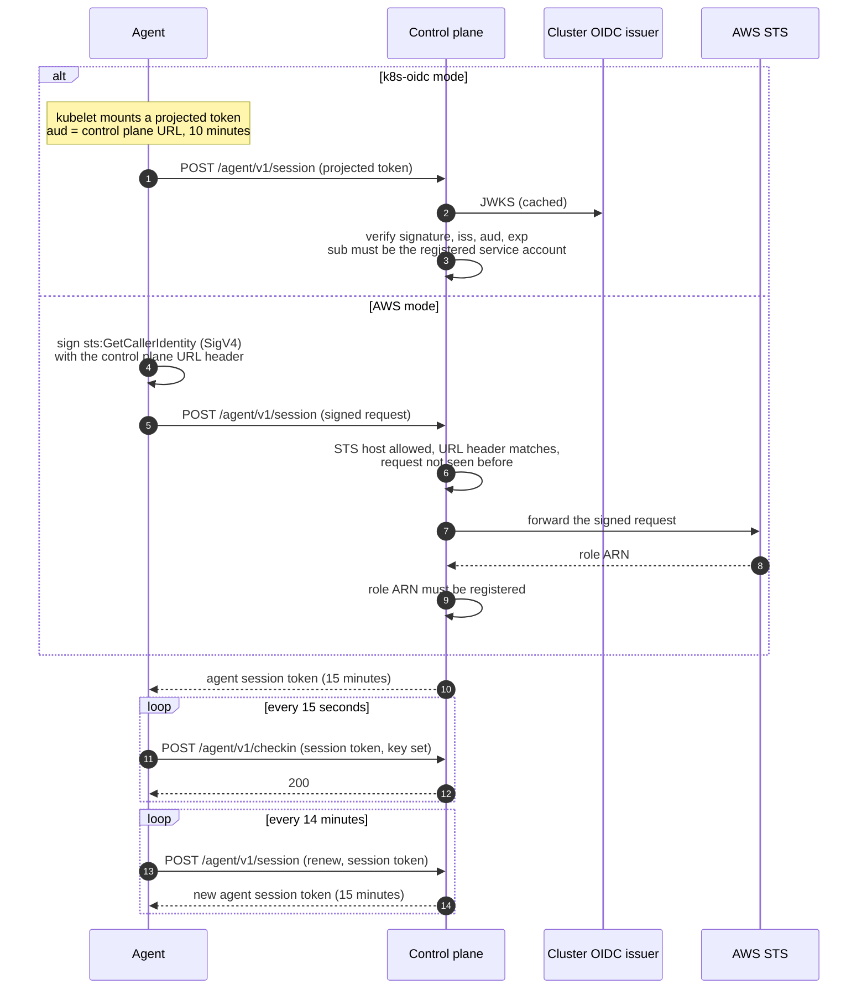
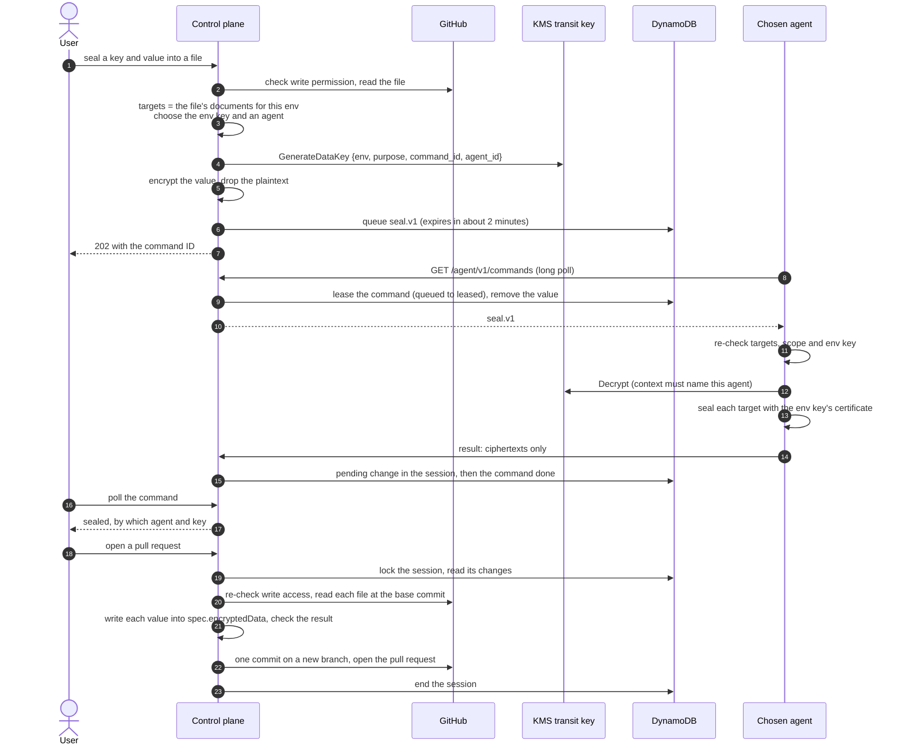
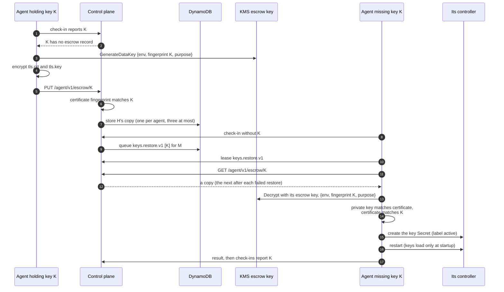

# Design

This document describes v1 of k8s-sealed-secrets-sealer: a control plane and a
set of per-cluster agents that let people seal values into
[Sealed Secrets](https://github.com/bitnami-labs/sealed-secrets) files in
GitHub, and that keep the sealing keys of every cluster in an environment in
sync.

## 1. Goals and non-goals

Goals:

- **One URL, no clusters to pick.** A person sealing a value opens the
  control plane's URL, one per environment (`sealer.dev.example.com`) or one
  for several (`sealer.example.com/prod/...`, section 15), picks a
  repository and a file, and enters a key and a value. They never pick a
  cluster or a region.
- **Every cluster in an environment can decrypt every value sealed for that
  environment.** The system keeps the clusters' sealing keys in sync and only
  seals with a key that every cluster already holds.
- **No inbound access to clusters.** Agents make outbound HTTPS calls only.
- **The control plane can never read a private sealing key,** and stored data
  never contains plaintext.
- **Runs serverless on AWS** (API Gateway and Lambda, preferred) or as a
  container on Kubernetes, from the same code. Past about 50 agents a
  container costs less (section 15).
- **Old keys can be retired.** Values sealed with older keys can be
  resealed onto the env key, a file at a time or on a schedule, so keys
  nothing uses any more can be deleted (section 16).
- **Runs and is tested locally** on a single k3d cluster.
- **Agnostic.** Annotation keys, environment, region and cluster names are all
  configuration. The project is MIT licensed.

Non-goals for v1:

- Unsealing, viewing or exporting secret values. Nothing in the system returns
  plaintext to a user.
- Cluster-wide sealing scope. It is refused everywhere (see section 6).
- Sharing keys or data across environments. Each environment has its own
  sealing keys, KMS keys, agent registry and DynamoDB table, whether it has a
  control plane of its own or shares one URL with others (section 15).
- Rotating values. Resealing moves a value onto the env key without
  changing it (section 16); a value whose key may be exposed must be sealed
  again with a new value.
- Non-GitHub source control.

## 2. Concepts and terms

| Term          | Meaning                                                        |
| ------------- | -------------------------------------------------------------- |
| Env           | A set of clusters that hold the same sealing keys, such as     |
|               | `dev` or `prod`. Each env has its own sealing keys, KMS keys,  |
|               | registry and table. A control plane serves one env, or several |
|               | on one URL (section 15).                                       |
| Region        | A label for where a cluster runs, such as `use1` or `use2`.    |
|               | A value that differs by region is sealed into only its         |
|               | regions' documents (section 6), and an agent there is          |
|               | preferred.                                                     |
| Cluster       | A Kubernetes cluster running one sealed-secrets controller and |
|               | one agent. Named by region and cluster, e.g. `use1/blue`.      |
| Agent         | The process in each cluster. It reports the controller's keys, |
|               | seals values and syncs keys. It only makes outbound calls.     |
| Control plane | The service behind the env's URL, which several envs may       |
|               | share. It serves the UI, talks to GitHub, queues commands for  |
|               | agents and stores state in DynamoDB. It has no Kubernetes      |
|               | client.                                                        |
| Sealing key   | An RSA key pair the controller stores as a Secret labeled      |
|               | `sealedsecrets.bitnami.com/sealed-secrets-key=active`.         |
| Fingerprint   | The controller's own key identifier: the SSH-style SHA-256     |
|               | fingerprint of the public key (`SHA256:<base64>`), computed    |
|               | with sealed-secrets' `crypto.PublicKeyFingerprint`. It depends |
|               | only on the key, so a reissued certificate keeps it, and it    |
|               | matches what the controller logs.                              |
| Key set       | Every sealing key one controller holds. A controller decrypts  |
|               | with any key in its set.                                       |
| Env key       | The newest key (by certificate `NotBefore`) held by every      |
|               | registered cluster in the env. Every seal uses the env key.    |
| Escrow        | The KMS-encrypted copy of every sealing key, stored in         |
|               | DynamoDB. Agents sync keys to each other through it.           |
| Reference     | A value in a SealedSecret a cluster's controller watches,      |
|               | sealed with a given key. Agents with `cleanup` count them, and |
|               | a key with any cannot be deleted (section 10).                 |
| Reseal        | Moving a sealed value onto the env key without changing it:    |
|               | an agent wraps its one-time key again for the env key, under   |
|               | the same label (section 16).                                   |

## 3. Architecture

```
  Browser
     │ HTTPS
     ▼
  CloudFront + WAF (sealer.dev.example.com)
     │
     ▼
  API Gateway (HTTP API) ◄─────────────── agents (below)
     │
     ▼
  Lambda: control plane ────────────────► GitHub App (read files, open PRs)
     │        │
     │        └─────────────────────────► KMS transit key (GenerateDataKey)
     ▼
  DynamoDB: agents, keys, escrow, commands, sessions

          HTTPS to /agent/v1/*, always opened by the agent
     ┌───────────────────────┬───────────────────────┬──────► API Gateway
     │                       │                       │
┌────┴─ use1/blue ──┐   ┌────┴─ use1/green ─┐   ┌────┴─ use2/blue ──┐
│  agent            │   │  agent            │   │  agent            │
│    │ Kubernetes   │   │    │ Kubernetes   │   │    │ Kubernetes   │
│    │ API          │   │    │ API          │   │    │ API          │
│    ▼              │   │    ▼              │   │    ▼              │
│  sealed-secrets   │   │  sealed-secrets   │   │  sealed-secrets   │
│  controller       │   │  controller       │   │  controller       │
└───────────────────┘   └───────────────────┘   └───────────────────┘

  Agents also call KMS directly: transit Decrypt (their own commands only)
  and the escrow key. Controllers never talk to the control plane.
```

The same picture, rendered:


**Control plane.** One Go binary with two entry points that serve the same
router:

- `cmd/lambda`: the preferred mode. API Gateway HTTP API invokes Lambda.
  CloudFront and WAF sit in front. The UI is embedded in the binary and
  CloudFront caches its hashed assets.
- `cmd/server`: a plain HTTP server for running as a container, for example
  on Kubernetes. It contains no Kubernetes client and knows nothing about the
  cluster it runs on. Locally this is the mode that runs in k3d.

An env serves every cluster in it, in every region and AWS account. Where
the control plane runs is unrelated to which clusters it serves: a control
plane in `use2` of a tools account serves clusters in `use1` and `use2` of
other accounts. One control plane serves one env or, optionally, several
envs on one URL (section 15, "Several envs on one URL").

**Agent.** One Deployment per cluster (`cmd/agent`), outbound only, with no
Ingress and no Service. It checks in on a timer, long-polls for commands, and
talks to its own sealed-secrets controller through the Kubernetes API.

**DynamoDB.** The only data store, one table per env. It holds agent state,
the key inventory, escrowed keys, queued commands and user sessions
(section 11). It is the broker for key sync, so its backups also back up the
keys. The audit trail is the structured logs, not the table (section 11).

## 4. Agent identity

Agents are registered ahead of time. The registry is part of the control
plane's configuration, managed with infrastructure as code. There is no
enrollment API and no self-registration: an identity that is not in the
registry is rejected. A registry entry holds the agent ID, region, cluster
name, enabled capabilities it may use, and exactly one identity:

**AWS mode.** Each agent has its own IAM role, attached to its service account
with EKS Pod Identity or IRSA. To log in, the agent signs an
`sts:GetCallerIdentity` request with SigV4, including a header that names the
control plane's URL, and sends the signed request (not credentials) to
`POST /agent/v1/session`. This is the same exchange Vault's AWS auth method
uses. The header is `X-K8s-Sealed-Secrets-Sealer-Audience`. The control
plane:

1. checks that the request is a POST of exactly
   `Action=GetCallerIdentity&Version=2011-06-15` over https to an allowed STS
   host, with no query string: by default `sts.amazonaws.com` and the
   regional hosts of known AWS regions, or an explicit list (for a region it
   does not know). The request goes to the URL the control plane holds
   for that host, never to the URL as sent, so it can't be made to call
   anything else;
2. accepts only the headers a signed STS call needs (`Authorization`,
   `X-Amz-Date`, `X-Amz-Security-Token`, `Content-Type` and the audience
   header), each once: a name given twice, in any mix of case, is refused,
   so the checks and STS can't read different copies. It requires the
   audience header to equal its own URL and to be among the signed headers,
   and the signature date to be within 15 minutes of now;
3. forwards exactly the headers it checked to STS, never following a
   redirect, and maps the returned assumed-role ARN to a registered agent;
4. records a hash of the forwarded signature only after STS accepted it (so
   forged requests can't fill the table) and rejects any later use of it;
   the record outlives the signature's validity window.

Anyone can send a request that passes the first two steps, so calls to STS
are limited per env and process. Each source address (an IPv6 address by
its /64) may make 20, then one every 5 seconds, so one source cannot use up
the calls; a login that succeeds gives its source's call back, so agents
behind one NAT gateway do not use up theirs. Overall there is a burst of
100, then one a second, which lets a whole fleet log in at once after a
restart. Agents renew their sessions without STS (below), so they call it
when they start or their session lapsed, and twice a day. Past a limit a
login gets 429, logged as `agent.login_throttled`, and the agent tries
again later. The address is the one the control plane sees: on Lambda, API
Gateway's source IP, which is CloudFront's when CloudFront is in front. A
private address, such as a load balancer's in front of a container, is one
every agent would share, so it has only the overall limit.

STS reports an assumed role without the role's path, so a role is matched by
partition, account and name, which IAM keeps unique per account. A registry
entry can also pin the role's unique ID (`AROA...`), so a role that is deleted
and recreated with the same name is not accepted. Every check except STS's
signature verification happens before anything is sent to STS.

The agent needs the same role for KMS anyway, so each agent has one identity.

**k8s-oidc mode.** The agent sends a projected service-account token with the
control plane's URL as its audience and a 10-minute lifetime (the kubelet
rotates it). The control plane verifies it against the registered cluster's
OIDC issuer (signature via the issuer's JWKS, `iss`, `aud`, `exp`) and requires
`sub` to equal the registered `system:serviceaccount:<namespace>:<name>`. An
issuer is registered with its JWKS URL, and a CA bundle when that URL's
certificate is not publicly trusted, or with a JWKS file holding its keys
when the control plane cannot reach it. A remote JWKS is fetched on first
use and again when a token names a key it lacks, as issuers rotate keys, but
at most once every 30 seconds per issuer: anyone can send a token naming an
unknown key. This mode is used locally and by anyone running outside AWS.
[docs/deployment.md](deployment.md) shows the registry for both modes.

**Registry changes.** A registry in a file or an SSM parameter is read
again about once a minute, with the JWKS and CA files it names: a change
to any of them is a change of the registry. The read starts on a request
rather than a timer (a Lambda instance is frozen between requests) and
runs beside it, never in a request's time, which stays the handler's own;
requests use the registry in force until the read is done, within 5
seconds. On Lambda, a read still running when its request ends is frozen
with the instance and goes on with its next request; one thawed after its
time ran out is started again. A change takes effect for logins, sessions
and the fleet at once, so removing an agent revokes it within about a
minute, without a restart. A registry that cannot be read or is invalid is
ignored: the one in force stays, and `registry.reload_failed` is logged. A
registry given inline in an environment variable changes only with a
restart.

In both modes a successful login returns a short-lived agent session token
(15 minutes), scoped to the agent API and bound to the agent as the
registry has it: its ID, its identity and its capabilities, as a hash.
Every other agent call carries it, and is refused once the registry no
longer has the agent that way, so a registry change that gives an ID
another identity or more capabilities ends its sessions. A minute before
its session ends, the agent renews it with itself
(`POST /agent/v1/session` with method `renew` and the session as its bearer
token): no identity is sent and nothing is asked of STS or an issuer. A
session also carries when the agent last logged in with its identity, and
renewal carries that over; once it is 12 hours old, renewal is refused. So
a session taken from an agent lasts 12 hours at most, and each agent proves
its identity twice a day: for aws-sts two STS calls, far inside the limits
above, and few moments for someone emptying them to catch it at. The agent
logs in with its identity when it starts, when its session lapsed, or when
the control plane refuses to renew it, as one that predates renewal does.
If that login is throttled, it goes on with the session while it lasts.



## 5. Command protocol

The control plane never connects to an agent. Agents call:

| Call                                   | Purpose                             |
| -------------------------------------- | ----------------------------------- |
| `POST /agent/v1/session`               | Log in, or renew (section 4).       |
| `POST /agent/v1/checkin`               | Report state on an interval.        |
| `GET  /agent/v1/commands?wait=20`      | Long-poll for queued commands.      |
| `POST /agent/v1/commands/{id}/result`  | Report a command's outcome.         |
| `PUT  /agent/v1/escrow/{fingerprint}`  | Upload an escrowed key.             |
| `GET  /agent/v1/escrow/{fingerprint}`  | Download an escrowed key.           |

Every call names the agent's env in the `X-K8s-Sealed-Secrets-Sealer-Env`
header, from its Helm values (section 8). A control plane serving several
envs sends the call to that env, whose registry must know the agent; it
answers `400` to a call that names no env and `404` to an env it does not
serve. One serving a single env also accepts a call without the header.

A check-in carries the agent version, the protocol version it speaks, the
command types it supports, its capabilities, its controller's settings
(namespace, key renew period, key order priority) and its key set:
fingerprint, `NotBefore`, `NotAfter` and certificate for every key. An
agent with the `cleanup` capability adds its latest count of references
(`key_usage`): when it finished, the namespaces its controller watches,
how many SealedSecrets and values it counted, how many values no key in
the cluster decrypts, and for each key that seals any the values and
SealedSecrets it seals; or why the count failed. The
agent's check-in interval (15 seconds by default, 5 seconds to 5 minutes)
comes in the `X-K8s-Sealed-Secrets-Sealer-Check-In-Interval` header, in
whole seconds. It is a header because control planes before v0.6.4 refuse a
check-in with a field they do not know, but ignore a header; one that
predates the header takes the agent to check in every 15 seconds.

Commands are typed and versioned: `seal.v1`, `keys.restore.v1`,
`renewal.enable.v1`, `keys.delete.v1`, `reseal.v1`. Each has an ID (a
ULID), the target agent ID, the env, a creation time, an expiry and a typed
payload. The rules:

- **Fixed command set.** The agent has a handler per type compiled in. There is
  no generic exec, apply or proxy command. An unknown type or a payload that
  fails validation is reported as failed and not acted on.
- **Only its own commands.** An agent can lease, read and report results only
  for commands addressed to its own ID.
- **Single use.** Leasing a command is a conditional write from `queued` to
  `leased`. A command is delivered at most once. If the agent dies before
  reporting, the command expires and the user retries. Key commands are
  idempotent and the control plane re-issues them when it sees the gap again.
  On shutdown the agent starts no new poll, but the poll in flight and the
  commands it leased still run and are reported, within 45 seconds. Those
  still unfinished then are reported as failed within 10 more seconds, so
  their work can be issued again without waiting for them to expire; the
  chart's `terminationGracePeriodSeconds` (60) leaves room for both.
- **Expiry is enforced in code.** DynamoDB TTL deletion is eventual, so the
  control plane and agent both refuse expired commands; TTL only cleans up.
  The agent measures expiry in the control plane's time, from the `Date`
  header of its responses, so a clock that is off does not expire commands.
  It neither runs nor reports a command that expired before it ran, and
  drops the result of one that expired while it ran, since the control
  plane would refuse those results.
- **Results are accepted once,** only from the leasing agent and only before
  expiry. The agent retries a result while the control plane cannot be
  reached or answers with a server error, until the command expires.
- **Long-poll within API Gateway limits.** The control plane holds a poll for
  up to 20 seconds, under the API Gateway integration timeout, checking
  DynamoDB for new commands in the meantime. Each check reads only the
  commands queued in the last 11 minutes (the longest a command lives, and a
  minute for clocks), a range of command IDs, not every command kept. The
  cost is roughly one held Lambda invocation per agent
  ([docs/operations.md](operations.md#cost-and-scale) has the numbers). An
  API Gateway WebSocket API is a possible later optimization; the protocol
  does not depend on the transport.
- **A leased command is sent.** A command leased into a response that is
  never written is lost until it expires. A poll ends within 25 seconds,
  store calls included, and leases a command only while 3 seconds are left to
  respond. One poll leases at most 16 commands and 512 KiB, well within what
  agents read (8 MiB, and 1 MiB up to v0.6.2) and Lambda returns; the rest
  wait for the next poll. If a lease fails after others, the poll still
  sends those. A `reseal.v1` payload, up to 320 KiB, is kept in an item of
  its own and read only for a command about to be leased, so the reads of
  an agent's recent commands, every poll and seal makes, do not read it.
- **Capabilities come from the agent's Helm values,** never from the control
  plane. Values decide which RBAC is installed and which handlers the agent
  enables. An agent refuses a command for a capability it does not have, and
  RBAC would stop it anyway.

| Capability | Commands                               | Default |
| ---------- | -------------------------------------- | ------- |
| `seal`     | `seal.v1`                              | on      |
| `keys`     | `keys.restore.v1`, escrow upload       | off     |
| `renewal`  | `renewal.enable.v1`                    | off     |
| `cleanup`  | `keys.delete.v1`, counting references  | off     |
| `reseal`   | `reseal.v1`                            | off     |

`keys` and `renewal` are off by default because they grant access to the
sealing keys and to the controller Deployment. Key sync, which most
multi-cluster envs need, works only on agents where an operator turned them
on. `cleanup` needs `keys`, and is off by default because it reads
SealedSecrets in every namespace and deletes key Secrets. `reseal` needs
`keys` too, whose key Secrets it opens values with, and adds no RBAC; it is
off by default because it uses the cluster's private keys for the control
plane (section 16). An agent may have none (`APP_CAPABILITIES=none`, which
the chart sets when all are off): it still checks in, reporting its
controller's active key.

The only command that deletes anything is `keys.delete.v1`, and an agent
refuses it for a key that any value in its cluster is sealed with
(section 10).

**Compatibility.** Messages change without breaking the other side:

- The control plane ignores fields it does not know in what agents send
  (logins, check-ins, results, escrow uploads), and agents ignore them in
  responses. Either side can add a field the other can do without. Control
  planes before v0.6.4 refuse a field they do not know in what agents send.
- Command payloads are strict: an agent refuses a payload with a field it
  does not know. A changed payload is a new command type, such as `seal.v2`.
  The control plane sends a type only to agents whose check-in lists it, so
  agents not yet upgraded keep getting the old one.
- A check-in may list the protocol versions the agent speaks in
  `protocols`; `protocol`, the one version agents name today, is still
  accepted beside it or alone. The control plane uses the newest version both
  speak, and refuses a check-in with none.

**Upgrades.** Upgrade the control plane first, then the agents, cluster by
cluster. Across versions:

- **Older agents.** A control plane supports agents up to one minor version
  behind it: it still speaks their protocol version, and sends them only the
  command types their check-ins list.
- **Newer agents** work with an older control plane only where they added
  nothing it must understand, such as a field or header it can ignore. A
  new protocol version, capability or `key_order_priority` value is
  refused, a command type the control plane does not know is never sent,
  and a control plane before v0.6.4 refuses any field it does not know.
  A control plane that predates session renewal answers `400` to it, and
  the agent logs in with its identity instead, as it did before.

## 6. Seal flow

1. A signed-in user with write access opens a session for a repository. A
   session is based on the head of the default branch the user is looking
   at: if the branch has moved since the page loaded, opening is refused and
   the page reloads. A user has at most one open session per repository and
   at most 10 in each env.
2. The user picks a file and submits a key and a value. The control plane
   re-checks the user's write permission on the repository, reads the file
   through the GitHub App at the session's base commit, and finds every
   SealedSecret document in it whose env annotation equals this env. One seal
   updates all of them, so a file with documents for `use1` and `use2` is
   sealed once. A seal may name regions instead, for a value that differs by
   region: it then updates only the documents whose regions are all named
   (see "Region-specific values" below). Each document sealed for
   contributes a target: namespace, name, scope and regions.
3. Scope comes from each document's own sealed-secrets scope annotations, the
   same place the controller reads it. `strict` and `namespace-wide` are
   allowed. `cluster-wide` is refused, because such ciphertext can be decrypted
   into any namespace by anyone able to create a SealedSecret. A file with any
   document that cannot be sealed into is refused as a whole.
4. The control plane chooses the env key and an agent (section 7).
5. It encrypts the value immediately with the **transit** KMS key: a data key
   from `GenerateDataKey` encrypts the value with AES-256-GCM, and the stored
   payload is the wrapped data key, nonce and ciphertext. The encryption
   context is `{env, purpose: seal, command_id, agent_id}`. The plaintext
   value and the data key are then dropped. The value is never logged, and
   request bodies are never logged.
6. It writes a `seal.v1` command (targets, secret key name, env key
   fingerprint) with an expiry of 2 minutes, storing the encrypted value
   beside the payload rather than in it, and returns `202` with the command
   ID. The UI polls the seal's status every second: queued, sealing, sealed,
   failed or expired, or superseded when newer seals of the key replaced
   the value in the session.
7. The agent leases the command. Leasing removes the encrypted value from the
   stored command, so it reaches the agent once. The agent re-validates the
   command itself: valid key name, namespace and name present, scope `strict`
   or `namespace-wide` (never `cluster-wide`), and the env key fingerprint in
   its own controller's key set, read again for this seal. It decrypts the
   value with KMS using the same encryption context, with its own env and ID
   and the command's ID, seals each target in process with that key's
   certificate, and returns only the ciphertexts.
8. The control plane checks the result (one ciphertext per target, in order,
   with the requested key) and records the ciphertexts as a pending change in
   the session before it marks the command done, so a sealed value always has
   its change. There is one pending change per file, key and regions:
   sealing the same key into the same file for the same regions again
   replaces it, and a seal that finishes late never replaces a newer one.
   Changes of one key for different regions can overlap; the newest wins for
   each document, and a change one newer change covers entirely is removed.
   The UI shows which agent and key sealed it. Users never see ciphertext.
9. When the user opens a pull request, the control plane locks the session,
   so nothing is sealed into it or removed from it meanwhile and it opens one
   pull request at most. It refuses while one of the session's seals is still
   running, and re-checks the user's write access.
10. It reads each file again at the session's base commit, checks that the
    file's documents for the env (in its regions, for a regional value) are
    still exactly the targets each value was sealed for, and writes the
    values in, in the order they were sealed, editing only
    `spec.encryptedData.<key>` in each targeted document. Values are replaced
    where they are written and new keys get a line of their own, so names,
    namespaces, annotations, comments, formatting and other documents stay
    byte for byte as they were. The result is checked by decoding it: it
    must equal the original with exactly those values set. A file that
    cannot be edited that precisely (YAML anchors in `spec.encryptedData`,
    say) is refused rather than reformatted.
11. One commit on a new branch from the base commit,
    `sealer/<env>/<login>-<session id>`, carries every file, and a pull
    request into the default branch proposes it. The branch name is unique
    to the session, so a session has one pull request at most. An attempt
    can fail part way, or GitHub can act and its answer be lost; trying
    again keeps the branch when it holds the same files and moves it to the
    new commit otherwise, and returns the pull request already open from
    it, with its title and description brought up to date. It moves the
    branch only from the App's own commit on the base commit: when someone
    else has pushed to it, a reviewer say, it is left alone and the user is
    told to change the pull request on GitHub or start a new session. The
    App makes
    the commit without an author, so GitHub signs it. The commit (a
    `Requested-by:` trailer) and the pull request (a mention) record who
    requested it; they name files, keys and documents, never values or
    ciphertexts. The session then ends. Opening the pull request is given
    20 seconds and ending or unlocking the session 3 more, within the 30
    that API Gateway gives a request.



**Transit key permissions.** The control plane may only call
`GenerateDataKey` on the transit key; it cannot decrypt. Each agent role may
call `Decrypt` only when the encryption context's `agent_id` equals the
agent's own ID, enforced by a key policy condition. The control plane's code
reflects this: its transit client interface has no decrypt method. So
DynamoDB, its backups and logs never hold anything the control plane could read
back, and one agent cannot read another agent's seal payloads.

**Agents seal with certificates from their own cluster.** The certificate comes
from the agent's own controller key set, never from the command. A control
plane cannot make an agent encrypt to a certificate the cluster doesn't hold.

**Why not encrypt in the browser.** The control plane serves the UI's
JavaScript. An attacker who controls the control plane can serve a page that
sends the value elsewhere, so browser-side encryption would only add protection
against passive leaks, which encrypt-on-receipt and the no-logging rule already
cover. This is a choice and can be revisited.

**Value size.** A single value is capped at 64 KiB, and a seal's value plus
1 KiB per target document at 224 KiB, so all of a seal's ciphertexts fit in
one DynamoDB item (400 KB). A 64 KiB value can go to three documents; a value
of a few KiB, to dozens. Larger values would need S3 and are out of scope for
v1.

**Region-specific values.** Some values differ by region: a regional
endpoint's credentials, a certificate per region. A seal can name the
regions it is for, and goes only into the file's documents whose regions
are all named, so one file can hold a different value for each region:

- Each region named must be a region of a document in the file; naming
  every region is sealing for every document. Documents without a region
  annotation are sealed for only when no region is named.
- A document can list several regions (a Kustomize base deployed to each
  of them, section 13). Those regions share the document, so its value
  cannot differ between them: a file with such a document is sealed for
  every document, and a seal naming only some of its regions is refused
  (422). Files Kustomize keeps per region, one region each, are sealed as
  any other file.
- The agent is chosen for the regions named, or the documents' regions
  when none is named (section 7).
- A key's pending changes may overlap, such as one for every document
  followed by one for `use1`. For each document, the newest seal wins:
  `use1` gets the second value and the rest keep the first. Removing the
  `use1` change brings the first value back there. A change one newer
  change covers entirely is removed; one that newer changes only cover
  between them stays, so removing either brings it back where that one
  applied.
- A document is identified by its place in the file, since copies of a
  secret in several regions often share a namespace and name.
- The pull request names each change's regions and the documents it ends up
  setting.

The UI shows, for a file whose documents name regions, where each key stands per
region, even with one region or one document listing several. When the documents
are in more than one region and none lists several, it lets a seal be limited to
some regions or started from a region of a key; otherwise it shows the regions
without a choice, and says why. A key a region does not need is not marked
missing there when that region's documents have the keys hint (section 13) and
it leaves the key out: list a region-only key in only that region's documents'
hint.

**Routes.** Each env's API is under `/api/v1/envs/{env}`, written `{api}`
below; with a single env it is also at `/api/v1` (section 12). Every route
needs a signed-in user whose session grants the env, and every write the
CSRF token (section 12). `.../session` is
`{api}/repos/{owner}/{repo}/session`.

| Route                                  | Purpose                             |
| -------------------------------------- | ----------------------------------- |
| `GET {api}/sessions`                   | The user's open sessions, with how  |
|                                        | many pending changes each has.      |
| `GET .../session`                      | The user's open session for the     |
|                                        | repository and its pending changes, |
|                                        | or null.                            |
| `POST .../session`                     | Open a session at `commit`, the     |
|                                        | head the user saw.                  |
| `DELETE .../session/{id}`              | Discard the session.                |
| `POST .../session/{id}/seals`          | Seal `value` as `key` into the file |
|                                        | at `path`, or only into its         |
|                                        | documents in `regions`; answers     |
|                                        | `202`.                              |
| `GET .../session/{id}/seals/{seal}`    | A seal's progress.                  |
| `DELETE .../session/{id}/changes/{id}` | Remove one pending change.          |
| `POST .../session/{id}/pull-request`   | Open a pull request with the        |
|                                        | pending changes; ends the session.  |

The repository's files at a session's base commit come from
`GET {api}/repos/{owner}/{repo}/files?commit=<sha>`. It lists the base
commit of the user's own session or the head of the default branch, and no
other commit.

## 7. Key selection and agent selection

On every check-in, each agent reports its controller's full key set (public
certificates only). From those reports the control plane computes:

- **Clusters in scope:** every registered agent in the env. A cluster
  that is temporarily down still counts, using its last reported key set,
  because it will still have to decrypt what is sealed now. A registered agent
  that has never checked in is ignored and flagged in the UI. A cluster leaves
  scope only when it is removed from the registry.
- **Env key:** the key with the newest `NotBefore` that is in every in-scope
  cluster's key set. Certificates have one-second precision, so keys made in
  the same second tie; the tie goes to the greater fingerprint, so the env
  key never depends on the order agents report in.
- **Keys left out:** a key an admin revoked (or deleted), and a key whose
  `NotBefore` is more than an hour ahead of the control plane's clock, are
  never the env key, never count as held, are never missing anywhere and
  are never restored. A future-dated key is used once its time comes; the
  fleet view flags it, and `key.future_dated` is logged. Without this
  bound, anyone who can create a Secret in one controller namespace could
  plant a key dated 2099 that would become the env key everywhere and
  outrank every renewal.
  When every key the clusters share is left out, there is no env key and
  nothing to restore: sealing waits for a new key, and the fleet view and
  status say so.
- **Joining clusters:** a cluster that just joined the env, or was rebuilt
  (its whole key set changed), reports only its controller's fresh key.
  For up to 30 minutes after it joined, it is left out of the env key while
  restore gives it the env's keys, if its agent has the `keys` capability
  and can tell that its controller orders keys by `NotBefore` (it refuses
  to restore otherwise), and the newest key the other clusters share is
  escrowed. Its own key is not the env key meanwhile, and it does not seal,
  since it lacks the env key. The 30 minutes cover a restore (a check-in, a
  command and a controller restart, about a minute), a key command that
  expires unleased (10 minutes) and two retries after failures, 5 minutes
  apart. After that, or when it cannot restore, it counts again, and the
  fleet view says it holds back the env key. The first clusters of an env
  have no one to catch up with, so they are never joining.

To choose the agent for a seal:

1. Candidates are agents that are healthy (checked in within three of their
   check-in intervals, and at least 45 seconds, so a short interval does not
   make an agent unhealthy while its controller restarts; an agent that does
   not report its interval is taken to have the default 15 seconds), have
   the `seal` capability, support `seal.v1`, and hold the env key.
2. Prefer an agent in a region named by the target documents' region
   annotations.
3. Then prefer the agent with the fewest commands in flight, then the most
   recent check-in.
4. If no key is held by every in-scope cluster, refuse with "keys out of sync"
   and name the clusters missing keys. Sync (section 8) normally closes the gap
   within a few check-ins. If no cluster is missing a key, every key they
   share is revoked or future-dated: refuse with "no usable sealing key", as
   a new key is needed.


The agent seals with the env key's certificate, which is not necessarily its
controller's newest key. This handles the cases that matter:

- A controller that just generated a key keeps advertising it as its newest,
  but it is not used until every cluster holds it.
- An agent that is down is skipped; any other agent holding the env key seals.
- A new cluster joins with its own fresh key. It is joining, so the env key
  stays the same while sync gives it the existing keys, and until its own key
  has reached every cluster.

An agent without the `keys` capability cannot read key secrets, so it reports
only its controller's active certificate (from `/v1/cert.pem`) as its key set.

## 8. Key escrow and sync

Agents sync keys to each other through DynamoDB, using a dedicated **escrow**
KMS key:

| Principal     | Escrow key permissions                                  |
| ------------- | ------------------------------------------------------- |
| Agent roles   | `GenerateDataKey`, `Decrypt`                            |
| Control plane | none                                                    |
| Admins        | none, except a separate break-glass role                |

The encryption context is `{env, fingerprint, purpose: key-escrow}`. Key
secrets are larger than the 4 KB limit of KMS `Encrypt`, so escrow uses
envelope encryption: a data key from `GenerateDataKey` encrypts the key
secret's `tls.crt` and `tls.key` with AES-256-GCM, and the escrow record
stores the wrapped data key, nonce and ciphertext next to the public
certificate. The encryption context is both the KMS encryption context and
the GCM additional data. An agent's env comes from its Helm values, not from
the control plane: it names that env on every request (the
`X-K8s-Sealed-Secrets-Sealer-Env` header), and refuses to log in to a
control plane that answers for another env.

**Upload.** Each check-in response lists the agent's keys it should escrow
(`escrow_needed`), for agents with the `keys` capability: those it has not
escrowed a copy of, while the key has fewer than three copies, and at most
20 a check-in of keys that have one already. Revoked and future-dated keys
are left out. The agent first checks each key Secret as a restore would
(step 2 below), so a key the controller could not use is never uploaded,
then encrypts and uploads it. The control plane parses the public
certificate, checks that its fingerprint matches the URL, that the agent's
latest check-in reported that key, and that the envelope's context is this
env and key, and stores the copy with a conditional write: one copy per
agent, three at most, never replaced. It can check the certificate but
cannot read or verify the private key, so a copy may not open: an agent
with `keys` can report another cluster's certificate (certificates are
public) and upload anything under it. That is why a key keeps copies from
up to three agents, and why restores try them in turn. `key.escrowed` is
logged for a key's first copy and `key.escrow_copied` for the others, each
naming the uploader. Fingerprints are base64, which can contain `/`, so in
URLs they use the URL-safe alphabet (`+` as `-`, `/` as `_`).

**Restore.** When an in-scope cluster's agent checks in missing an escrowed
key, the control plane queues `keys.restore.v1` for that agent with the
missing fingerprints, newest first, 100 at most per command. It queues one
at a time: none while the agent's last is open, or finished less than 2
minutes ago (5 after a failure), since each ends in a controller restart.
It sends none to an agent that cannot tell its controller's key order,
which would refuse it; the fleet view says so. A download returns one
copy: the first that agent's restores have not found bad. A failed restore
names the copy it tried and whether the copy was at fault (it did not
open, or its private key is not the certificate's); a Secret the agent
could not create says nothing about the copy. A failure that names no
copy, from an older agent, moves the agent on to the next copy, as before.
Only the agent's own results of the last hour count, read once per
restore, so no agent can steer another away from a good copy. A revoked
key, deleted or not, is not returned. The agent, for each one not
already present (a key Secret with that fingerprint under any value of the
key label counts, so a key relabeled, for example as `compromised`, is
never brought back):

1. downloads the escrow record and decrypts it with KMS, naming its own
   configured escrow key and the expected context (neither is taken from the
   record, so a record made under another key or for another env or key does
   not open);
2. reads the private key and certificate as the controller does (the first
   private key it can parse, which must be RSA, and the first
   certificate), and checks that the private key matches the certificate and
   the certificate's fingerprint matches the one requested;
3. creates a `kubernetes.io/tls` Secret in the controller namespace with the
   controller's key name prefix (its `--key-prefix`) and the label
   `sealedsecrets.bitnami.com/sealed-secrets-key=active`, annotated with
   `sealer.cruxstack.io/fingerprint`,
   `sealer.cruxstack.io/restored-from: escrow` and the time.

After restoring the missing keys, the agent restarts the controller. This is
required: the controller lists key secrets only at startup
(`initKeyRegistry`) and does not watch for new ones. It deletes the
controller's pods that were created before the newest restored key's Secret,
and their Deployment starts new ones; with one replica the controller is
unavailable for the few seconds its new pod takes to start. With several,
it deletes one pod at a time, each once the pod that replaced the last is
ready. A pod counts as the controller's only when the Deployment owns its
ReplicaSet, so another workload's pods that the Deployment's selector
happens to match are never deleted, nor taken as proof that a key loaded.
Deleting pods needs no write access to the Deployment. A delete is not an
eviction, so the controller's PodDisruptionBudget does not hold it back.
Before deleting anything, the agent checks that every key Secret would
load, since a new pod stops at one that does not. The agent refuses the
whole command if its controller orders keys by `SecretCreationTimestamp`,
or if it cannot tell how it orders them.

A restored key counts as held only once the controller has loaded it: when
every ready controller pod was created after the key's Secret (in a later
second, as creation times are whole seconds), or when the controller seals
with it. Until then the agent leaves it out of its check-ins and does not
seal with it, so it cannot become the env key while this cluster could not
decrypt with it. When the agent cannot tell, because the controller's
Deployment or pods cannot be read or none of its pods is ready (as while it
restarts), it skips that check-in rather than leave out keys the controller
loaded long ago. If the restart failed or never happened, the agent retries
it at each check-in, whether or not the control plane answers, backing off
from 30 seconds to 10 minutes, and a repeated restore command retries it
too. While a restore runs, the check-in loop leaves restarts to it, so the
controller restarts once for the whole restore. While the controller
restarts, the agent seals with the keys it reported last.

Key commands expire after 10 minutes. The control plane does not queue a
restore for a key that an open restore command already covers, nor for 2
minutes after one succeeded (until the agent's next inventory shows the key;
`APP_KEY_COMMAND_SETTLE`, from 10 seconds to 10 minutes) or 5 minutes after
one failed. A key that a restore found already in the
cluster while the agent still does not report it, because it is held under
another label or the controller has not loaded it, is not restored again
for an hour, and the fleet view says so in the agent's issues. Each
decision is about the agent that is checking in, and an agent checks in
serially, so concurrent check-ins from different agents cannot queue
duplicate commands. Each check-in plans with its own new state and every
other agent's latest, read afresh. A deleted key an admin reinstates
(section 10) may be in no cluster any more, so for 7 days every in-scope
cluster without it counts as missing it, and restore brings it back from
escrow.



**Key order.** The controller orders keys by `--key-order-priority`, which
defaults to `CertNotBefore`. With that default a restored key keeps its place
in the order, so the newest key is the same in every cluster. The exception
is keys made in the same second, such as by clusters created together: each
controller breaks the tie its own way and may keep its own key as active.
That is harmless, because sealing uses the env key and every cluster holds
every key, and the next renewal produces a key that is newest everywhere.
With `SecretCreationTimestamp`, a restored old key would become a
controller's newest. Agents report the setting; the control plane flags any
cluster not using `CertNotBefore` and excludes it from key comparison until
fixed.

**Controller settings.** The agent reads the controller's settings from its
Deployment the way the controller does. A flag on the command line wins, and
of several occurrences the last one. Otherwise its `SEALED_SECRETS_`
variable applies (`SEALED_SECRETS_KEY_ORDER_PRIORITY` for
`--key-order-priority`). `--rotate-period` is the old name of
`--key-renew-period`. When a setting comes from somewhere the agent cannot
read, such as a ConfigMap through `envFrom`, the agent reports it as unknown
and refuses to restore keys, since it cannot tell the key order.

**Authenticity.** Only agent roles can encrypt under the escrow key, and
AES-GCM with a bound encryption context detects tampering. The control plane
can't read keys or forge escrow records. The worst it can do is withhold or
delete them. An agent's copy can still hold the wrong key; the restoring
agent's checks catch that, and another agent's copy is tried next.

**Restore is automatic,** with alerts through structured log events at `warn`
level or above:

| Event                       | When                                            |
| --------------------------- | ----------------------------------------------- |
| `key.discovered`            | A check-in reports a fingerprint never seen.    |
| `key.escrowed`              | An agent uploads a key to escrow.               |
| `key.restore_queued`        | A restore is queued for a cluster missing keys. |
| `key.restored`              | An agent restores a key into its controller.    |
| `key.restore_skipped`       | A key to restore is held under another label.   |
| `key.sync_failed`           | An upload or restore fails.                     |
| `key.escrow_refused`        | A restore asked for a revoked key.              |
| `key.order_mismatch`        | A controller does not order keys by NotBefore.  |
| `key.future_dated`          | A check-in reports a key dated in the future.   |
| `key.revoked`               | An admin revoked a key.                         |
| `key.reinstated`            | An admin reinstated a revoked or deleted key.   |
| `key.deleted`               | An admin deleted a key.                         |
| `key.remove_queued`         | A removal is queued for a cluster holding a     |
|                             | deleted key.                                    |
| `key.removed`               | An agent removed a deleted key from its         |
|                             | cluster.                                        |
| `key.remove_refused`        | An agent refused to remove a deleted key, as    |
|                             | values are sealed with it, or could not.        |
| `key.unmatched_values`      | A cluster has values none of its keys decrypts. |
| `key.delete_undone`         | A cluster counted values sealed with a deleted  |
|                             | key, which is revoked again.                    |
| `key.usage_invalid`         | An agent's count was not valid; it counts as    |
|                             | failed.                                         |
| `key.count_failed`          | An agent could not count key references.        |
| `keys.near_limit`           | A cluster's keys reach 50% or 80% of the limit. |
| `keys.truncated`            | A cluster reports more keys than are kept.      |
| `keys.out_of_sync`          | A seal was refused because no env key exists.   |
| `renewal.enable_queued`     | No cluster renews; one is asked to.             |
| `renewal.enabled`           | An agent turned on key renewal.                 |
| `controller.restarted`      | An agent restarted its controller.              |
| `controller.restart_failed` | An agent could not restart its controller.      |

The control plane's events name the env and what they are about: the agent
and cluster, the fingerprint, the user. An agent's events name its
controller and what they are about, such as the fingerprint, but not the
agent or its cluster: tell those apart by where the logs come from.
Events about a check-in (`key.order_mismatch`, `key.future_dated`,
`keys.near_limit`, `keys.truncated`, `key.unmatched_values`) are logged
once, at the check-in where the condition first shows for that agent.

**Backups.** The table has point-in-time recovery and a scheduled AWS Backup
plan. The escrow key is a multi-Region KMS key with a replica in another
region, so a backup can be restored and decrypted if a region is lost. Losing
the escrow key loses the escrowed copies, so it has deletion protection
through its key policy and the longest pending-deletion window.
[docs/operations.md](operations.md#backups-and-restore) has the restore
runbook: what in the table rebuilds itself, and what only escrow holds.

## 9. Key renewal

The controller generates a new key every `--key-renew-period` (30 days by
default; `0` turns renewal off). Two postures are supported:

- **Renewal on everywhere.** Each controller generates keys on its own
  schedule. Sync spreads them, and each becomes the env key once every cluster
  holds it. The cost is more keys over time, which deleting the keys no
  value uses keeps down (section 10).
- **Renewal on in at least one cluster.** Agents report their controller's
  renew period. If no in-scope cluster in the env is known to have renewal
  on, the control plane sends `renewal.enable.v1` to one healthy agent that
  has the `renewal` capability and can read its controller's flags, chosen
  deterministically (the lowest agent ID), at that agent's check-in but never
  its first: agents that start together check in at once, each before the
  others' states are stored, and each could take itself for the lowest. The
  agent patches its controller
  Deployment's arguments to set the configured period (`keyRenewPeriod` in
  the control plane's chart, 30 days by default), which rolls the
  controller, and logs `renewal.enabled`. The flag it sets overrides any
  variable and earlier occurrence. If renewal is already on, or the agent
  cannot read the period, it changes nothing. If the chosen agent goes down,
  the next one is asked.

**Recommended: renewal in one cluster per env.** Run every controller with
`--key-renew-period=0` (the sealed-secrets chart's `keyrenewperiod: "0"`;
the controller renews every 30 days unless told otherwise), and give the
`renewal` capability only to agents in clusters that are always up. The
control plane then turns renewal on in exactly one of them, as the local
stack does. Setting the period on one always-up controller yourself, and
`0` on the rest, works as well. A cluster that is down still counts as
renewing with its last reported period, so a cluster that runs only at
times should not be the one. Renewal in one cluster is better because:

- Sync puts every key in every cluster. With renewal on in N clusters,
  every cluster gains N keys per period instead of one: N times the keys
  to hold, report on every check-in and, once unused, delete.
- Every new key is restored into every other cluster, and each restore
  restarts that cluster's controller once. N renewing clusters cause about
  N×(N−1) controller restarts per period instead of N−1.

**Key limit.** Sync spreads every key to every cluster, so with renewal on
everywhere an env gains about 12 keys a year per cluster. The control plane
keeps track of 250 keys per cluster, the newest by `NotBefore`, keys that
are not usable (revoked, or dated in the future) last, so keys planted with
a far-off date cannot crowd out the keys in use. A check-in with more is
accepted: the oldest are left out of the agent's stored state and of key
sync, and the fleet view says so. A key no newer than the newest usable key
left out of a cluster's report is not counted as missing there, since the
cluster may hold it, so it is never restored again.
A cluster that joins later does not get keys every cluster leaves out.
`keys.near_limit` is logged when a cluster's keys reach 50% and 80% of the
limit, and `keys.truncated` once some are left out; the fleet view warns at
the same points. Renewal on in one cluster keeps an env far from the limit,
and deleting old keys no value uses (section 10) takes them out of every
cluster's count.

The limit was 100 and a check-in over it was refused, which stopped the
whole env. It is 250 now; the numbers, for 4096-bit keys:

| What                               | Per key  | At 250 keys | Bound   |
| ---------------------------------- | -------- | ----------- | ------- |
| Check-in body                      | 1.9 KB   | 465 KB      | 2 MiB   |
| Agent state item in DynamoDB       | 127 B    | 32 KB       | 400 KB  |
| Strongly consistent read of it     |          | 8 RCU       |         |

Check-ins read every agent's state, so the item's size multiplies with the
number of agents, which is the reason not to go higher. A check-in body over
2 MiB, about 1,100 keys, is still refused. A restore command names at most
100 keys, because agents built when the limit was 100 refuse more; the rest
follow in later commands, one at a time.

## 10. Security model

| Threat                | What it can do                 | Mitigations                    |
| --------------------- | ------------------------------ | ------------------------------ |
| Compromised control   | See values submitted while it  | No escrow key access; no       |
| plane                 | is compromised; queue seals    | transit `Decrypt`; agents      |
|                       | for any namespace/name in the  | refuse cluster-wide and only   |
|                       | env; open PRs through the      | use certificates from their    |
|                       | GitHub App; withhold or delete | own cluster; fixed command set |
|                       | data; lie in the UI; have      | whose one delete agents refuse |
|                       | agents delete keys no value in | for keys values use, by their  |
|                       | their clusters uses.           | own count; no inbound path     |
|                       |                                | into clusters; branch          |
|                       |                                | protection on repos.           |
| Compromised agent or  | Read that cluster's keys (as   | Inherent to cluster access.    |
| cluster               | can anyone with secret read in | Transit `Decrypt` limited to   |
|                       | the controller namespace) and  | its own commands. Every        |
|                       | so decrypt the env's secrets;  | `key.escrowed` names the       |
|                       | upload a key it generated so   | source cluster. Keys dated in  |
|                       | it becomes the env key;        | the future are not used.       |
|                       | report false key sets; escrow  | Escrow keeps a copy per agent. |
|                       | copies that do not open.       | After an incident, revoke the  |
|                       |                                | key and rotate values.         |
| Rogue agent           | Nothing.                       | Registry in IaC, identity      |
|                       |                                | verified, no self-enrollment.  |
| Stolen DynamoDB data  | Ciphertext only.               | Transit and escrow need KMS    |
| or backup             |                                | `Decrypt`, held only by agent  |
|                       |                                | roles; CMK encryption at rest; |
|                       |                                | no plaintext stored; seal      |
|                       |                                | payloads removed after lease.  |
| Malicious user        | Seal into files in repos they  | Per-repo permission checks;    |
|                       | can write to; read nothing.    | env allowlist; scope from the  |
|                       |                                | file; only `encryptedData`     |
|                       |                                | edited; audit; rate limits.    |
| Replay or             | Reuse a login, command or      | TLS; STS requests accepted     |
| interception          | result.                        | once; tokens audience-bound    |
|                       |                                | and short-lived; commands      |
|                       |                                | single-use with expiry;        |
|                       |                                | payloads bound to command and  |
|                       |                                | agent by encryption context.   |

**In plain terms, a compromised control plane can** read values people submit
while it is compromised, seal those values into pull requests, and stop the
system from working. Through agents with `cleanup`, it can also take keys out
of clusters that no value there is sealed with, which values in git not yet
deployed may need; escrow keeps their copies 30 days, but the control plane
can delete those as it can any data. **It cannot** read or forge any private
sealing key, decrypt anything stored before or after, make an agent produce
cluster-wide ciphertext or encrypt to a key outside the env, make an agent
delete a key a value in its cluster is sealed with, turn on agent
capabilities, or run anything else on a cluster. Through agents with
`reseal`, it can have values it holds the ciphertext of moved onto the key
an agent's controller seals with, which every cluster holding that key
then opens; but never onto an older key, which may be exposed, and never
under another label: not into another namespace, name or scope (section
16).

**A compromised cluster** already holds every env key, so injecting a key
gives it nothing new while it is compromised. An injected key would, however,
keep being used afterwards, which is why every escrow upload names its source
and why incident response includes revoking keys.

**Revoking a key.** An env admin revokes a key from the fleet page, or a
script does with the admin token, in an env that allows it
(`adminTokenKeyChanges`; the token often goes to monitoring, so by default
it only reads the fleet):

```sh
curl -X POST -H "Authorization: Bearer $APP_ADMIN_TOKEN" \
  https://sealer.example.com/api/v1/envs/dev/admin/keys/SHA256:abc.../revoke
```

The fingerprint is in the URL-safe alphabet (or the standard one, with `/`
written `%2F`), and `.../reinstate` undoes it. Both confirm in a dialog on
the fleet page. A revoked key is never the env key, never restored to a
cluster, never counted as missing and never counts as held. A seal still
running with it fails ("the key was revoked; seal the value again"), and
a pull request is refused while its session holds values sealed with it,
which the session view marks, until they are sealed again or removed. Pull
requests opened before are not changed. `key.revoked` and `key.reinstated`
name the admin. An admin's grant is checked at sign-in and lasts the
session (8 hours by default), so someone removed from the admin team can
change keys until their session ends; shorten `userSessionTTL` if that
matters. Revoking changes only what the control plane does: clusters keep
the key and still decrypt with it, and so can anyone who has a copy. Values
sealed with a key that may be compromised must be rotated (sealed again with
new values), because git history keeps the old ciphertext; resealing the
same values would not help. The key's escrowed copies are kept, so a key
revoked by mistake can be reinstated. Deleting it, below, takes it out of
the clusters.

**Deleting a key.** A revoked key stays in every cluster, and counts toward
the key limit. Deleting takes it out, and only a revoked key that no value
uses can be deleted. Agents with the `cleanup` capability count, every few
minutes (`keyUsageInterval`, 5 by default), the values in the SealedSecrets
their controller watches by the key that sealed them. They read which
namespaces the controller watches, and its label selector, from its
Deployment as the controller does. For each value they decrypt only the
RSA-wrapped session key at the head of its ciphertext, with each key in the
cluster under any value of the key label, and drop it at once; a value whose
SealedSecret has not changed is not decrypted again. A value sealed under
another scope than its SealedSecret's annotations say still counts for its
key. Agents report a count per key, never which SealedSecret holds what. The
fleet page shows each key's references by cluster, and the clusters that did
not count.

An admin deletes a key from the fleet page, or a script with the admin
token in an env that allows it, as for revoking:

```sh
curl -X POST -H "Authorization: Bearer $APP_ADMIN_TOKEN" \
  https://sealer.example.com/api/v1/envs/dev/admin/keys/SHA256:abc.../delete
```

It is allowed only when the key is revoked, has an escrowed copy (so the
deletion can be undone), and every in-scope cluster's agent has `cleanup`
and counted after the key was revoked (so no new value can be sealed with
it), within the last hour, without error, and found no value sealed with
it. A cluster that does not hold the key and has values none of its keys
decrypts holds the deletion back too: those values may be sealed with the
key. On every key it cannot delete, active and deleted ones included, the
fleet view says why not in one sentence (`delete_blocked`), and a request
to delete it is refused with it. A key with any references is never
deleted. The deletion holds only for the revocation the counts were made
since: a key reinstated and revoked again in between is not deleted.
`key.deleted` names the admin.

Each agent with `cleanup` whose cluster still holds the key is then sent
`keys.delete.v1`, one at a time as restores are, also when the key limit
leaves the key out of the agent's stored state. The agent counts again and
refuses a key any value is sealed with (`key.remove_refused`; the control
plane asks again 10 minutes later). It names a key Secret by its private
key, as the controller does, and refuses a key while a Secret holding it
does not load or has another key's certificate. Otherwise it deletes every
Secret in the controller's namespace that holds the key, under any value of
the key label, each only as it was read, and restarts the controller as a
restore does: the controller holds its keys in memory until it restarts
(`key.removed`). A cluster that was down, or a key Secret made again, gets
the same command when its agent reports the key. The key's escrowed copies
expire 30 days after the deletion. Until then, reinstating the key makes it
active again, and key sync restores it to every cluster from escrow; after
that it cannot come back. A deleted key is a revoked key for everything
else.

A cluster that counts values sealed with a deleted key, or refuses to
remove it for them, undoes the deletion: the key is revoked again, its
escrowed copies stop expiring, and `key.delete_undone` names the cluster
and its counts. Past the purge the copies may be gone; the key still
returns as revoked, and once reinstated, a cluster that holds it escrows it
again.

Counts cover only what clusters hold. Values in git that are not deployed to
a namespace a controller watches (a branch, an app not deployed yet, a
cluster not in the registry) and pull requests opened before the revocation
that merge later are not counted. Two things catch those: a value that no
key in a cluster decrypts is counted as unmatched, which the fleet view shows
as an issue of that cluster and `key.unmatched_values` reports, and the 30
days in which reinstating the key brings it back.

**Controller namespace.** The controller runs in its own namespace, not
`kube-system`. RBAC cannot limit `list secrets` or `delete pods` by label,
so an agent with the `keys` capability can read every Secret and delete any
pod in the controller namespace, and with `cleanup` delete any Secret
there; that namespace must hold only the controller and its keys. The agent
chart refuses `keys` with the controller in `kube-system`.

**Agent RBAC.** The Helm chart installs a Role in the controller namespace,
bound to the agent's ServiceAccount in the agent's own namespace, and with
`cleanup` one cluster-wide read (below):

| Capability | Rules in the controller namespace                             |
| ---------- | ------------------------------------------------------------- |
| base       | `get` the controller Service; `get` `services/proxy` on it    |
|            | (for `/v1/cert.pem`); `get` the controller Deployment (to     |
|            | read its flags).                                              |
| `seal`     | Nothing more: sealing uses public certificates in process.    |
| `keys`     | `list`, `create` Secrets; `list`, `delete` Pods and `list`    |
|            | ReplicaSets (restart).                                        |
| `renewal`  | `patch` the controller Deployment.                            |
| `cleanup`  | `delete` Secrets (deleted keys).                              |

`get` and `patch` are limited to the named Service and Deployment with
`resourceNames`; `list`, `create` and `delete` cannot be, because the
objects' names are generated or unknown.

With `cleanup` the chart also installs the agent's only cluster-wide
permission: a ClusterRole and ClusterRoleBinding that let it `list`
SealedSecrets (`bitnami.com`) in every namespace, to count the values
sealed with each key. The agent reads only those its controller watches,
but with `keys` it holds every private key of its cluster, so the
permission lets it decrypt every SealedSecret those keys sealed, anywhere
in the cluster. Their name has the release's namespace in it, so agents of
several controllers in one cluster each have their own. The chart refuses
`cleanup` without `keys`, which it needs to read the keys it counts with
and to restart the controller.

`patch` on the Deployment cannot be limited to the one argument renewal
sets: an agent with `renewal` can change the controller's pod spec, and so
run anything as the controller's ServiceAccount, which in the upstream
chart reads and writes Secrets in every namespace. That is why `keys`
restarts the controller by deleting its pods instead. Give `renewal` to as
few agents as you can (one per env is enough), or set the controller's own
renew period and leave it off.

## 11. Data model

One DynamoDB table per env, encrypted with a customer-managed KMS key, with
point-in-time recovery. Its key is two strings, the partition key `pk` and
the sort key `sk`; its TTL attribute is `expires_at` (epoch seconds). It has
no secondary indexes, and on-demand capacity suits its load.
[docs/deployment.md](deployment.md#4-the-control-plane-in-the-tools-account)
shows creating one.

| Entity          | `pk`               | `sk`                  | TTL                    |
| --------------- | ------------------ | --------------------- | ---------------------- |
| Agent state     | `AGENT#<id>`       | `STATE`               | none                   |
| Key usage       | `AGENT#<id>`       | `USAGE`               | none                   |
| Command         | `AGENT#<id>`       | `CMD#<ulid>`          | expiry + 1 hour        |
| Command payload | `COMMAND#<ulid>`   | `PAYLOAD`             | expiry + 1 hour        |
| Key             | `KEY#<fp>`         | `META`                | none                   |
| Key escrow      | `KEY#<fp>`         | `ESCROW`              | purge, once deleted    |
| Escrow copy     | `KEY#<fp>`         | `ESCROW#<agent id>`   | purge, once deleted    |
| Revoked key     | `KEYS`             | `REVOKED#<fp>`        | none                   |
| Reinstated key  | `KEYS`             | `REINSTATED#<fp>`     | reinstated + 7 days    |
| Session         | `USER#<user id>`   | `SESSION#<repo>`      | idle timeout (1 hour)  |
| Session count   | `USER#<user id>`   | `SESSIONS`            | session's maximum age  |
| Seal            | `SESSION#<id>`     | `SEAL#<ulid>`         | session's maximum age  |
| Pending change  | `SESSION#<id>`     | `CHANGE#<id>`         | session's maximum age  |
| Change places   | `SESSION#<id>`     | `CHANGES`             | last place's end       |
| File reseal     | `SESSION#<id>`     | `RESEAL#<ulid>`       | session's maximum age  |
| Schedule        | `RESEAL`           | `SCHEDULE#<id>`       | none                   |
| Schedule count  | `RESEAL`           | `SCHEDULES`           | none                   |
| Run             | `RESEAL`           | `RUN#<ulid>`          | end + 180 days         |
| Run repository  | `RUN#<ulid>`       | `REPO#<repo>`         | last change + 180 days |
| Run work        | `RUN#<ulid>`       | `WORK#<repo>`         | 30 days                |
| Run results     | `RUN#<ulid>`       | `BATCH#<repo>#<ulid>` | 30 days                |
| Results marker  | `RUN#<ulid>`       | `DONE#<repo>#<ulid>`  | 30 days                |
| Open reseal PR  | `RESEAL`           | `PR#OPEN#<repo>#<n>`  | none                   |
| Ended reseal PR | `RESEAL`           | `PR#DONE#<repo>#<n>`  | end + 180 days         |
| Login replay    | `REPLAY#<hash>`    | `REPLAY`              | signature expiry       |
| Rate window     | `RATE#<key>#<end>` | `RATE`                | window end             |

- **Agent state:** last check-in, version, supported commands, capabilities,
  controller settings, key set (the newest 250), how many keys were
  reported and the newest `NotBefore` of those left out, and when the agent
  joined (its first check-in, or the first after its cluster was rebuilt).
  Commands in flight are counted from the agent's commands. For an agent
  with `cleanup`, when its latest stored count of references finished and
  how many values it found unmatched, so a check-in carrying the same count
  writes nothing more.
- **Key usage:** an agent's latest count of references: when the agent
  finished it (`scanned_at`, the agent's clock) and when the control plane
  first received it (`counted_at`, its own), the namespaces counted, how
  many SealedSecrets and values, how many unmatched, and per key the values
  and SealedSecrets it seals; or the error. A count that is not valid is
  stored as a failed one. It is written only when an agent sends a new
  count, on condition it is new, so `counted_at` is never moved later, and
  it is kept out of the agent state that every check-in reads. The fleet view and the delete gate read every agent's with one
  batch read.
- **Command:** type, status (`queued`, `leased`, `succeeded`, `failed`;
  past its expiry without a result it counts as expired), lease and finish
  times, expiry, payload, result. The expiry is also kept as epoch
  milliseconds (`deadline`), so leasing and results are conditional writes
  that check it. A seal's encrypted value is kept in its own attribute and
  removed when the command is leased; a seal's result keeps only a summary,
  since its ciphertexts go to the pending change. Polls, seals and pull
  requests look for open commands only among those queued in the last 11
  minutes, and key sync among those of the last 21, which covers commands
  that finished recently: command IDs are ULIDs, so each is a range of sort
  keys.
- **Key:** certificate, `NotBefore`, `NotAfter`, first seen (agent and time),
  status (`active`, `revoked` or `deleted`) and who set it when, and a
  deleted key's purge time (`purge_at`, 30 days after). Which clusters hold
  a key is derived from agent state.
- **Key escrow:** wrapped data key, nonce, ciphertext, KMS key ARN and
  encryption context, uploading agent and time. The first upload is
  `ESCROW` and lists the agents of the other copies (`copies`), so one read
  tells who escrowed a key; each other agent's copy is `ESCROW#<agent id>`,
  three in all at most. Copies are written with the list in one
  transaction. Deleting a key sets `expires_at`, the table's TTL, on each of
  its copies to its purge time, in the same transaction as its status, on
  condition no copy was added meanwhile. DynamoDB removes them some time
  after, up to days later, so every read treats a copy past it as gone.
  Reinstating removes it.
- **Revoked key:** fingerprint, `NotBefore`, `NotAfter`, who revoked it and
  when, written with the key's status in one transaction, so every
  check-in reads all revoked keys with one query. A deleted key keeps its
  record, with its status, who deleted it, when, and its purge time, so
  every check-in still knows it from that query.
- **Reinstated key:** a deleted key an admin reinstated, with its
  `NotBefore`, `NotAfter`, and who reinstated it when, written with its
  status; it is read with the revoked keys. For 7 days every in-scope
  cluster without it is missing it, since no cluster may hold it any more
  (section 8). Revocations live only in
  the table: a restore to an earlier point, or a new table, loses those
  made since, and they must be made again
  ([docs/operations.md](operations.md#restoring-the-table)).
- **Session:** owner (GitHub user ID and login), repository (lowercased in
  the key, so there is one per user and repository), base branch and commit,
  idle expiry and maximum age. Using a session (sealing, removing a change)
  moves its idle expiry an hour on, but never past its maximum age of 8
  hours. Keying sessions by user makes ownership structural: a user can only
  ever address their own. Live sessions per user are capped at 10, and a
  session at 50 pending changes, even under concurrent requests (below).
  While a pull request is opened from it, the session is locked
  (`submit_deadline`, epoch milliseconds, 2 minutes at most): sealing,
  removing a change and discarding are refused, and a seal queues its
  command before it marks the session used, so a seal is either in the pull
  request or refused. File content is not stored; it is fetched again at the
  base commit when the pull request is opened.
- **Session count:** a version number. Opening a session counts the user's
  live sessions with a query, then writes the session and the next version
  in one transaction, on condition the version is still the one read before
  the query. Of two sessions opened at once, one is written and the other
  counts again.
- **Change places:** a version, and the changes that seals still running
  will make, by change and seal, each held until its seal's command expires
  and a minute more. A seal counts the session's pending changes and these
  places, and adds its own on condition the version has not moved, so
  seals still running count toward the 50. A seal gives its place up when
  its result comes in: its change then counts itself, and removing the
  change frees the place at once. A seal that never reports keeps its
  place until it lapses. Every stored change counts, including one that
  newer changes of the key cover between them, which the session does not
  show (removing one of those brings it back); a seal refused at the cap
  names those.
- **Seal:** the command carrying a requested seal and the agent it went to,
  with the file, key, regions, targets and requesting user, so the UI can
  follow its progress.
- **Pending change:** file path, secret key name, the regions it was sealed
  for (none for every document), the command and agent that sealed it, the
  key's fingerprint, the targets and one ciphertext per target. The ID is
  derived from the path, key and regions, so sealing a key for the same
  regions again replaces the change; a seal that finishes late does not
  replace a newer one (command IDs are ULIDs). Overlapping changes of a key
  are resolved when read: the newest wins for each document, identified
  by its position in the file at the session's commit. Ciphertexts are
  stored apart from the targets so listings leave them out; they are
  never returned to clients. Never plaintext. Discarding a session leaves
  its seals and changes to expire unreachable.
- **Command payload:** the payload of a `reseal.v1`, kept apart from its
  command, which keeps its size, so polls read only small items.
- **File reseal:** a file's values sent for resealing in a session: the
  file, agent, env key, requesting user, the documents values were sent
  from, each command with its keys and items, the counts known before
  sending, and what each command did (`outcomes`, one entry per command,
  set once, so commands finishing at once do not overwrite each other).
  Its pending changes are `Pending change` items of kind `reseal`, which
  name the keys their values came off (`resealed_from`).
- **Schedule:** name, repositories, orgs, interval, whether it is enabled,
  its next run, who created and last changed it when, its active run and
  its latest. Starting a run writes the run and sets the schedule's active
  run in one transaction, on condition it has none (and, for a run on
  schedule, that its next run is still the one read), so one tick starts a
  given run and a schedule has one active run at most.
- **Schedule count:** how many schedules the env has, changed in the same
  transaction as each schedule created or deleted, on condition it stays
  under 50.
- **Run:** the schedule, its name, scope and creator as the run started,
  trigger, who requested it, status, start and end, how many repositories
  and how many of them ended which way, value counts, pull requests opened,
  the repository keys started and not done, the last one started (runs go
  through their repositories in key order), and the lease of the tick
  advancing it (`lease_until`, epoch milliseconds). A tick saves it on
  condition it still holds the lease and the run is active, so a run an
  admin cancelled meanwhile stays cancelled. Runs are listed newest first,
  one query of the `RESEAL` partition.
- **Run repository:** a repository's status in a run, its file and value
  counts, its pull request, why it was skipped or failed, at most 50
  failures and the keys values came off: what run views read, for every
  repository of a run.
- **Run work:** what a run needs to carry on with a repository, apart, so
  run views do not read it: the commit read, the candidate files and how
  many were read, the files with documents for the env, the commands
  queued, and the attempts to open its pull request.
- **Run results and marker:** what one of a run's commands did with each
  value, with the document it is for and its new ciphertext, written when
  the result comes in, with a small marker in the same transaction; ticks
  list a repository's markers to see which commands answered, and read the
  results once all have. They are kept only while runs can use them.
- **Reseal pull request:** see section 16. Open ones are under `PR#OPEN#`
  and move under `PR#DONE#` in one transaction when a tick sees them merged
  or closed, so the open ones, which ticks and the default list read, are
  one query however many ended ones are kept. Schedules, runs and pull
  requests share the `RESEAL` partition: its reads are small and a few a
  minute, far from a partition's limits. An env with thousands of open
  reseal pull requests at once would want them under a partition per
  repository owner.
- **Login replay:** a hash of an aws-sts login's signature, written once STS
  has accepted the login, so each signed request logs an agent in only once.
  It is kept 35 minutes, longer than STS accepts the signature.
- **Rate window:** how many requests of one kind a user (or session) made in
  one fixed minute, or how many permission lookups their repository lists
  made in ten (section 12). A request over the limit is not counted.

**Audit trail.** The table keeps no audit records: commands and sessions
expire, and agent state is replaced on every check-in. The audit trail is
the structured logs of the control plane and of every agent, whose events
(the `event` key) say who did what. They name the person (GitHub login and
ID) or agent, and what was acted on (repository, file, key name, cluster,
fingerprint), never values or ciphertexts:

| Area         | Events                                                       |
| ------------ | ------------------------------------------------------------ |
| Sign-in      | `user.login` (with the envs granted), `user.login_rejected`, |
|              | `user.login_failed`, `user.logout`                           |
| Sealing      | `session.opened`, `session.discarded`, `seal.requested`,     |
|              | `seal.succeeded`, `seal.failed`, `seal.superseded`,          |
|              | `change.removed`, `pr.opened`, `pr.failed`; `seal.sealed`    |
|              | from the agent                                               |
| Repositories | `repo.permission_mismatch`                                   |
| Resealing    | `reseal.requested`, `reseal.schedule_created`,               |
|              | `reseal.schedule_updated`, `reseal.schedule_deleted`,        |
|              | `reseal.run_started`, `reseal.run_finished`,                 |
|              | `reseal.pr_opened`, `reseal.pr_merged`, `reseal.pr_closed`,  |
|              | `reseal.failed`; `reseal.done` from the agent                |
| Rate limits  | `request.rate_limited`                                       |
| Setup        | `github_app.setup_needed`, `github_app.created`,             |
|              | `github_app.setup_refused`, `github_app.setup_failed`        |
| Agents       | `agent.login`, `agent.session_renewed`,                      |
|              | `agent.login_rejected`, `agent.login_throttled`,             |
|              | `agent.checkin_rejected`, `agent.capability_ignored`,        |
|              | `command.leased`, `command.finished`; `command.started`,     |
|              | `command.succeeded`, `command.failed`, `command.expired`     |
|              | from the agent                                               |
| Keys         | `key.discovered`, `key.escrowed`, `key.escrow_copied`,       |
|              | `key.escrow_read`, `key.escrow_rejected`,                    |
|              | `key.escrow_refused`, `key.restore_queued`, `key.restored`,  |
|              | `key.sync_failed`, `key.revoked`, `key.reinstated`,          |
|              | `key.deleted`, `key.remove_queued`, `key.removed`,           |
|              | `key.remove_refused`, `key.delete_undone`,                   |
|              | `key.unmatched_values`, `key.usage_invalid`,                 |
|              | `renewal.enable_queued`, `renewal.enabled`,                  |
|              | `renewal.enable_failed`; `key.escrow_uploaded`,              |
|              | `key.removed`, `key.remove_refused`, `key.count_failed` and  |
|              | `controller.restarted` from the agent                        |

Collect the agents' logs from every cluster as well as the control
plane's, and keep them for at least a year, or as long as your compliance
rules ask, where people who can seal cannot change them. On Lambda, a
CloudWatch Logs group keeps everything until a retention is set, so set
one. The pull requests are a second, lasting record: each commit's
`Requested-by:` trailer names who sealed which keys into which files, and
for a run's, who created its schedule.

## 12. User authentication and authorization

- **Login** is GitHub OAuth (scope `read:org`). A random state goes in a
  short-lived HttpOnly cookie and is compared in constant time; over https
  it is a `__Host-` cookie like the session's, so a sibling subdomain
  cannot plant its own state and finish its own sign-in in someone else's
  browser. `return_to` is honored only for same-origin paths. The
  user must be a member of the configured org and, when teams are
  configured, an active member of at least one of them.
- **Session.** An HttpOnly, SameSite=Lax cookie holding a JWT signed with
  HS256, bound to the deployment's URL (audience), naming the envs it grants
  and whether the user administers each, 8 hours by default. Over https it
  is a `__Host-` cookie, so sibling subdomains can neither set nor read it.
  The user session key is separate from the agent session key.
- **CSRF.** Every state-changing request must send `X-CSRF-Token`, an HMAC
  of the session cookie under a key derived from the session key. `/me`
  returns it; a page that cannot read `/me` (another origin) cannot learn
  it, and a token for one session is useless with another.
- **Browser hardening.** Every response carries a strict Content Security
  Policy (same-origin scripts only and never inline, inline styles allowed
  for UI components, images also from GitHub avatars),
  `X-Frame-Options: DENY`, `nosniff`, a same-origin referrer and opener
  policy, and HSTS over https. The UI is built into the binary and needs no
  third-party origin at runtime.
- **Repository access** goes through the GitHub App's installation token, but
  every operation is first checked against the signed-in user's own permission
  on that repository: read to list and discover, write to create a session,
  seal and open a pull request. Write access is re-checked on every seal and
  PR. Reading one's own session asks GitHub nothing: its seals and pull
  request check again. The permission comes from
  `GET /repos/{owner}/{repo}/collaborators/{login}/permission`, and the answer
  must name the signed-in user's GitHub ID (logins can change hands). Results
  are cached for 2 minutes per Lambda instance. A repository the user cannot
  read is reported as not found, so private repository names are not
  disclosed. Archived repositories are not listed and cannot be written.
- **The repository list** checks the user's permission on every repository
  the App is installed on, and shows only those they can read. It reuses a
  permission for 10 minutes rather than 2, so a list costs GitHub calls only
  for what was not checked lately; opening a repository checks again. A
  list stops starting checks with a quarter of its time left. It then shows
  the repositories known to be readable, says it is incomplete, and the
  next list checks the rest. A repository whose permission is not known is
  never shown.
- **The repository list in the browser.** So that it shows as soon as
  someone signs in, the UI saves the last list it was sent in the
  browser's local storage, per GitHub user ID (which a renamed login keeps)
  and env, and shows it at once while it asks the control plane for the
  current one, which replaces it on screen and in storage. The list is
  saved when it arrives, whatever page is open by then. Only what the list
  shows is kept (owner, name, visibility, default branch and the user's
  access): no key, value or token. A saved list is validated field by field
  when read, and dropped when malformed, of another format version, or
  more than 14 days old; one the control plane refuses (403) is deleted.
  It only saves a wait: every repository a user opens is checked against
  their permission as above, so a repository they lost access to since
  fails to open, and the next list leaves it out. Signing out deletes every
  saved list and recent repository in the browser, for anyone. Like the
  page itself, storage is read only by the app's own scripts, under the
  Content Security Policy above.
- **Least-privilege tokens.** The control plane mints each installation
  token with only the permissions its use needs: `contents: read` and
  `metadata: read` to list repositories, read files and look up permissions;
  `contents: write` and `pull_requests: write` only to open a pull request.
  The App itself needs repository permissions Contents (read and write),
  Metadata (read) and Pull requests (read and write), and, when it also
  signs users in, organization permission Members (read). One GitHub App can
  provide both: its client ID and secret sign users in, and its App ID and
  private key read repositories.
- **GitHub App setup.** With `APP_GITHUB_APP_PARAMETER`, the App's
  credentials (ID, private key, client ID and secret) are one SSM
  SecureString parameter, read at start. While it does not exist the
  control plane serves the agent API, health checks and its setup page
  only: every other page redirects to `/setup`, sign-in answers `503`, and
  that page's Content-Security-Policy also lets forms post to GitHub's web
  host. The page creates the App with GitHub's manifest flow: a random
  state goes in a short-lived HttpOnly cookie (`__Host-` over https), the
  start of a setup must send `X-Requested-With`, and GitHub's redirect back
  must carry the same state, compared in constant time. The code is
  exchanged at most ten times a minute per instance (GitHub rate-limits
  that unauthenticated call by address). An App GitHub says is owned by
  anyone but the org (someone posting the same form to their own org) is
  refused. The parameter is written with `Overwrite=false`, so the first
  App set up is kept and a second is refused, and read back through its
  ARN. Creating an App in the org takes an owner of it, so the page needs
  no token of its own. The instance that wrote the parameter starts using
  the App at once; others read the parameter at most every ten seconds as
  requests come in. Neither the credentials nor the code are logged or
  returned to the browser.
- **Env allowlist.** An env can require membership in one or more GitHub
  teams of the org (`github.allowedTeams`). Use it for `prod`. Membership
  is checked at sign-in; removing someone from the team takes effect when
  their session expires.
- **Admins.** Members of an env's admin teams (`github.adminTeams`) are its
  admins; with none configured, nobody is. Membership is checked at sign-in
  and kept in the session, like the allowlist. Only admins can read the
  env's fleet (`GET .../fleet`: every agent with its cluster, controller,
  keys and issues). Everyone who may use the env can read `GET .../status`,
  which says whether sealing works and how many of its clusters are ready,
  but names none of them. The UI shows the status as a dot on the env
  badge, and the fleet only to admins. Admins also revoke and reinstate
  keys there. Automation reads the same fleet through the admin API, with
  a token rather than a sign-in, and changes keys with it only where the
  env allows it ([docs/operations.md](operations.md#admin-api)).
- **Resealing** is for admins too: they reseal a file in their session, for
  which they also need write access to the repository, manage schedules,
  and see runs and reseal pull requests, which show only the repositories
  they can read (section 16). The admin token reads schedules, runs and
  reseal pull requests, and changes none of them.
- **One sign-in for every env.** A deployment serving several envs signs
  people in once. At sign-in the control plane works out, for each env,
  whether its teams admit the person and whether they administer it; the
  session (an HttpOnly cookie) carries the envs it grants and nothing else,
  and each env's API refuses a session that does not grant it. Someone no
  env admits cannot sign in. Every env's API is under
  `/api/v1/envs/{env}/`; signing in, `/me` (the user and their envs) and
  signing out are under `/api/v1/auth/`. With a single env its API is also
  at `/api/v1/`.
- **Rate limits** use API Gateway throttling and WAF rate-based rules per
  client. In-memory limiters do not hold across Lambda instances, so limits
  that matter (sessions per user, and the per-user limits below) are
  enforced with DynamoDB, in each env's own table: they are per user and
  env, so someone who uses two envs has each env's allowance. Each call that
  costs GitHub requests, KMS or agent work has a fixed one-minute window,
  generous for a person using the UI and tight for a script. A repository
  list costs a permission lookup per repository the instance has not
  checked lately, so the lookups lists make are limited as well: 1,000 per
  user and env in each ten minutes, which a list may finish past. A request
  over a limit gets 429 with `Retry-After` and logs `request.rate_limited`;
  a request that fails still counts. When the count cannot be written, as
  when DynamoDB throttles a busy counter, the instance counts the request
  itself: the limits must not lift when the store struggles. A limited
  `GET` must come from the UI's own scripts (`Sec-Fetch-Site: same-origin`,
  or the `X-Requested-With` header the UI sends), so another site's page
  cannot spend a user's limits with links; a proxy in front must pass one
  of them on.

  | Call                      | Requests a minute, per env  |
  | ------------------------- | --------------------------- |
  | List repositories         | 10 per user                 |
  | List a repository's files | 30 per user                 |
  | Open a session            | 10 per user                 |
  | Seal a value              | 20 per session, 30 per user |
  | Open a pull request       | 5 per user                  |
  | Reseal a file             | 10 per user                 |
  | A run, or reseal PRs      | 60 per user                 |
- **GitHub's rate limit.** One App's hourly budget serves every env and
  user. Each instance keeps what GitHub told it, shared by the envs it
  serves: the installation's repositories for 5 minutes, a repository's
  details for 1 minute, permissions for 2 (10 for the list), and commits'
  discovered files and parsed blobs, which never change, until it needs
  the room. Lookups of the same thing at once make one call, which runs
  apart from the requests waiting for it, for up to 30 seconds: a request
  that gives up stops waiting, and the others still get the answer. The UI
  fetches a listing of a session's commit once, and the repository list
  again only when it is stale, not when the tab regains focus. The control
  plane never retries a GitHub call. When GitHub refuses one for the rate
  limit, the user gets `503` with `Retry-After` and when to try again, and
  `github.rate_limited` is logged. `github.rate_limit_low` warns, once per
  window, when a tenth of the budget is left.
- **Secrets the control plane needs** (GitHub App private key, OAuth client
  secret, session keys, admin token) come from SSM Parameter Store, which
  suits Lambda: a setting may hold a parameter's ARN, read once at start.
  Secrets Manager is not supported. In a container they can also be plain
  environment variables, from a Kubernetes Secret.

## 13. Annotations

The control plane decides which SealedSecret documents belong to its env from
two annotations whose keys are configurable:

| Annotation | Default key                          | Required |
| ---------- | ------------------------------------ | -------- |
| Env        | `k8s-sealed-secrets-sealer/env`      | yes      |
| Region     | `k8s-sealed-secrets-sealer/region`   | no       |

A document belongs to the env when its env annotation equals the env's
name. The env annotation is how a fleet says which documents it manages:
each env names its annotation (`APP_ENV_ANNOTATION`, the chart's
`annotations.env`, or an env's own `envAnnotation` in `APP_ENVS`) and
ignores every other document, so fleets can share a repository without
touching each other's documents. The region annotation says which regions
a document is for: a seal can be limited to some regions' documents
(section 6, "Region-specific values"), the agent is preferably chosen in
them, and the UI shows keys per region. A region is a lowercase DNS label
of at most 63 characters, like the registry's (`use1`). A document deployed
to several regions, such as a Kustomize base its regional overlays share,
lists them separated by commas or spaces (`use1, use2`, at most 32); they
share the document, so a value goes to all of them. Files that already use
other annotation names keep working by configuring the keys to match them.

**Hints.** Five more annotations, under the env annotation's prefix (the
part of its key before `/`), help people seal the right values. They are
optional and change nothing about how a value is sealed:

| Annotation             | Holds                                         |
| ---------------------- | --------------------------------------------- |
| `<prefix>/title`       | A short name for the secret: one line, cut at |
|                        | 80 characters.                                |
| `<prefix>/description` | What the secret is for: one line, cut at 300  |
|                        | characters.                                   |
| `<prefix>/keys`        | The keys the Secret should hold, separated by |
|                        | commas or spaces.                             |
| `<prefix>/docs`        | An http(s) link to the secret's docs or       |
|                        | runbook.                                      |
| `<prefix>/order`       | Where the file goes in the file list: a whole |
|                        | number, quoted, 0 at the top.                 |

```yaml
metadata:
  annotations:
    k8s-sealed-secrets-sealer/env: dev
    k8s-sealed-secrets-sealer/title: Billing payment provider
    k8s-sealed-secrets-sealer/description: Credentials the billing service uses
    k8s-sealed-secrets-sealer/keys: api-token, db-password
    k8s-sealed-secrets-sealer/docs: https://docs.example.com/runbooks/billing
    k8s-sealed-secrets-sealer/order: "0"
```

The UI names a file by its title, with its path under it, in the file list
and the file's header; a file without one goes by its path. It shows the
description in the same places, links the docs, lists the expected keys
first among the file's keys and marks the ones some document lacks, suggests
them first in the seal form and warns, without refusing, when a new key is
not among them. It lists the files with an order first, lowest first, then
the rest by path, and opens the first one values can be sealed into when
none is picked; a file takes the first order its documents give, and files
with the same order stay in path order. Annotation values are strings, so
an order is quoted (`"0"`).

Invalid values are dropped: a key that cannot name a Secret value, a link
that is not absolute http(s) or carries credentials, an order that is not a
whole number from 0 to 1000000 in digits alone. Control and formatting
characters are dropped from a title or description, so neither can read as
something else. Hints come from the documents themselves, so they are
reviewed with the file like any other change.

**Discovery.** A repository's SealedSecret files are found on the head of its
default branch: the commit's tree is listed once, files whose name matches
the discovery globs (`*sealed*.yaml` and `*sealed*.yml` by default; a glob
with a slash matches the whole path) are read, at most 500 of them and none
over 1 MiB, and parsed. Parse results are cached by blob ID, which is
immutable. A file is listed when it has at least one document for the env;
one that matches but cannot be parsed is listed with the reason, and so is
one GitHub failed to send. A seal into a file GitHub failed to send answers
`502`; `422` is for files that cannot be sealed into.

Each document's decryption label comes from its own metadata, the same place the
controller reads it. A document cannot be sealed into when its scope is
`cluster-wide`, it has no namespace or name, its region annotation is not a
valid region list, it uses the legacy `spec.data` format or another
`apiVersion`, or its `encryptedData` is not a mapping; the UI shows why. A file
with a duplicate key in any mapping is refused as a whole, because tools may
resolve the duplicate differently (a second `namespace:` read first here and
last by another parser would change the label). Documents are numbered as the
YAML parser sees them: empty documents are not counted.

## 14. Local development

Everything runs on one k3d cluster named `sealer` (context `k3d-sealer`) with
a local image registry, driven by Tilt through atmos (`atmos dev up`).

| Namespace              | Contents                                           |
| ---------------------- | -------------------------------------------------- |
| `sealer-system`        | Control plane (server mode), DynamoDB Local,       |
|                        | local-kms, and the GitHub mock (OAuth, a GitHub    |
|                        | App and fixture repositories).                     |
| `<sim>-sealed-secrets` | The simulated cluster's controller and its keys.   |
|                        | The controller runs with `--all-namespaces=false`  |
|                        | and `--additional-namespaces=<sim>-apps`.          |
| `<sim>-sealer`         | That simulated cluster's agent.                    |
| `<sim>-apps`           | Targets for end-to-end tests.                      |

The simulated clusters are `dev-use1-blue`, `dev-use1-green` and
`dev-use2-blue`: one env, two regions, two clusters in one region. Their
agents have every capability, and count key references every 5 seconds;
the control plane ticks every second, and holds off a key command's work
for 15 seconds after it succeeds. Its GitHub App's credentials are in an
SSM mock, seeded with the GitHub mock's App; the end-to-end tests leave it
empty and set the App up through the setup page first.
Agents use k8s-oidc identity; all three share the k3d cluster's issuer and
are told apart by their service account subject. Each simulated cluster
gets the same Helm chart and RBAC layout as a real one. The same control
plane also serves a `prod` env whose one cluster does not run (`otherEnvs`
in `dev/stack.yaml`). `atmos dev agent up` runs an isolated copy of the
stack per Git worktree.

**Why e2e can't apply one sealed document to all three.** Strict-scope
ciphertext is bound to a namespace and name. Each simulated controller only
watches its own apps namespace, and one k3d cluster can't hold three
namespaces with the same name, so one sealed document can't be applied in
all three. The end-to-end tests prove the same property another way:

- A fixture file holds one dev document per simulated cluster, each in that
  cluster's `<sim>-apps`. One seal through the control plane, by one agent
  with the env key, goes into all three; with the pull request's documents
  applied, every controller produces the Secret with the value. One seal
  uses one key, so this proves all three hold it.
- A value sealed with kubeseal and the env key's certificate, taken from
  one cluster, unseals in every cluster.
- The control plane starts with no GitHub App: an App created in another
  org is refused, and one created in the org through the setup page is
  stored, used at once and installed, then signs everyone in for the
  checks that follow.
- Every controller starts with its own key and renewal off: the keys
  converge through escrow, and renewal is turned on in exactly one cluster.
- Each cluster counts the values sealed with the env key in the SealedSecrets
  its controller watches. A key no value uses is revoked, deleted once every
  cluster counted it since, removed from every cluster, and reinstated from
  escrow.
- A value sealed with an older key is resealed in a session, and only it
  changes in the pull request; applied, it decrypts to the same value in
  every cluster, which counts it under the env key. A schedule's run opens
  one pull request for the repository, a second skips it while that is
  open, and the tick sees it closed once it is closed in the mock.

[docs/development.md](development.md#tests-and-checks) lists every check.
Key rotation (the env key staying put until every cluster holds a new key)
and sealing while an agent is down are covered by the fleet package's unit
tests, not end to end.

**Limits of local fidelity.** local-kms implements the KMS API but does not
enforce key policies, so "the control plane cannot decrypt" and "an agent can
only decrypt its own commands" are not tested locally. They are left to the
Terraform module, not released yet, and the control plane's transit client
exposes no decrypt method. The Lambda entry point (`cmd/lambda`) is tested
with unit tests that pass it API Gateway HTTP API events, the format
function URLs share; it does not run in the local stack.

## 15. Deployment

This repository releases:

- the control plane Lambda package (`bootstrap` for `provided.al2023`, amd64
  and arm64);
- container images for the control plane and the agent;
- Helm charts for the agent and for the control plane in container mode.

Each release is published only after the whole CI suite, end-to-end tests
included, passed on its commit. Every file, image and chart carries a build
provenance attestation (`gh attestation verify`), and the images carry
SBOMs.

**On Lambda** the control plane is the same HTTP handler as in a container,
behind an API Gateway HTTP API (payload format 2.0, `$default` stage) or a
function URL; CloudFront and WAF sit in front. The function's timeout must
exceed the agents' longest command poll (25 seconds), and API Gateway's 30
seconds bound every request. The function keeps no state between requests:
anything durable is in DynamoDB, and the remote JWKS of Kubernetes issuers
are cached per instance. Secrets come from SSM Parameter Store: any setting
may hold a parameter's ARN instead of its value, read at start. The agent
registry, which can outgrow Lambda's 4 KB of environment variables, can be
given the same way (`APP_REGISTRY`, an advanced-tier parameter up to 8 KB),
and is then read again about once a minute (section 4), or packaged as a
file. The function's role needs `ssm:GetParameter` on those parameters (and
`kms:Decrypt` for SecureStrings), and `ssm:PutParameter` on the GitHub
App's when the setup page creates it (section 12), the table's DynamoDB
actions and
`kms:Decrypt` on its KMS key, and `kms:GenerateDataKey` on the transit key.
An EventBridge Scheduler schedule invokes the function every minute with
`{"sealer": "tick"}` to run reseal schedules (section 16); its role needs
`lambda:InvokeFunction` on the function. Each agent holds a Lambda
invocation most of the time, so past about 50 agents a container costs
less; [docs/operations.md](operations.md) has the size limits and what each
agent costs.

AWS infrastructure lives in a separate repository,
`terraform-aws-k8s-sealed-secrets-sealer`: API Gateway HTTP API, Lambda,
CloudFront and WAF, the DynamoDB table (PITR, TTL, CMK), the transit and
escrow KMS keys with their policies, the AWS Backup plan and the agent IAM
roles. An env is one instance of that module, in whichever region suits,
or one entry of a deployment that serves several.

[docs/deployment.md](deployment.md) walks through a deployment across envs,
accounts and regions, with each piece's configuration, and
[docs/operations.md](operations.md) covers running it: the admin API, size
limits and cost, upgrades, backups and restore, and troubleshooting.

**Accounts and regions.** Nothing ties an env to an AWS account or region.
A registry entry names an agent's role by its full ARN, account included,
and the control plane forwards each agent's signed login to the STS
endpoint of the agent's own region. KMS keys are regional and are called in
their own region: a key named by its ARN (as a key in another account must
be) is called in the region the ARN names, by the control plane and agents
alike, so the transit and escrow keys may sit in different regions. A
layout that keeps each env's keys with its clusters:

| Account         | Holds                                                  |
| --------------- | ------------------------------------------------------ |
| tools (`use2`)  | The control plane, its API and its DynamoDB tables:    |
|                 | ciphertext only.                                       |
| dev, prod       | The clusters and their agents' roles, and the env's    |
|                 | transit and escrow keys: multi-Region keys made in     |
|                 | `use1` with a replica in `use2`, so each cluster calls |
|                 | its own region.                                        |

The only grant across accounts is then the control plane's
`kms:GenerateDataKey` on each env's transit key, in that key's policy, with
the env in the encryption context. Agents use keys in their own account,
and nothing in the tools account can decrypt anything.

**Several envs on one URL.** One deployment can serve several envs, such as
dev and prod, on one URL: `APP_ENVS` (the chart's `envs`) lists them, each
with its own registry, DynamoDB table, transit key and teams, and the other
settings are shared. People sign in once and switch envs in the UI, whose
pages carry their env first in the path (`/prod/secrets/...`), so links keep
their env. Each agent names its env in the `X-K8s-Sealed-Secrets-Sealer-Env`
header (from its own configuration), and its request goes to that env,
whose registry must then know it; an agent that names no env is refused,
and an env's agent sessions are signed with a key derived for it. Inside
the process every env is its own server, with its own store, registry,
transit key and agent sessions.

Envs on one URL share the agent audience, so the control plane refuses an
agent identity (an IAM role, or an issuer and service account) registered
in two of them, at start and when a registry changes: one login would
otherwise be accepted by both. It also refuses two envs naming the same
transit key, since only separate keys let key policies keep envs apart.
The admin token is shared unless an env sets its own (`adminToken`), and
changes keys only in envs that set `adminTokenKeyChanges`.

The trade-off is isolation. A deployment per env keeps envs apart down to
the IAM role: whoever can change the dev deployment cannot touch prod. A
deployment serving several holds every env's permissions in one role, so a
compromised or broken control plane, or a bad deploy, affects all of them,
and whoever can deploy it controls prod. Their data stays apart (each env
has its own table, keys and agents, and sessions cannot cross envs), but
choose one deployment per env when prod must be isolated from everything
else.

## 16. Resealing

Resealing moves sealed values off older keys onto the env key, without
changing them. Once every value a key sealed has moved, and the pull requests
that move them are merged and deployed, the key has no references left and
can be deleted (section 10, "Deleting a key").

Resealing does not protect a value sealed with a key that may be exposed.
Git history keeps the old ciphertext, which the old key still opens, so such
a value must be rotated: a new value sealed in its place. The UI says so
wherever it offers resealing, and so does every pull request it opens.

**How a value is resealed.** A sealed value is sealed-secrets'
`HybridEncrypt` output: a 2-byte big-endian length, an RSA-OAEP (SHA-256)
encryption of a one-time AES-256 key under the value's label, then the value
encrypted with AES-GCM under that key, with a zero nonce and no additional
data. The label (`namespace/name`, the namespace, or nothing, by scope) binds
only the RSA part. An agent with the `reseal` capability rewraps each value
of a `reseal.v1` command:

1. It derives the label from the item's namespace, name and scope as the
   controller does (`EncryptionLabel`), and tries only that label.
2. It decrypts the RSA part with the keys of the key Secrets in its
   controller's namespace, each named by its private key as the reference
   count names them (section 10), the env key first. A value the env key
   opens is `current`; one no key opens is `failed`. The env key must be
   the key its controller seals with, its active key, read as for a
   check-in; otherwise it refuses the command.
3. Otherwise it encrypts the same one-time key to the env key, under the
   same label, keeps the AES-GCM part as it is, and checks that the env
   key's private key opens the new RSA part to the same one-time key. The
   value is `resealed`, and the result names the key it came off.

The value itself is never decrypted, not even in the agent's memory, and
the one-time key is cleared at once. Keeping it is sound: it was only ever
used for this value, and the old ciphertext, which git keeps, already opens
to the value with the old key; the new ciphertext opens to nothing more.

**Why it is safe against a compromised control plane.** The new value has
the label the old one opened with, so a reseal can never move a value to
another namespace, another name or a wider scope: a command that names
another namespace for a ciphertext gets a failure, since no key opens it
under that label. The agent reseals only onto the key its own controller
seals with, the newest, never onto an older key a cluster still holds: a
key revoked because it may be exposed, say, which would otherwise reach
back into every value in git. It refuses cluster-wide values as it
refuses to seal them, and returns ciphertexts only, never a one-time key
or a value. The control plane checks that each resealed value's AES-GCM
part is the original's, byte for byte. So a compromised control plane can
have values it holds the ciphertext of moved onto the key controllers seal
with, which every cluster holding that key opens, as it opens any value
sealed now; nothing more.

**Commands.** A `reseal.v1` carries at most 500 values and 320 KiB, counting
each value's ciphertext and 1 KiB, so the command and its result each fit
in a DynamoDB item; every value of a key in a file goes in the same command.
Its payload is kept in an item of its own, read only when the command is
leased, so the polls that read an agent's commands do not read it. It
expires after 10 minutes, as key commands do. The agent is chosen as for a
seal (section 7), among healthy agents with `reseal` that report `reseal.v1`
and whose controller seals with the env key, in the documents' regions
first. Clusters made in the same second, such as the local stack's, may
each seal with their own key, so only some agents qualify; when none
does, resealing waits, and the status says why. A value whose key that
agent's cluster does not hold fails there; it is not tried elsewhere.

### Resealing a file

An env admin who can write to the repository reseals a file from their
session (`POST .../session/{id}/reseals` with its `path`). The control
plane reads the file at the session's commit and sends every value of its
documents for the env, except where a pending change of the session sets
the key in that document. It is refused while a seal of the session is
still running, whose change it could not leave out yet. The values of a
document that cannot be sealed into, such as a cluster-wide one, fail
without being sent. A file reseal sends at most 2,000 values, so its record
stays small; a larger file is refused, and a schedule can reseal it.

Each key with resealed values becomes a pending change of kind `reseal`
that sets only the documents whose value was resealed; `current` and
`failed` values make none. A reseal never replaces a value sealed in the
session: where a seal and a reseal set the same key of a document, the
seal wins, whichever came first, in what the session shows, in the changes
it prunes and in the pull request. Its ID is its own, so a seal of the key
covers it, and a newer reseal replaces it. Every
key with values to reseal holds a place among the session's 50 changes
until its command is done, and a file whose keys would not fit is refused
at once, saying how many changes it can make. The pull request lists the
resealed values apart from the sealed ones: which keys of which files, in
which documents, from which keys to the env key. It is recorded as a reseal
pull request (below).

`GET .../session/{id}/reseals/{reseal}` serves its progress: `queued`,
`resealing`, `done`, `failed` or `expired`, with the file's values counted
(total, resealed, current, failed, and pending: left out for a pending
change), the failures and the changes it made. The values of a command no
agent answered in time fail.

### Schedules and runs

An env admin creates schedules, at most 50 per env: a name, repositories
(`owner/name`, up to 100) and orgs (up to 20), at least one of them, and an
interval of 1 to 365 days. A new schedule's next run is an interval from
now. Once a run starts on schedule, the next is an interval after the one
that started, moved past now if runs were missed. Changing the interval
sets the next run an interval from now, as does enabling the schedule
again; disabling it clears the next run, and any other change keeps it.

A run is started by a tick when its schedule is due, or by an admin with
"Run Now". A schedule has one active run at most: a due schedule waits for
it, and "Run Now" is refused meanwhile (409). Ticks advance a run a bounded
step at a time:

1. **Discover** the repositories: those listed, and every repository of the
   GitHub App's installation owned by a listed org, compared without case,
   leaving out archived and disabled ones. A listed repository the App
   cannot reach fails. A run covers at most 500 repositories, the first by
   name, and says how many it left out.
2. **Each repository,** five at a time:
   - it is skipped while a reseal pull request an earlier run opened there
     is still open, checked on GitHub first when it was not lately: merge or
     close it first;
   - the head of its default branch is read, its files are found as for
     people (section 13), at most 200 with documents for the env, and each
     file's values go to an agent as the file is read, a few files a tick,
     while agents have fewer than 8 commands in flight;
   - once every command answered or expired, one pull request carries every
     resealed value, in one commit on `sealer/<env>/reseal-<run id>` from
     the head the run read, opened through the same GitHub App code as a
     session's. Its text says how many values in how many files moved from
     which keys to the env key, names the schedule, and says resealing does
     not rotate values; its `Requested-by:` trailer names the schedule's
     creator. No ciphertext. A repository with nothing resealed is
     `unchanged`, or `failed` when values failed.
3. **Finish:** `succeeded` when every repository was opened, unchanged or
   skipped; `partial` when some failed; `failed` when all did, or none was
   in scope. An admin can cancel a run: it queues nothing more, its commands
   in flight expire, and pull requests it opened stay. Deleting a schedule
   cancels its active run.

A run does not hang on an agent that never answers: its commands expire
after 10 minutes, and their values fail ("no agent answered in time"). For
its first 10 minutes, a run waits for an agent able to reseal, as one that
restarts comes back; after that, values no agent can take fail, and a later
run tries them again. Values resealed onto an env key revoked before the
pull request opens are left out of it and fail. A run that makes no
progress for an hour fails, so its schedule can run again; a pull request
that cannot be opened is tried three times.

**Ticks.** In a container, `cmd/server` ticks every `APP_TICK_INTERVAL` (a
minute by default, a second in the local stack). On Lambda, an EventBridge
Scheduler schedule invokes the function every minute (`rate(1 minute)`)
with the payload `{"sealer": "tick"}`, and the function ticks within the
time the invocation has, less 10 seconds; any other event is an HTTP
request, as before. Without that schedule, schedules never run. A tick,
for each env in turn:

- starts the due schedules, each with a conditional write on its next run,
  so of ticks that start the same run, one does;
- leases each active run it advances (`lease_until`, a conditional write)
  for as long as the tick has and a minute, so overlapping ticks, on
  several Lambda instances or containers, never advance one at once, and
  gives the lease up when it is done; a run that ends, or is cancelled,
  clears its schedule's active run in the same write;
- checks open reseal pull requests on GitHub, the least recently checked
  first, at most 10, each once it has gone 15 ticks unchecked: about every
  15 minutes at a tick a minute.

Ticks spend at most 100 GitHub requests a minute in an env, counted in the
table, so every instance shares the count; answers the control plane has
cached cost nothing. One step that needs more, such as discovering 100
repositories or opening a pull request of many files, runs in a minute of
its own.

### Reseal pull requests

Every pull request with resealed values is recorded: those runs open
(`source: schedule`, with the schedule and run) and those opened from a
session with reseal changes (`source: session`). Each has its repository,
number, URL, title and branch, when it opened, who requested it, how many
values in how many files it reseals, the keys it moves values off, and its
state: `open`, `merged` or `closed`, with when, and when it was last
checked. Merged and closed ones are kept 180 days.

### Who sees what

Env admins manage schedules, and see runs and reseal pull requests.
Repository names are never shown to someone who cannot read them: a run's
details and the list of reseal pull requests show only the repositories
the admin can read, checked as the repository list checks them (section 12)
and counted against the same limit, and count the rest as `hidden`. A list
of runs names no repository, and counts none hidden. Schedules are the
exception: they show every env admin the repositories and orgs admins gave
them, since a schedule is what admins edit, and one that hid some of its
own repositories could not be edited without losing them. The admin token
reads schedules, runs and reseal pull requests, every repository included,
and changes nothing. `GET {api}/status` says whether the env can reseal
now (`can_reseal`, with why not in `reseal_blocked`).

| Route                                     | Purpose                            |
| ----------------------------------------- | ---------------------------------- |
| `POST .../session/{id}/reseals`           | Reseal a file's values; answers    |
|                                           | `202`.                             |
| `GET .../session/{id}/reseals/{reseal}`   | A file reseal's progress.          |
| `GET {api}/reseal/schedules`              | The schedules, each with its       |
|                                           | latest run.                        |
| `POST {api}/reseal/schedules`             | Create a schedule.                 |
| `PATCH {api}/reseal/schedules/{id}`       | Change a schedule.                 |
| `DELETE {api}/reseal/schedules/{id}`      | Delete a schedule, cancelling its  |
|                                           | active run.                        |
| `POST {api}/reseal/schedules/{id}/run`    | Run now; `409` while a run is      |
|                                           | active.                            |
| `GET {api}/reseal/runs`                   | Runs, newest first (`?schedule=`,  |
|                                           | `?limit=`, 50 at most).            |
| `GET {api}/reseal/runs/{id}`              | A run with its repositories.       |
| `POST {api}/reseal/runs/{id}/cancel`      | Cancel a run.                      |
| `GET {api}/reseal/pull-requests`          | Reseal pull requests               |
|                                           | (`?state=open`, `merged`,          |
|                                           | `closed` or `all`).                |
| `GET {api}/admin/reseal/...`              | The GETs above, with the admin     |
|                                           | token.                             |

**Events,** at info or warn, name the env, the user or schedule, the
repository and counts, never a value or ciphertext:

| Event                     | When                                            |
| ------------------------- | ----------------------------------------------- |
| `reseal.requested`        | An admin reseals a file in a session.           |
| `reseal.schedule_created` | An admin creates a schedule.                    |
| `reseal.schedule_updated` | An admin changes one.                           |
| `reseal.schedule_deleted` | An admin deletes one.                           |
| `reseal.run_started`      | A run starts, on schedule or by "Run Now".      |
| `reseal.run_finished`     | A run ends, or is cancelled: its status and     |
|                           | counts.                                         |
| `reseal.pr_opened`        | A reseal pull request is opened.                |
| `reseal.pr_merged`        | A tick sees one merged.                         |
| `reseal.pr_closed`        | A tick sees one closed without merging.         |
| `reseal.failed`           | A command, a repository or values of one        |
|                           | failed, with why.                               |
| `reseal.done`             | An agent reseals a command's values (agent).    |
| `reseal.tick_failed`      | A tick met an error; the next goes on.          |

## 17. Future work (not in v1)

- **Resealing with another cluster's agent.** A value whose key the chosen
  agent's cluster does not hold fails; trying an agent of another cluster is
  left for later.
- **Runs across GitHub App installations.** A run reaches the repositories
  of the App's one installation; an org the App is installed on separately
  is not reached.

## 18. Build order

Each step is one pull request or a few:

1. **Scaffold:** this document, atmos tooling, the k3d and Tilt stack with
   simulated clusters and controllers, minimal binaries, CI and the license.
2. **Agents:** k8s-oidc identity, sessions, check-in, key inventory, the
   agent registry, and the fleet view (env key, missing keys) through an
   admin API that exists only when an admin token is configured. The AWS
   identity mode followed in its own pull request, tested against a fake STS
   that verifies SigV4 signatures, because it cannot run in the local stack.
3. **Sealing:** the web UI and user auth, then the manifest editor, GitHub
   client, sessions in DynamoDB, transit encryption, key and agent selection,
   the seal command, and the end-to-end decrypt tests. The fleet page
   arrives with the UI; until users can sign in, fleet data stays behind the
   admin API rather than on an unauthenticated page.
4. **Keys:** escrow, sync, renewal management and the alert events. Built
   before the sealing half of step 3, because sealing needs an env key and
   the simulated clusters start with keys of their own.
5. **Release:** images, the Lambda package and the Helm charts.

The Terraform module repository follows step 5.
