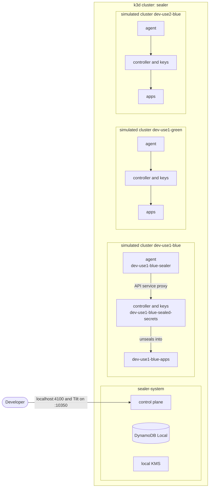

# Development

Everything runs through [Atmos](https://atmos.tools) commands. Each command
declares the exact versions of the tools it needs (Go, k3d, Tilt, Helm,
kubectl, golangci-lint, ...), and Atmos installs them into `.tools/` the first
time. Docker and Atmos are the only prerequisites.

```sh
atmos list commands
```

## The local stack

`atmos dev up` creates the k3d cluster `sealer` (with a local image registry)
on first use, pulls and checksum-verifies the upstream sealed-secrets chart,
builds the binaries, and runs Tilt in the foreground. The dashboard is at
http://localhost:10350.

The stack is one k3d cluster that stands in for a whole environment:

| Namespace                  | Contents                                          |
| -------------------------- | ------------------------------------------------- |
| `sealer-system`            | Control plane, DynamoDB Local, local KMS          |
| `<cluster>-sealed-secrets` | That cluster's sealed-secrets controller and keys |
| `<cluster>-sealer`         | That cluster's agent                              |
| `<cluster>-apps`           | Where tests apply SealedSecrets for that cluster  |



The simulated clusters come from `dev/stack.yaml`: `dev-use1-blue`,
`dev-use1-green` and `dev-use2-blue`. Each controller runs with
`--all-namespaces=false` and watches only its own two namespaces, with no
cluster-scoped RBAC, so the clusters are as separate as they can be inside
one Kubernetes API. Each agent's Role exists only in its own controller's
namespace; the e2e suite checks that no agent can reach another cluster's
controller.

The AWS services are local stand-ins: DynamoDB Local and
[local-kms](https://github.com/nsmithuk/local-kms), seeded with a `transit`
and an `escrow` key (`dev/k3d/emulators.yaml`). local-kms does not enforce
key policies, so "the control plane cannot decrypt" is tested with the
Terraform module, not here.

| Endpoint       | Default                 |
| -------------- | ----------------------- |
| Tilt           | http://localhost:10350  |
| Control plane  | http://localhost:4100   |
| DynamoDB Local | http://localhost:4102   |
| Local KMS      | http://localhost:4103   |

Go changes rebuild the binaries on the host (with the Go build cache) and
redeploy in seconds; the images only wrap the binaries
(`dev/docker/Dockerfile`).

| Command                  | What it does                                            |
| ------------------------ | ------------------------------------------------------- |
| `atmos dev up`           | Start the stack, Tilt in the foreground                 |
| `atmos dev ci`           | Start the stack, wait until ready, exit                 |
| `atmos dev status`       | Pods, each agent's controller key, endpoints            |
| `atmos dev logs [res]`   | Tilt logs, optionally for one resource (`-f` to follow) |
| `atmos dev down`         | Remove the workloads, keep the cluster                  |
| `atmos dev destroy`      | Delete the cluster, its registry and every key in it    |

## Worktree stacks

`atmos dev agent up` starts a stack for the current Git worktree in its own
k3d cluster (`sealer-<hash>`) on its own block of ports, in the background,
and waits until it is ready. Several can run beside `atmos dev up`. Use
`atmos dev agent status`, `logs`, `down` and `destroy` to manage it, and
`eval "$(atmos dev agent env)"` to point other `atmos dev` commands at it.

## Tests and checks

| Command               | What it does                                                |
| --------------------- | ----------------------------------------------------------- |
| `atmos test unit`     | Go unit tests with the race detector                        |
| `atmos test e2e`      | Whole stack in a throwaway cluster, then end-to-end checks  |
| `atmos check all`     | go mod tidy, gofmt/goimports, golangci-lint, govulncheck,   |
|                       | Helm lint and kubeconform                                   |
| `atmos verify pr`     | All of the above, as CI runs them (`--fast` skips e2e)      |

`atmos test e2e` uses the cluster `sealer-e2e` and ports that do not clash
with a running development stack. Pass `--keep` to leave the cluster up after
the run for inspection.

## Configuration

The binaries read `APP_` environment variables, all in `internal/config`.

| Variable                   | Component | Default                     |
| -------------------------- | --------- | --------------------------- |
| `APP_HTTP_ADDR`            | both      | `:8080` / `:8081` (agent)   |
| `APP_LOG_LEVEL`            | both      | `info`                      |
| `APP_LOG_FORMAT`           | both      | `json` (or `text`)          |
| `APP_CONTROLLER_NAMESPACE` | agent     | required                    |
| `APP_CONTROLLER_NAME`      | agent     | `sealed-secrets-controller` |
| `APP_INVENTORY_INTERVAL`   | agent     | `1m` (10s to 1h)            |
| `APP_KUBE_CONTEXT`         | agent     | in-cluster configuration    |
