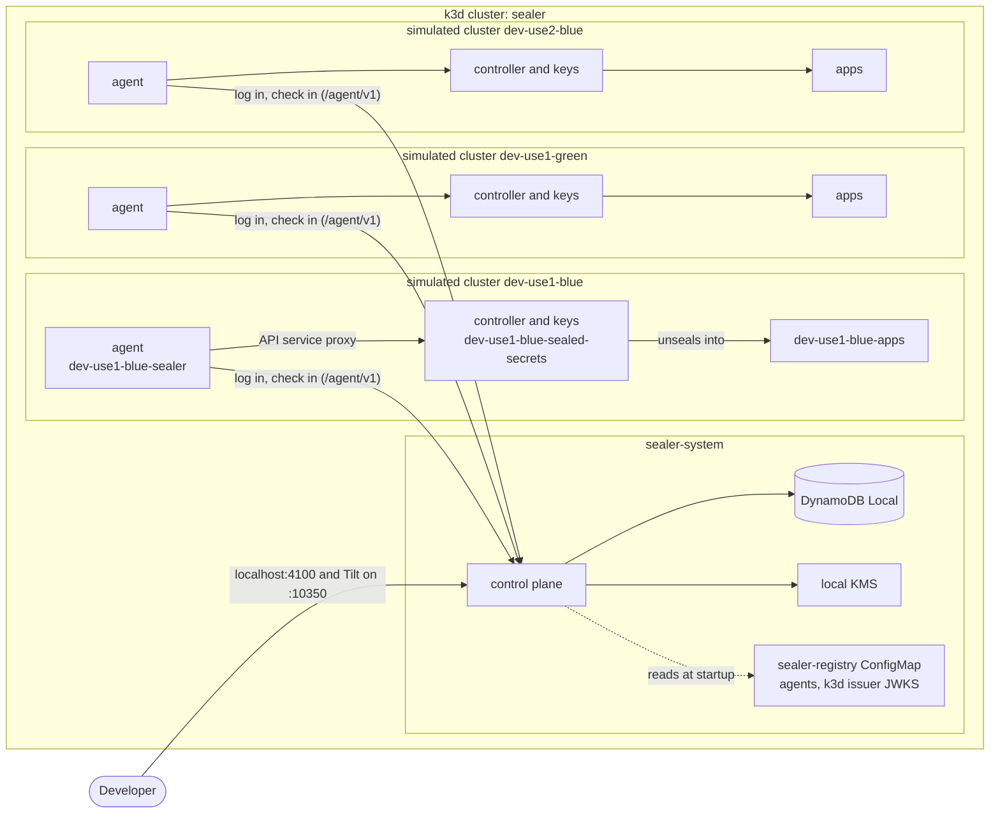

# Development

Everything runs through [Atmos](https://atmos.tools) commands. Each command
declares the exact versions of the tools it needs (Go, k3d, Tilt, Helm,
kubectl, golangci-lint, ...), and Atmos installs them into `.tools/` the first
time. Docker and Atmos are the only prerequisites.

```sh
atmos list commands
```

## The local stack

`atmos dev up` creates the k3d cluster `sealer` (with a local image registry)
on first use, pulls and checksum-verifies the upstream sealed-secrets chart,
builds the binaries, and runs Tilt in the foreground. The dashboard is at
http://localhost:10350.

The stack is one k3d cluster that stands in for a whole environment:

| Namespace                  | Contents                                          |
| -------------------------- | ------------------------------------------------- |
| `sealer-system`            | Control plane, DynamoDB Local, local KMS, GitHub  |
|                            | mock                                              |
| `<cluster>-sealed-secrets` | That cluster's sealed-secrets controller and keys |
| `<cluster>-sealer`         | That cluster's agent                              |
| `<cluster>-apps`           | Where tests apply SealedSecrets for that cluster  |



The simulated clusters come from `dev/stack.yaml`: `dev-use1-blue`,
`dev-use1-green` and `dev-use2-blue`. Each controller runs with
`--all-namespaces=false` and watches only its own two namespaces, with no
cluster-scoped RBAC, so the clusters are as separate as they can be inside
one Kubernetes API. Each agent's Role exists only in its own controller's
namespace; the e2e suite checks that no agent can reach another cluster's
controller.

The AWS services are local stand-ins: DynamoDB Local and
[local-kms](https://github.com/nsmithuk/local-kms), seeded with a `transit`
and an `escrow` key (`dev/local-kms/seed.yaml`; throwaway key material, local
use only). The control plane and the agents use the transit key through
`alias/sealer-transit`, and agents the escrow key through
`alias/sealer-escrow`. local-kms does not enforce key policies, so "the
control plane cannot decrypt" and "an agent can decrypt only its own seals"
are tested with the Terraform module, not here; the control plane's transit
client has no decrypt method either way.

Every simulated controller starts with its own key and with key renewal off
(`--key-renew-period 0`). Within a minute or so of `atmos dev up`, the agents
escrow their keys, each cluster restores the others' keys from escrow (its
controller restarts once per restore), and the control plane turns renewal on
in one cluster, `dev-use1-blue`. `atmos dev status` then shows the same env
key everywhere.

| Endpoint       | Default                 |
| -------------- | ----------------------- |
| Tilt           | http://localhost:10350  |
| Web UI and API | http://localhost:4100   |
| DynamoDB Local | http://localhost:4102   |
| Local KMS      | http://localhost:4103   |
| GitHub (mock)  | http://localhost:4104   |

Go changes rebuild the binaries on the host (with the Go build cache) and
redeploy in seconds; the images only wrap the binaries
(`dev/docker/Dockerfile`).

| Command                  | What it does                                            |
| ------------------------ | ------------------------------------------------------- |
| `atmos dev up`           | Start the stack, Tilt in the foreground                 |
| `atmos dev ci`           | Start the stack, wait until ready, exit                 |
| `atmos dev status`       | Pods, the fleet (env key, each agent's keys), endpoints |
| `atmos dev logs [res]`   | Tilt logs, optionally for one resource (`-f` to follow) |
| `atmos dev down`         | Remove the workloads, keep the cluster                  |
| `atmos dev destroy`      | Delete the cluster, its registry and every key in it    |

## Signing in locally

Open http://localhost:4100 and sign in. GitHub is a mock
(`cmd/mock-github`) that lets you pick a user:

| User    | Result                                                   |
| ------- | -------------------------------------------------------- |
| `alice` | Signs in: org member and in the allowed team `sealers`   |
| `bob`   | Refused: in the org, not in the allowed team             |
| `carol` | Refused: not in the org                                  |

The mock is also a GitHub App, installed on the fixture repositories in
`internal/mockgithub/fixtures`:

| Repository               | alice | bob  | carol |
| ------------------------ | ----- | ---- | ----- |
| `example-org/apps`       | write | read | none  |
| `example-org/platform`   | read  | none | none  |
| `example-org/restricted` | none  | none | none  |

In `example-org/apps`, `deploy/billing/sealed-secret.yaml` has one dev
document per simulated cluster (one seal updates all three) and a prod
document the dev stack ignores; the other files cover namespace-wide and
cluster-wide scope and a prod-only file.

Its installation tokens carry the permissions they were minted with, and every
repository call checks them, as GitHub does. Tilt generates the App's key pair
for each stack (`.tools/dev/<context>/github-app.pem`, never committed): the
control plane signs App JWTs with the private key and the mock checks them
with the public key.

The UI is built into the control plane binary; Tilt rebuilds it when
`web/` changes. For hot reload while working on the UI, run
`atmos web dev` (Vite on http://localhost:5173, proxying `/api` to the
stack's control plane) and sign in through it the same way.

## Worktree stacks

`atmos dev agent up` starts a stack for the current Git worktree in its own
k3d cluster (`sealer-<hash>`) on its own block of ports, in the background,
and waits until it is ready. Several can run beside `atmos dev up`. Use
`atmos dev agent status`, `logs`, `down` and `destroy` to manage it, and
`eval "$(atmos dev agent env)"` to point other `atmos dev` commands at it.

## Tests and checks

| Command                  | What it does                                               |
| ------------------------ | ---------------------------------------------------------- |
| `atmos test unit`        | Go unit tests with the race detector                       |
| `atmos test integration` | The store against DynamoDB Local and envelope encryption   |
|                          | against local KMS, both in Docker                          |
| `atmos web test`         | Web UI tests (vitest)                                      |
| `atmos web check`        | Web UI lint, type check and formatting                     |
| `atmos test e2e`         | Whole stack in a throwaway cluster, then end-to-end checks |
| `atmos check all`        | go mod tidy, gofmt/goimports, golangci-lint, govulncheck,  |
|                          | Helm lint and kubeconform                                  |
| `atmos verify pr`        | All of the above, as CI runs them (`--fast` skips e2e)     |

`atmos test e2e` uses the cluster `sealer-e2e` and ports that do not clash
with a running development stack. Pass `--keep` to leave the cluster up after
the run for inspection. Besides bringing the stack up, it checks that:

- only registered service accounts can log in, only with tokens for the
  control plane's audience, and that check-ins, commands and escrow need a
  session token;
- keys converge: every cluster restores the others' keys from escrow, each
  key is escrowed once, every controller seals with the same env key, and
  key renewal is turned on in exactly one cluster;
- every agent checks in with its controller's whole key set and flags, and
  can reach only its own controller;
- a value sealed with the env key's certificate, taken from one cluster,
  unseals in every cluster;
- the UI is served with a strict content security policy, the fleet API
  requires sign-in, alice can sign in while bob and carol are refused, and
  sign-out requires the CSRF token;
- alice sees only the repositories she can read, with her access, discovery
  finds the dev SealedSecrets (and flags cluster-wide scope), and a
  repository she cannot read is not found;
- alice opens a session on `example-org/apps` and seals a value into the
  billing file: one agent seals it with the env key for all three dev
  documents, the session lists the pending change without its ciphertexts,
  and the value appears in no log; sealing into a cluster-wide document, or
  into a repository she cannot write, is refused.

## Local agent identity

The local stack uses the `k8s-oidc` login. The `aws-sts` login (an agent's
IAM role, proven with a signed `sts:GetCallerIdentity` request) needs real
AWS, so it is covered by unit tests against a fake STS that verifies SigV4
signatures the way STS does.

Locally, agents log in with their projected service-account tokens, issued
by the k3d cluster. The Tiltfile reads the cluster's token issuer and signing
keys (`/openid/v1/jwks`) once and writes them, with an agent registry built
from `dev/stack.yaml`, into the `sealer-registry` ConfigMap. The control plane
verifies tokens against those keys and never calls the Kubernetes API. Its
local-only secrets, including the admin token `atmos dev status` uses, are in
`dev/k3d/control-plane-secret.yaml`.

## Configuration

The binaries read `APP_` environment variables, all in `internal/config`.
Invalid or missing settings are reported together at startup.

| Variable                           | Component     | Default                            |
| ---------------------------------- | ------------- | ---------------------------------- |
| `APP_HTTP_ADDR`                    | both          | `:8080` / `:8081` (agent)          |
| `APP_LOG_LEVEL`                    | both          | `info`                             |
| `APP_LOG_FORMAT`                   | both          | `json` (or `text`)                 |
| `APP_ENV_NAME`                     | both          | required                           |
| `APP_PUBLIC_URL`                   | control plane | required                           |
| `APP_AGENT_AUDIENCE`               | control plane | `APP_PUBLIC_URL`                   |
| `APP_REGISTRY_FILE`                | control plane | required                           |
| `APP_AGENT_SESSION_KEY`            | control plane | required, at least 32 bytes        |
| `APP_ADMIN_TOKEN`                  | control plane | unset: admin API disabled          |
| `APP_DYNAMODB_TABLE`               | control plane | required                           |
| `APP_DYNAMODB_ENDPOINT`            | control plane | AWS (set for emulators)            |
| `APP_DYNAMODB_CREATE_TABLE`        | control plane | `false` (emulators only)           |
| `APP_AWS_STS_HOSTS`                | control plane | AWS's public STS hosts             |
| `APP_GITHUB_ORG`                   | control plane | required                           |
| `APP_GITHUB_ALLOWED_TEAMS`         | control plane | unset: any org member              |
| `APP_GITHUB_OAUTH_CLIENT_ID`       | control plane | required                           |
| `APP_GITHUB_OAUTH_CLIENT_SECRET`   | control plane | required                           |
| `APP_GITHUB_URL`                   | control plane | `https://github.com`               |
| `APP_GITHUB_API_URL`               | control plane | `https://api.github.com`           |
| `APP_GITHUB_OAUTH_TOKEN_URL`       | control plane | `APP_GITHUB_URL` + token path      |
| `APP_ALLOW_INSECURE_GITHUB`        | control plane | `false` (local mocks only)         |
| `APP_USER_SESSION_KEY`             | control plane | required, at least 32 bytes        |
| `APP_USER_SESSION_TTL`             | control plane | `8h` (15m to 24h)                  |
| `APP_GITHUB_APP_ID`                | control plane | required                           |
| `APP_GITHUB_APP_PRIVATE_KEY`       | control plane | required, PEM                      |
| `APP_GITHUB_APP_INSTALLATION_ID`   | control plane | looked up on the org               |
| `APP_ENV_ANNOTATION`               | control plane | `k8s-sealed-secrets-sealer/env`    |
| `APP_REGION_ANNOTATION`            | control plane | `k8s-sealed-secrets-sealer/region` |
| `APP_DISCOVERY_FILE_GLOBS`         | control plane | `*sealed*.yaml,*sealed*.yml`       |
| `APP_KEY_RENEW_PERIOD`             | control plane | `720h`                             |
| `APP_KMS_TRANSIT_KEY_ID`           | both          | required (agent: with `seal`)      |
| `APP_KMS_ESCROW_KEY_ID`            | agent         | required with `keys`               |
| `APP_KMS_REGION`                   | both          | the AWS SDK's region               |
| `APP_KMS_ENDPOINT`                 | both          | AWS (set for emulators)            |
| `APP_CONTROL_PLANE_URL`            | agent         | required, https                    |
| `APP_ALLOW_INSECURE_CONTROL_PLANE` | agent         | `false` (local stacks only)        |
| `APP_IDENTITY_MODE`                | agent         | `k8s-oidc` (or `aws-sts`)          |
| `APP_IDENTITY_AUDIENCE`            | agent         | `APP_CONTROL_PLANE_URL`            |
| `APP_IDENTITY_TOKEN_FILE`          | agent         | the chart's projected token        |
| `APP_AWS_STS_REGION`               | agent         | the AWS SDK's region               |
| `APP_CAPABILITIES`                 | agent         | `seal`                             |
| `APP_CHECKIN_INTERVAL`             | agent         | `15s` (5s to 5m)                   |
| `APP_CONTROLLER_NAMESPACE`         | agent         | required                           |
| `APP_CONTROLLER_NAME`              | agent         | `sealed-secrets-controller`        |
| `APP_CONTROLLER_DEPLOYMENT`        | agent         | `APP_CONTROLLER_NAME`              |
| `APP_KUBE_CONTEXT`                 | agent         | in-cluster configuration           |
